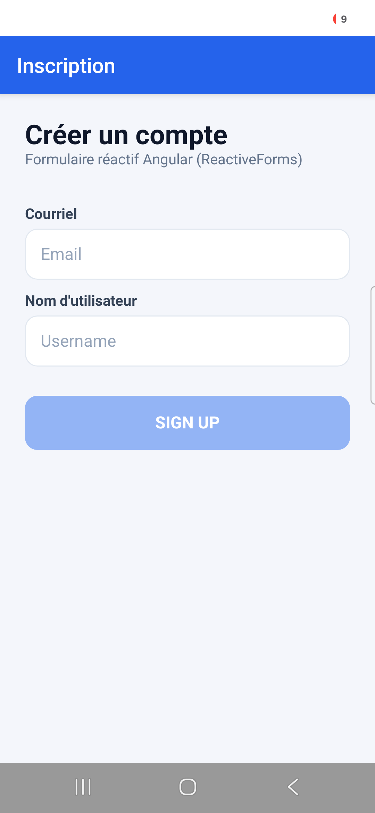
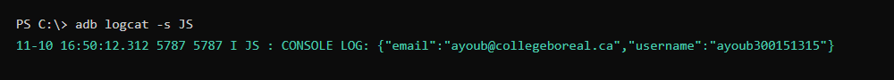

# 300151315 - Forms

Application créée par **Toumi Ayoub**.

## Description
Application mobile NativeScript (Angular) `B300151315` avec un formulaire réactif (**ReactiveForms**) :

- un champ **Email** et un champ **Username**, tous les deux obligatoires (`Validators.required`) ;
- un bouton **sign up** qui affiche le courriel et l'utilisateur dans la console.

Le bouton reste désactivé tant que les deux champs ne sont pas remplis. Les valeurs envoyées s'affichent aussi sous le bouton.

## Création du projet
NativeScript, Android Studio et le SDK Android étaient déjà installés sur mon PC depuis le laboratoire NativeScript.

```
ns create B300151315 --template @nativescript/template-blank-ng
cd B300151315
code .
```

## Exécution
```
ns run android
```

## Fichiers modifiés

| Fichier | Rôle |
|---------|------|
| `src/app/home/home.component.html` | Formulaire : `[formGroup]`, deux `TextField` avec `formControlName`, bouton `(tap)` |
| `src/app/home/home.component.ts` | `FormBuilder`, `FormGroup`, `Validators.required`, méthode `onButtonTap()` |
| `src/app.css` | Style du formulaire (champs, bouton, encadré du résultat) |

### home.component.html
```xml
<StackLayout [formGroup]="signUpForm" class="page">
  <TextField formControlName="email" hint="Email" keyboardType="email" class="champ"></TextField>
  <TextField formControlName="username" hint="Username" class="champ"></TextField>
  <Button text="sign up" (tap)="onButtonTap()" [isEnabled]="signUpForm.valid" class="bouton"></Button>
</StackLayout>
```

### home.component.ts
```typescript
export class HomeComponent implements OnInit {
  signUpForm: FormGroup;

  constructor(private formBuilder: FormBuilder) {}

  ngOnInit(): void {
    this.signUpForm = this.formBuilder.group({
      email: ['', Validators.required],
      username: ['', Validators.required],
    });
  }

  onButtonTap() {
    console.log(JSON.stringify(this.signUpForm.value));
  }
}
```

Dans les versions récentes de NativeScript (composants *standalone*), il faut ajouter `NativeScriptFormsModule` et `ReactiveFormsModule` dans `imports` du composant pour que `[formGroup]` et `formControlName` fonctionnent.

## Résultat

### Application sur le téléphone (Samsung Galaxy S24)

| Formulaire vide (bouton désactivé) | Après « sign up » |
|---|---|
|  |  |

### Console
Le courriel et l'utilisateur affichés dans la console (`console.log`), vus avec `adb logcat` :

```
JS: CONSOLE LOG: {"email":"ayoub@collegeboreal.ca","username":"ayoub300151315"}
```



## Problèmes rencontrés et solutions

| Problème | Solution |
|----------|----------|
| Disque C: plein pendant `ns create` (`ENOSPC`) | Cache npm et dossier temporaire déplacés sur D: (`npm_config_cache`, `TEMP`) |
| `'gradlew.bat' is not recognized` pendant `ns build android` | Variable `NoDefaultCurrentDirectoryInExePath` retirée pour la commande |
| `INSTALL_FAILED_UPDATE_INCOMPATIBLE` : l'app du labo NativeScript avait le même identifiant | Identifiant changé en `org.nativescript.forms.B300151315` dans `nativescript.config.ts` |
