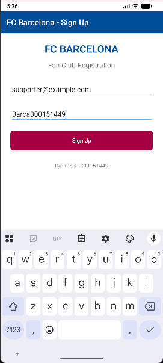
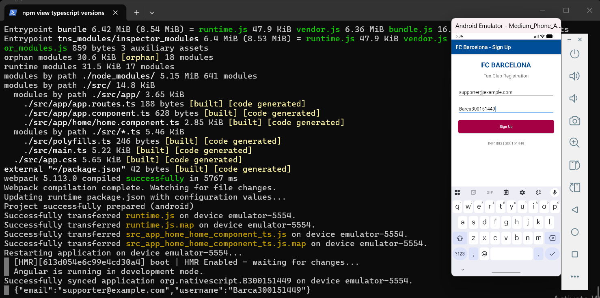
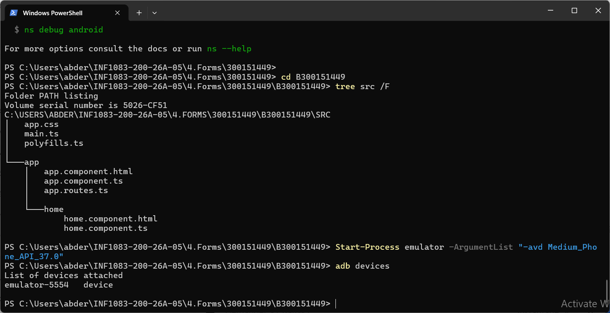

# 4.Forms — ReactiveForms

**Étudiant :** 300151449  
**Projet :** B300151449  
**Cours :** INF1083 — Collège Boréal

## Objectif

Comprendre les layouts NativeScript et les formulaires réactifs Angular en réalisant un formulaire d'inscription au fan-club du FC Barcelona.

## Création et exécution

```powershell
ns create B300151449 --template @nativescript/template-blank-ng
cd B300151449
ns run android
```

## Réalisation

Le composant `src/app/home/home.component.ts` utilise `FormBuilder`, `FormGroup`, `Validators.required`, `ReactiveFormsModule` et `NativeScriptFormsModule`. Le fichier `home.component.html` utilise un `StackLayout`, deux `TextField` associés à `email` et `username`, et un bouton Sign Up lié à `onButtonTap()`.

```typescript
this.signUpForm = this.formBuilder.group({
  email: ['', Validators.required],
  username: ['', Validators.required]
});

// Méthode appelée lors du clic
onButtonTap(): void {
  console.log(JSON.stringify(this.signUpForm.value));
}
```

Les champs sont déclarés obligatoires ; la méthode affiche les valeurs sans bloquer les soumissions invalides, conformément à l'exemple du laboratoire.

## Résultat

Le test sur l'émulateur Android a affiché les valeurs suivantes dans la console :

```json
{"email":"supporter@example.com","username":"Barca300151449"}
```

### Formulaire



### Résultat dans la console



### Structure du projet


