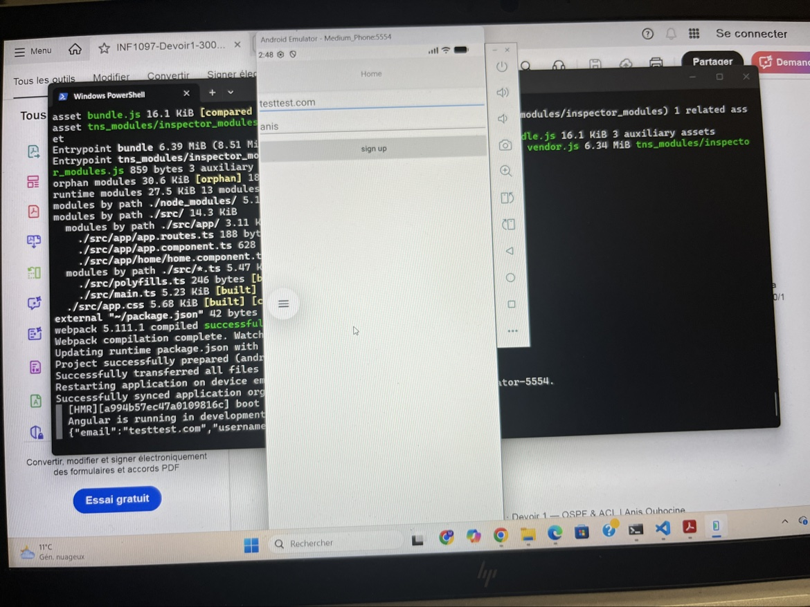
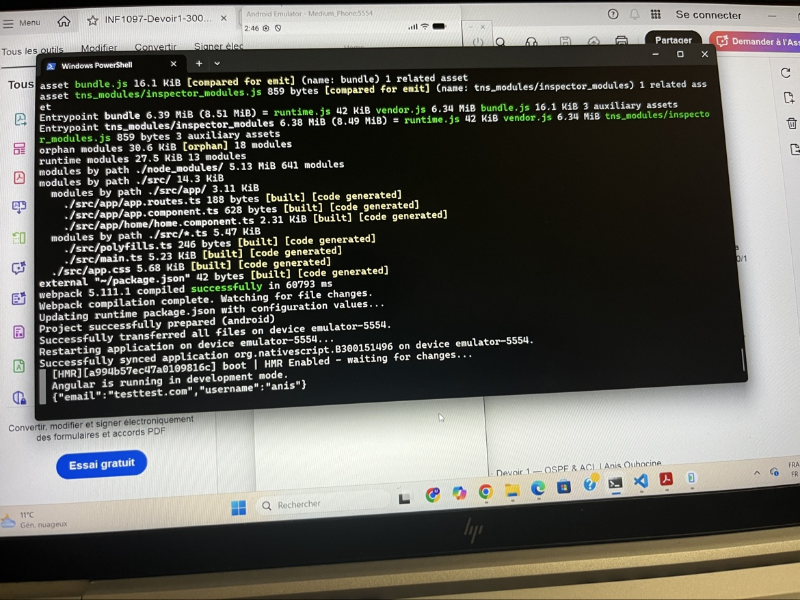

# Labo 8.Forms — 300151496

## 🎯 Objectif
Comprendre les formulaires Angular (`ReactiveForms`) dans une application NativeScript.

## 🚀 Réalisation
- Projet créé avec `ns create B300151496 --template @nativescript/template-blank-ng`
- **Template** (`src/app/home/home.component.html`) : un `StackLayout` lié au formulaire via `[formGroup]="signUpForm"`, avec deux `TextField` (`email`, `username`) et un bouton `sign up` qui appelle `onButtonTap()`.
- **Composant** (`src/app/home/home.component.ts`) : le `FormBuilder` crée le `signUpForm` avec deux contrôles obligatoires (`Validators.required`) ; `onButtonTap()` affiche les valeurs dans la console via `console.log(JSON.stringify(this.signUpForm.value))`.
- Modules importés : `NativeScriptCommonModule`, `NativeScriptFormsModule`, `NativeScriptRouterModule`, `ReactiveFormsModule`.

## ✅ Résultat
En remplissant les champs et en tapant sur « sign up », l'email et l'utilisateur s'affichent dans la console :
`{"email":"testtest.com","username":"anis"}`

## 🖼️ Captures

