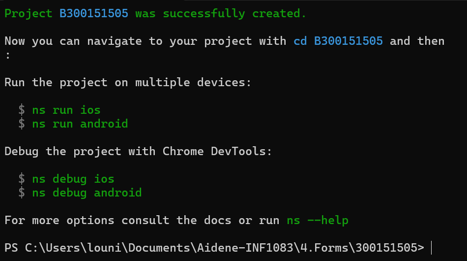
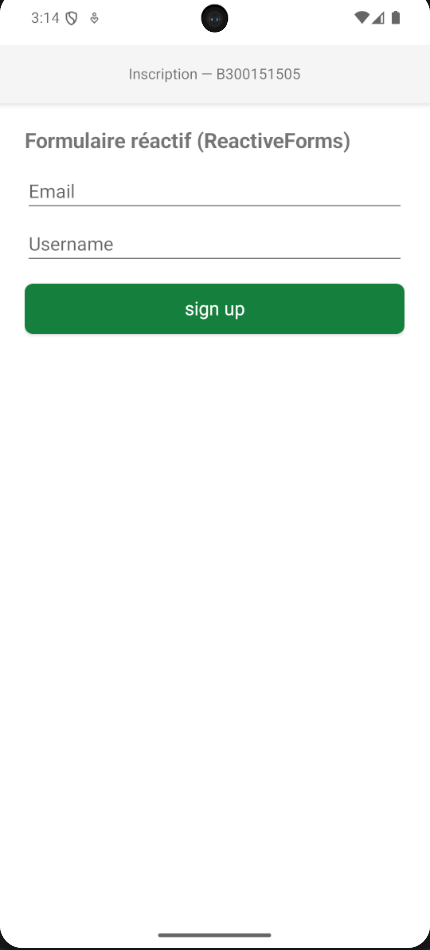
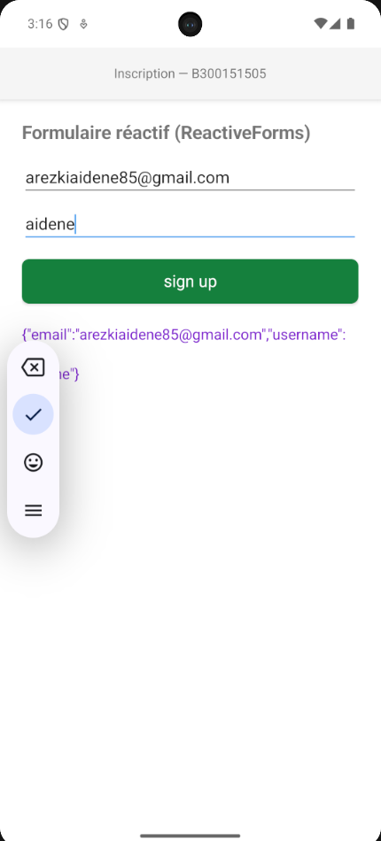
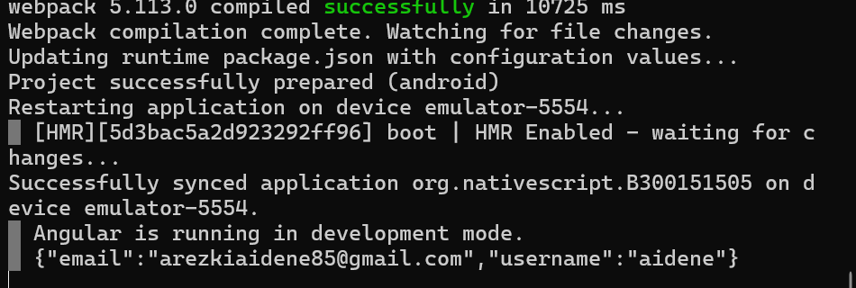

# 📝 Forms (ReactiveForms) — INF1083

**Étudiant :** Aidene Arezki  
**Matricule :** 300151505  
**GitHub :** [300151505](https://github.com/300151505)  
**Cours :** INF1083 — Développement d'applications  
**Session :** Automne 2026  

> ℹ️ Travail réalisé sur l'ordinateur d'un ami (session Windows `louni`) car mon ordinateur n'avait plus d'espace, avec mon propre dépôt et mon compte GitHub.

---

## 🎯 Objectif

Créer un formulaire **ReactiveForms** dans une application **NativeScript Angular** et afficher le courriel et le nom d'utilisateur saisis **dans la console**.

Projet : **`B300151505`** (NativeScript 9 + Angular 22, émulateur Pixel 7 — Android 15)

```text
4.Forms/300151505/
├── README.md
├── images/
└── B300151505/
    └── src/app/
        ├── app.routes.ts              ← route /home
        └── home/
            ├── home.component.html    ← StackLayout [formGroup] + TextField + Button
            └── home.component.ts      ← FormBuilder, Validators, onButtonTap()
```

## ▶️ Exécuter le projet

```powershell
cd 4.Forms\300151505\B300151505
npm install
ns run android
```

---

## 🏗️ 1. Création du projet

```powershell
cd 4.Forms\300151505
ns create B300151505 --template @nativescript/template-blank-ng
```



## ✍️ 2. Le template — `home.component.html`

```xml
<ActionBar>
  <Label text="Inscription — B300151505"></Label>
</ActionBar>

<StackLayout [formGroup]="signUpForm" class="p-6">
  <Label text="Formulaire réactif (ReactiveForms)" class="text-xl font-bold mb-4"></Label>

  <TextField formControlName="email" hint="Email" keyboardType="email"></TextField>
  <TextField formControlName="username" hint="Username"></TextField>

  <Button text="sign up" (tap)="onButtonTap()" class="bg-green-700 text-white"></Button>

  <Label [text]="resultat()" textWrap="true"></Label>
</StackLayout>
```

- `[formGroup]` relie le `StackLayout` au formulaire `signUpForm`.
- `formControlName` relie chaque `TextField` à un contrôle.
- `(tap)` déclenche `onButtonTap()` quand on touche le bouton.

## ⚙️ 3. Le composant — `home.component.ts`

```typescript
@Component({
  selector: 'Home',
  templateUrl: './home.component.html',
  imports: [NativeScriptCommonModule, NativeScriptFormsModule, NativeScriptRouterModule, ReactiveFormsModule],
  schemas: [NO_ERRORS_SCHEMA],
})
export class HomeComponent {

  private formBuilder = inject(FormBuilder);

  signUpForm: FormGroup = this.formBuilder.group({
    email: ['', Validators.required],
    username: ['', Validators.required],
  });

  resultat = signal('');

  onButtonTap() {
    console.log(JSON.stringify(this.signUpForm.value));
    this.resultat.set(
      this.signUpForm.valid
        ? JSON.stringify(this.signUpForm.value)
        : 'Veuillez remplir les deux champs.'
    );
  }
}
```

| Élément | Rôle |
|---|---|
| `FormBuilder` | crée le `FormGroup` |
| `Validators.required` | rend les deux champs obligatoires |
| `NativeScriptFormsModule` | relie les `TextField` NativeScript aux contrôles (sinon les valeurs restent vides) |
| `ReactiveFormsModule` | fournit `[formGroup]` et `formControlName` |
| `signal()` | met à jour l'affichage (Angular 22 *zoneless*) |

---

## ✅ 4. Résultat

| Formulaire au démarrage | Formulaire rempli + résultat |
|---|---|
|  |  |

Console (`ns run android`) après **sign up** :



```text
{"email":"arezkiaidene85@gmail.com","username":"aidene"}
```

---

## ⚠️ 5. Problèmes rencontrés et solutions

| Problème | Cause | Solution |
|---|---|---|
| Écran blanc au démarrage | Mon projet **2.NativeScript** a le **même identifiant** (`org.nativescript.B300151505`) : des fichiers de l'ancienne application restaient sur l'émulateur | `adb uninstall org.nativescript.B300151505` puis `adb shell rm -rf /data/local/tmp/org.nativescript.B300151505`, puis `ns run android` |
| L'application passait en arrière-plan quand je **collais** le courriel | Le clavier Android proposait d'ouvrir le texte copié dans une autre application | Saisie avec `adb shell input text "..."` après avoir touché le champ |
| `Application ... is not running` | L'émulateur n'était pas prêt | Relancer `ns run android` |

```powershell
adb shell input text "arezkiaidene85@gmail.com"
adb shell input text "aidene"
```

## 📝 Conclusion

J'ai créé un formulaire réactif avec `FormBuilder`, `FormGroup` et `Validators` dans une application NativeScript, et affiché les valeurs saisies dans la console. J'ai aussi appris à diagnostiquer un écran blanc avec `adb logcat` et à nettoyer une application installée avec `adb uninstall`.
