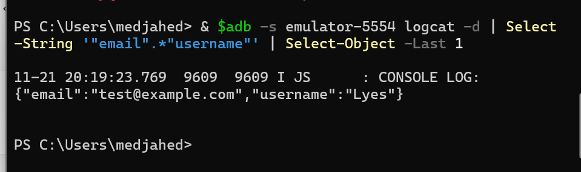

# Formulaires réactifs avec NativeScript

- Étudiant : Lyes Medjahed
- Numéro étudiant : 300153676
- Cours : INF1083

L’application [B300153676](./B300153676/) utilise un formulaire réactif Angular. Les champs `email` et `username` sont obligatoires. Le bouton **sign up** affiche leurs valeurs en JSON dans la console.

## Lancement sur Android

```bash
cd B300153676
npm ci
ns run android
```

Saisir un courriel et un nom d’utilisateur, puis appuyer sur **sign up**. Par exemple, la console doit afficher `{"email":"test@example.com","username":"etudiant"}`.

## Test du formulaire sur Android

Après un clic sur **sign up**, la console affiche le courriel et le nom saisis dans le formulaire.


