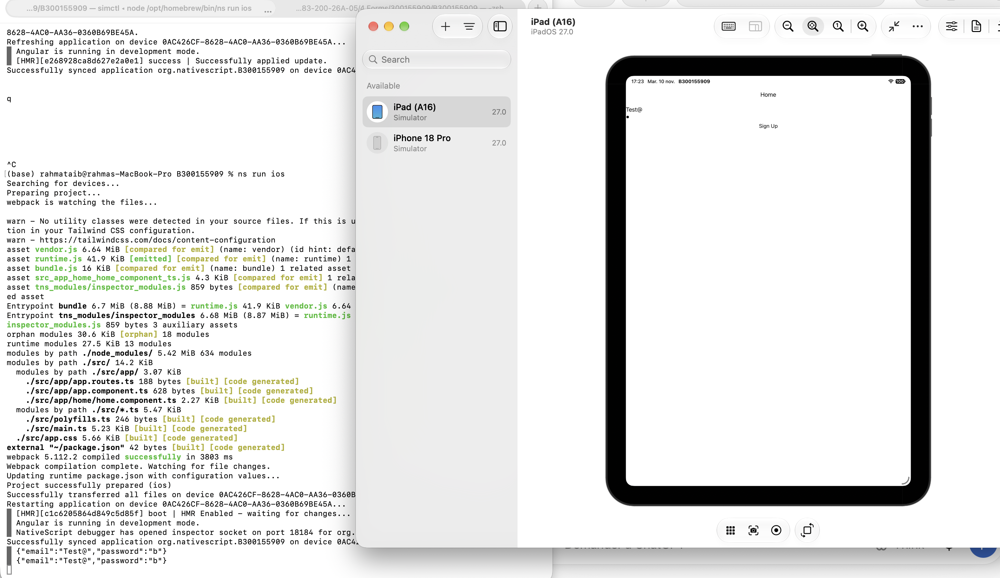

# 8. Forms

## 🎯 Objectif
Comprendre et utiliser les formulaires avec Angular et NativeScript.

## 👩‍💻 Student Information
- **Name:** Rahma Taieb
- **Student ID:** 300155909
- **Course:** INF1083

## 📚 Description
This exercise demonstrates how to create a registration form using ReactiveForms.

## ⚙️ Technologies
- Angular
- NativeScript
- TypeScript
- ReactiveFormsModule
- NativeScriptFormsModule

## 📝 Form Fields
- Email
- Password

## 💻 Implementation
- FormBuilder
- FormGroup
- Validators.required
- Email validation
- Sign Up button
- Console output using JSON.stringify()

## 📸 Screenshots

### Console Result

## ✅ Expected Result

When clicking the Sign Up button, the email and password are displayed in the console in JSON format.

