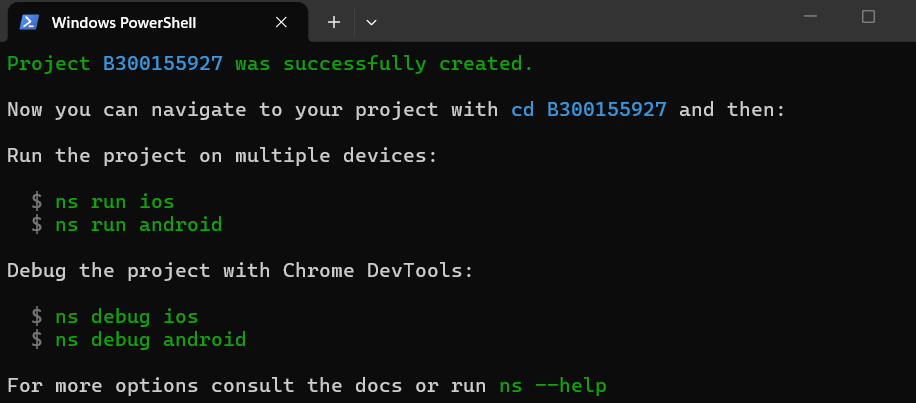
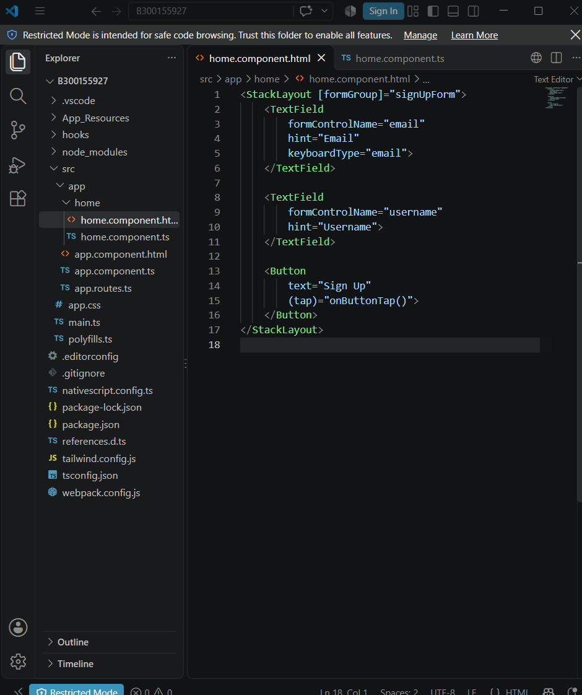
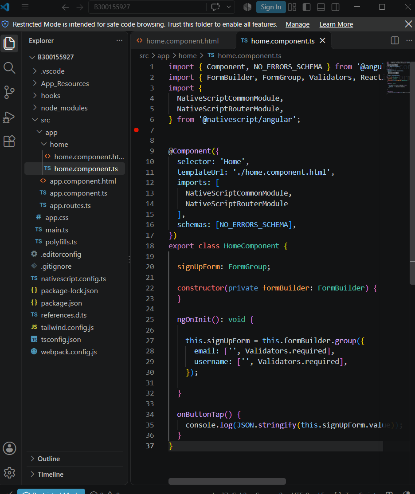
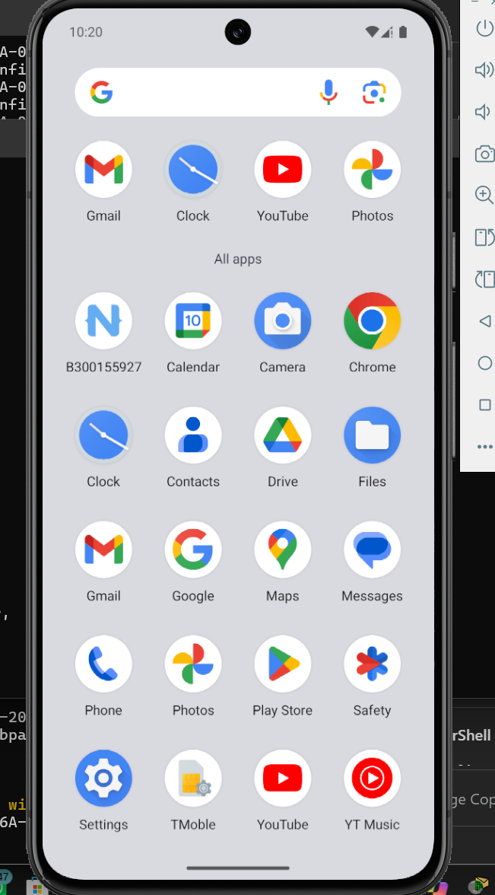
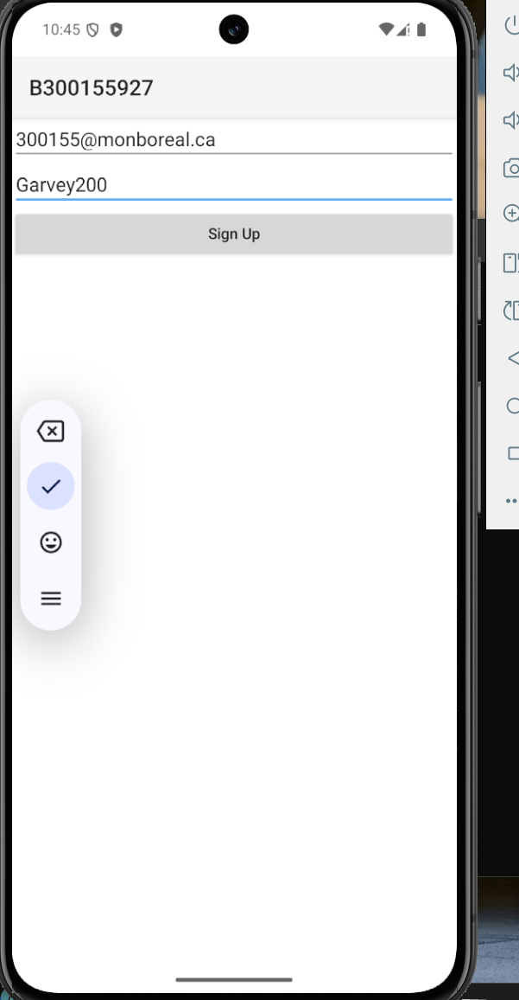

# 300155927

# Projet NativeScript — B300155927

Documentation des étapes de création d'une application mobile avec **NativeScript** et Angular : un formulaire d'inscription (*Sign Up*) testé sur un émulateur Android.

## Environnement

| Élément | Détail |
|---|---|
| Framework | NativeScript (avec Angular) |
| Nom du projet | `B300155927` |
| Éditeur | Visual Studio Code |
| Formulaire | Inscription : courriel + nom d'utilisateur |
| Test | Émulateur Android |

## Étapes

### 1. Création du projet

Le projet est créé avec la ligne de commande NativeScript (`ns`). PowerShell affiche le message **« Project B300155927 was successfully created »** et propose les commandes suivantes : entrer dans le dossier (`cd B300155927`), lancer l'application (`ns run android` ou `ns run ios`) et déboguer (`ns debug android`).



### 2. La vue du formulaire — `home.component.html`

Dans VS Code, on voit la structure du projet : le dossier `src/app/home/` contient le composant principal. Le fichier `home.component.html` décrit l'écran avec des balises NativeScript :

- un `StackLayout` qui contient le formulaire `signUpForm` ;
- un champ `TextField` pour le **courriel** (`email`, avec le clavier de type courriel) ;
- un champ `TextField` pour le **nom d'utilisateur** (`username`) ;
- un bouton `Button` **« Sign Up »** qui appelle la fonction `onButtonTap()` quand on appuie dessus.



### 3. La logique du formulaire — `home.component.ts`

Le fichier `home.component.ts` contient le code du composant `HomeComponent` :

- le formulaire est construit avec `FormBuilder` (formulaire réactif d'Angular) ;
- les deux champs, `email` et `username`, sont **obligatoires** (`Validators.required`) ;
- la fonction `onButtonTap()` affiche les valeurs du formulaire dans la console avec `console.log`.



### 4. Installation sur l'émulateur Android

Après le lancement avec `ns run android`, l'application est installée sur l'émulateur : son icône **B300155927** (avec le logo NativeScript) apparaît dans la liste des applications du téléphone.



### 5. L'application en marche

L'application s'ouvre sur l'écran d'inscription : le titre **B300155927**, le champ courriel, le champ nom d'utilisateur et le bouton **Sign Up**. Sur la capture, les deux champs sont remplis, prêts à être envoyés avec le bouton.



## Commandes utilisées

```powershell
ns create B300155927   # créer le projet
cd B300155927          # entrer dans le dossier
ns run android         # lancer sur l'émulateur Android
ns debug android       # déboguer avec Chrome DevTools
```
