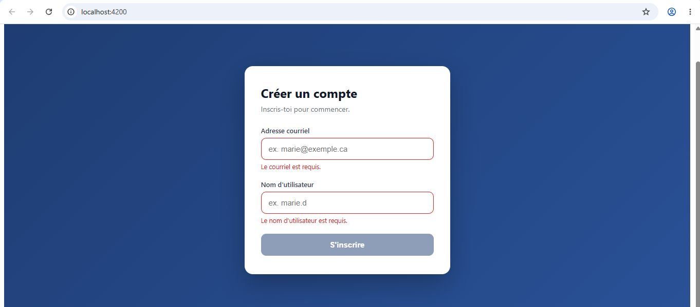
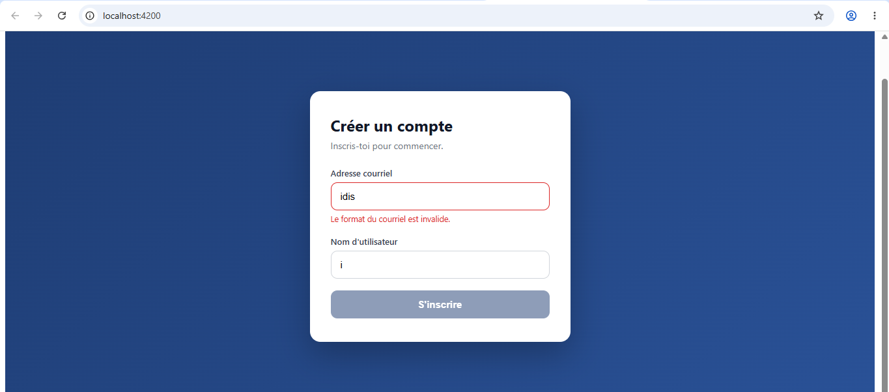
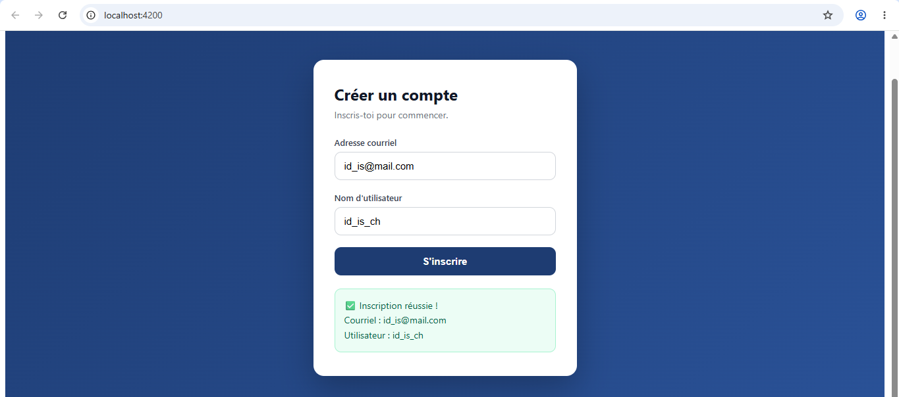

# Labo 4 — Formulaires Angular (ReactiveForms)

**Étudiant :** 300156187
**Cours :** INF1083 — Développement d'application

## Objectif

Comprendre les formulaires réactifs d'Angular : FormBuilder, FormGroup, formControlName et Validators.

## Étapes réalisées

1. Création du projet : `ng new B300156187`
2. Démarrage du serveur : `ng serve` → http://localhost:4200
3. Création du composant inscription : `ng g c inscription`
4. Formulaire réactif avec `FormBuilder` : champs `email` et `username`
5. Validation : `Validators.required` sur les deux champs, `Validators.email` sur le courriel
6. Soumission : `(ngSubmit)` appelle `onSubmit()`, qui affiche les valeurs en JSON dans la console
7. Bouton désactivé tant que le formulaire est invalide, messages d'erreur après saisie
8. Style CSS professionnel (carte centrée, focus lumineux, états d'erreur)

## Résultat

*Champ laissé vide : le message « requis » s'affiche et le formulaire ne peut pas être envoyé.*

*Courriel mal formé : le validateur `Validators.email` détecte le format invalide.*

