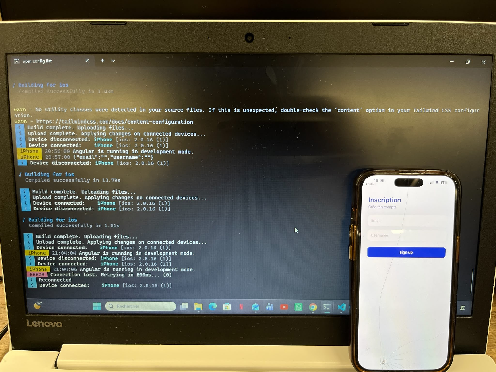

# 📱 Labo 4 - Forms

## 📝 Description du projet

Application mobile NativeScript qui contient un formulaire
d'inscription avec deux champs : un email et un username.

Quand l'utilisateur remplit le formulaire et tape sur le bouton
"sign up", les valeurs du formulaire s'affichent dans la console
en format JSON. C'est le résultat demandé par l'énoncé.

Ce labo a été refait en NativeScript, comme l'énoncé le demande.
La première version était en Angular WEB, ce n'était pas la bonne
technologie pour ce labo.

## 🛠️ Template et technologies utilisés

- **Template :** `@nativescript/template-blank-ng`
- **Framework :** NativeScript 9.1.1 + Angular 22
- **Langage :** TypeScript
- **Formulaire :** Angular Reactive Forms (`FormBuilder`, `FormGroup`, `Validators`)
- **Plugins :** aucun plugin supplémentaire, seulement les
  paquets de base du template (`@nativescript/core`,
  `@nativescript/angular`)

## 📁 Structure du projet
  B300156187/
  ├── src/
  │ └── app/
  │ ├── home/
  │ │ ├── home.component.html -> le formulaire (StackLayout, TextField, Button)
  │ │ └── home.component.ts -> la logique du formulaire
  │ ├── app.component.html
  │ ├── app.component.ts
  │ ├── app.routes.ts
  │ └── app.css -> le style de l'app
  ├── package.json
  ├── nativescript.config.ts
  └── README.md

## 📋 Le formulaire

### home.component.html

Le formulaire est dans un `StackLayout` avec `[formGroup]="signUpForm"`.
Il contient deux `TextField` et un `Button` :

html
<StackLayout [formGroup]="signUpForm" class="page">
    <Label text="Inscription" class="title"></Label>
    <Label text="Crée ton compte" class="subtitle"></Label>
    <TextField formControlName="email" hint="Email" keyboardType="email" class="field"></TextField>
    <TextField formControlName="username" hint="Username" class="field"></TextField>
    <Button text="sign up" (tap)="onButtonTap()" class="btn"></Button>
</StackLayout>
✉️ TextField pour l'email, avec le clavier email sur le téléphone.
👤 TextField pour le username.
🔘 Button avec (tap) : en NativeScript, on utilise (tap)
pour un appui sur un bouton, pas (click) et pas (ngSubmit).
home.component.ts
Le formulaire est créé avec FormBuilder dans ngOnInit,
avec les deux champs en Validators.required (obligatoires) :

typescript

this.signUpForm = this.formBuilder.group({
    email: ["", Validators.required],
    username: ["", Validators.required],
});
Quand on tape sur le bouton, la méthode onButtonTap() affiche
les valeurs du formulaire dans la console :

typescript

onButtonTap() {
    console.log(JSON.stringify(this.signUpForm.value));
}
🚀 Installation et lancement
✅ Prérequis
Node.js 24
NativeScript CLI 9.1.1
JDK 17 (Temurin)
Android SDK
📦 Installer les dépendances
bash

npm install
📲 Lancer l'app en Preview (sur iPhone)
bash

ns preview --no-hmr
On scanne le QR code avec l'application NativeScript Preview.
On utilise --no-hmr parce que le rechargement à chaud (HMR)
ne fonctionne pas bien avec ce projet.

🤖 Compiler pour Android
bash

ns build android
Le fichier APK est généré dans :
platforms/android/app/build/outputs/apk/debug/app-debug.apk

▶️ Lancer sur émulateur / appareil Android
bash

ns run android
🎯 Résultat attendu
L'app s'ouvre sur le formulaire d'inscription.
On entre un email et un username.
On tape sur "sign up".
La console affiche les valeurs en JSON, par exemple :
json

{"email":"test@test.com","username":"idir"}
📸 Captures

⚠️ Remarque sur le nom du projet
Le projet s'appelle B300156187 et le dossier aussi.
C'est obligatoire : NativeScript refuse un nom de projet qui
commence par un chiffre, donc ns create 300156187 ne marche pas.
C'est pour ça que l'énoncé dit de créer le projet avec
ns create B300156187 --template @nativescript/template-blank-ng.

🎓 Étudiant
Nom : Idir Islam Chili
ID : 300156187
Cours : INF1083 - Développement d'applications mobiles
Collège Boréal

© 2026 Idir Islam Chili — Tous droits réservés
