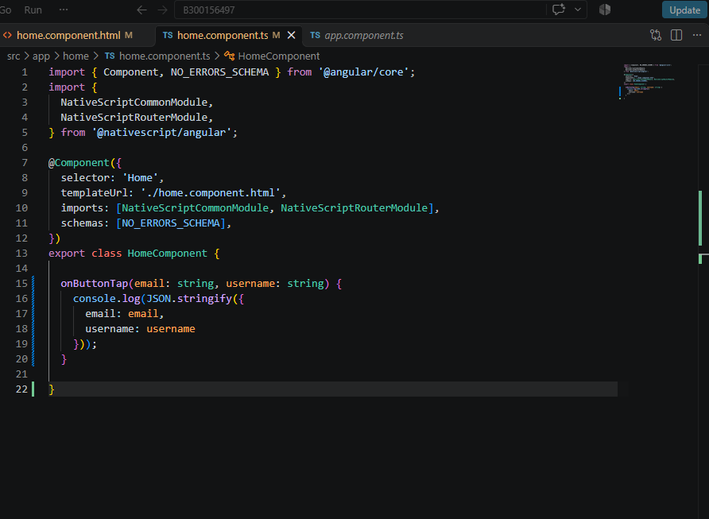
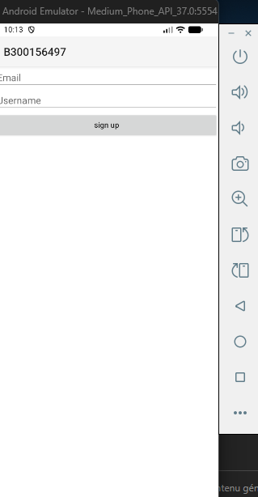
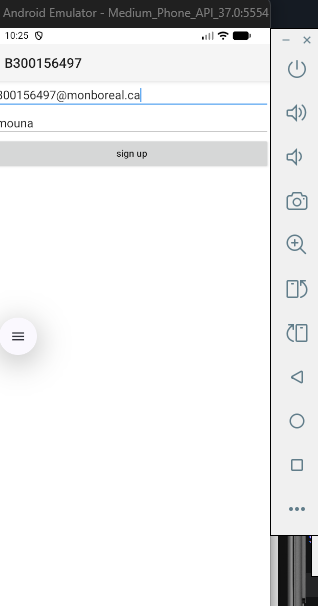
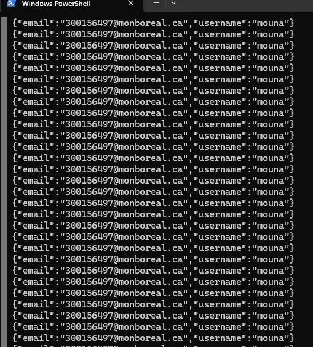

# 300156497
# Laboratoire 8 - Forms avec NativeScript et Angular

# Modification du fichier home.component.ts
Cette étape montre la modification du fichier home.component.ts afin d'ajouter la méthode onButtonTap(). Cette méthode récupère les valeurs saisies dans les champs Email et Username et les affiche dans la console au format JSON lorsque l'utilisateur clique sur le bouton sign up.

# Résultat de l'application
Cette capture montre l'interface finale de l'application NativeScript. L'utilisateur peut saisir un courriel et un nom d'utilisateur dans les champs de texte. Un bouton « sign up » permet d'envoyer les informations vers la console afin de vérifier les données saisies.
Commande utilisée est ns run android

# 📧 Saisie des informations utilisateur
Cette capture montre l'entrée des données dans le formulaire. Un courriel et un nom d'utilisateur sont saisis dans les champs prévus avant l'envoi des informations à l'aide du bouton sign up. Cette étape permet de vérifier que le formulaire accepte les données de l'utilisateur.
Commande utilisée est ns run android

# ✅ Affichage des données dans la console
Cette capture montre le résultat obtenu après avoir cliqué sur le bouton sign up. Les informations saisies dans le formulaire sont récupérées et affichées dans la console PowerShell au format JSON. Cela confirme que l'application transmet correctement le courriel et le nom d'utilisateur.
Commande utilisée ns run android

# Conclusion
Ce laboratoire a permis de découvrir les formulaires avec NativeScript et Angular. Nous avons créé une interface contenant un champ de courriel, un champ de nom d’utilisateur et un bouton « sign up ». Les données saisies sont récupérées et affichées dans la console au format JSON. Ce laboratoire a également permis de comprendre la structure d’un composant Angular et l’interaction entre l’interface utilisateur et le code TypeScript.
