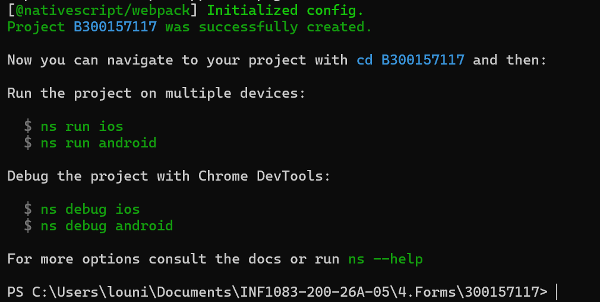
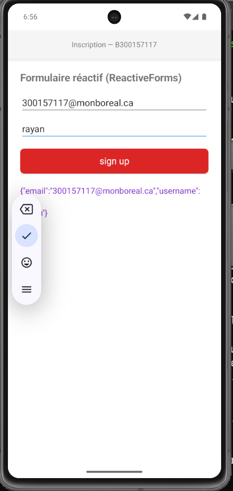
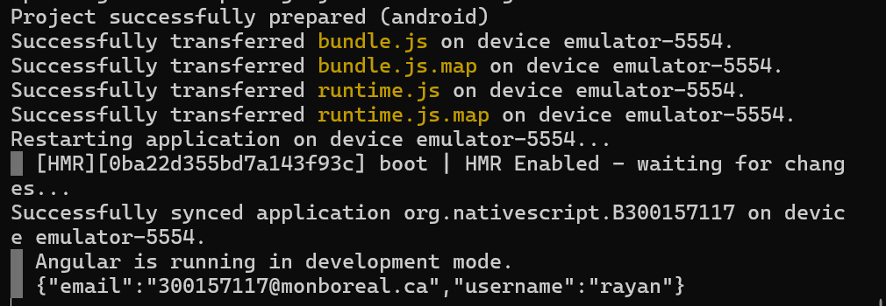

# 📝 Forms (ReactiveForms) — INF1083

**Étudiant :** Rayan Lounis  
**Matricule :** 300157117  
**GitHub :** [lounisrayan](https://github.com/lounisrayan)  
**Cours :** INF1083 — Développement d'applications  
**Session :** Automne 2026  

---

## 🎯 Objectif

Créer un formulaire **ReactiveForms** dans une application **NativeScript Angular** et afficher le courriel et le nom d'utilisateur saisis **dans la console**.

Projet réalisé : **`B300157117`** (NativeScript 9 + Angular 22, émulateur Pixel 7 — Android 15)

```text
4.Forms/300157117/
├── README.md
├── images/
└── B300157117/
    └── src/app/
        ├── app.routes.ts              ← route /home
        └── home/
            ├── home.component.html    ← StackLayout [formGroup] + TextField + Button
            └── home.component.ts      ← FormBuilder, Validators, onButtonTap()
```

---

## ▶️ Exécuter le projet

```powershell
cd 4.Forms\300157117\B300157117
ns run android
```

---

## 🏗️ 1. Création du projet

```powershell
cd 4.Forms\300157117
ns create B300157117 --template @nativescript/template-blank-ng
```



---

## ✍️ 2. Le template — `home.component.html`

```xml
<ActionBar>
  <Label text="Inscription — B300157117"></Label>
</ActionBar>

<StackLayout [formGroup]="signUpForm" class="p-6">
  <Label text="Formulaire réactif (ReactiveForms)" class="text-xl font-bold mb-4"></Label>

  <TextField formControlName="email" hint="Email" keyboardType="email"></TextField>
  <TextField formControlName="username" hint="Username"></TextField>

  <Button text="sign up" (tap)="onButtonTap()"></Button>

  <Label [text]="resultat()" textWrap="true"></Label>
</StackLayout>
```

- `[formGroup]` relie le `StackLayout` au formulaire `signUpForm`.
- `formControlName` relie chaque `TextField` à un contrôle du formulaire.
- `(tap)` est l'**event binding** NativeScript (équivalent de `(click)`).

## ⚙️ 3. Le composant — `home.component.ts`

```typescript
import { Component, NO_ERRORS_SCHEMA, inject, signal } from '@angular/core';
import { FormBuilder, FormGroup, ReactiveFormsModule, Validators } from '@angular/forms';
import {
  NativeScriptCommonModule,
  NativeScriptFormsModule,
  NativeScriptRouterModule,
} from '@nativescript/angular';

@Component({
  selector: 'Home',
  templateUrl: './home.component.html',
  imports: [NativeScriptCommonModule, NativeScriptFormsModule, NativeScriptRouterModule, ReactiveFormsModule],
  schemas: [NO_ERRORS_SCHEMA],
})
export class HomeComponent {

  private formBuilder = inject(FormBuilder);

  signUpForm: FormGroup = this.formBuilder.group({
    email: ['', Validators.required],
    username: ['', Validators.required],
  });

  resultat = signal('');

  onButtonTap() {
    console.log(JSON.stringify(this.signUpForm.value));

    this.resultat.set(
      this.signUpForm.valid
        ? JSON.stringify(this.signUpForm.value)
        : 'Veuillez remplir les deux champs.'
    );
  }
}
```

---

## ⚠️ 4. Problèmes rencontrés et solutions

| Problème | Cause | Solution |
|---|---|---|
| Les valeurs pourraient être vides `{"email":"","username":""}` | Sans `NativeScriptFormsModule`, les `TextField` ne sont pas reliés au formulaire | Ajout de **`NativeScriptFormsModule`** dans `imports` |
| Écran blanc au démarrage | Le nouveau modèle utilise `provideZonelessChangeDetection()` (Angular sans zone.js) et la page était chargée en différé (`loadComponent`) | Route directe `{ path: 'home', component: HomeComponent }` et formulaire créé dès la déclaration |
| Le résultat ne s'afficherait pas à l'écran | En mode *zoneless*, une simple variable ne déclenche pas la mise à jour de l'affichage | Utilisation d'un **`signal()`** pour `resultat` |
| `Application ... is not running` | L'émulateur venait de démarrer | Relancer `ns run android` |

> Pour trouver la cause de l'écran blanc, j'ai lu les journaux de l'application avec `adb logcat -d -s JS`.

---

## ✅ 5. Résultat

Courriel : `300157117@monboreal.ca` · Utilisateur : `rayan` → **sign up**

| Application (Pixel 7) | Console (`ns run android`) |
|---|---|
|  |  |

Résultat affiché dans la console :

```text
{"email":"300157117@monboreal.ca","username":"rayan"}
```

---

## 📝 Conclusion

J'ai créé un formulaire réactif avec `FormBuilder`, `FormGroup` et `Validators` dans une application NativeScript. J'ai appris que les `TextField` NativeScript ont besoin de `NativeScriptFormsModule` pour être reliés au formulaire, et qu'avec Angular *zoneless* il faut utiliser des **signals** pour mettre l'affichage à jour.

---

<p align="center"><b>📝 INF1083 — Forms | 300157117</b></p>
