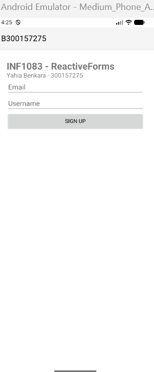
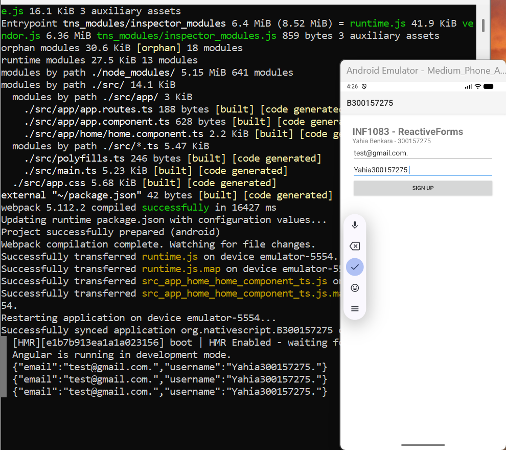

# TP 4 — Forms : ReactiveForms avec NativeScript Angular

**Étudiant :** Yahia Benkara  
**Matricule :** 300157275  
**Cours :** INF1083 — Développement d’applications  
**Projet :** `B300157275`

## Objectif

Créer un formulaire NativeScript Angular avec **ReactiveForms**, deux champs obligatoires (`Email` et `Username`) et un bouton qui affiche leurs valeurs dans la console, conformément au TP du professeur.

## Création du projet

```powershell
ns create B300157275 --template @nativescript/template-blank-ng
```

Le projet se trouve dans `4.Forms/300157275/B300157275`.

## Implémentation

Le composant `src/app/home/home.component.ts` utilise `FormBuilder`, `FormGroup`, `Validators.required` et les modules `ReactiveFormsModule` et `NativeScriptFormsModule`.

```typescript
signUpForm: FormGroup;

constructor(private formBuilder: FormBuilder) {
  this.signUpForm = this.formBuilder.group({
    email: ['', Validators.required],
    username: ['', Validators.required],
  });
}

onButtonTap() {
  console.log(JSON.stringify(this.signUpForm.value));
}
```

Dans `home.component.html`, les champs sont liés au formulaire avec `formControlName` :

```xml
<StackLayout [formGroup]="signUpForm" padding="30" spacing="20">
    <Label text="INF1083 - ReactiveForms" fontSize="24" fontWeight="bold"></Label>
    <Label text="Yahia Benkara - 300157275" fontSize="16"></Label>
    <TextField formControlName="email" hint="Email" keyboardType="email"></TextField>
    <TextField formControlName="username" hint="Username"></TextField>
    <Button text="SIGN UP" (tap)="onButtonTap()"></Button>
</StackLayout>
```

## Résultat sur Android

L’application a été exécutée sur l’émulateur `Medium_Phone_API_37.0` avec `ns run android`. Le formulaire affiche les deux champs et le bouton **SIGN UP**.



## Test de soumission et console

Après avoir renseigné le courriel et le nom d’utilisateur puis appuyé sur **SIGN UP**, l’application affiche les valeurs dans la console :

```json
{"email":"test@gmail.com.","username":"Yahia300157275."}
```



La capture confirme le bon fonctionnement du formulaire et l’affichage des valeurs exigé par le professeur.

## Conclusion

Ce TP m’a permis de créer un formulaire réactif avec NativeScript Angular, de relier les champs à un `FormGroup` et de récupérer leurs valeurs lors du clic sur le bouton.
