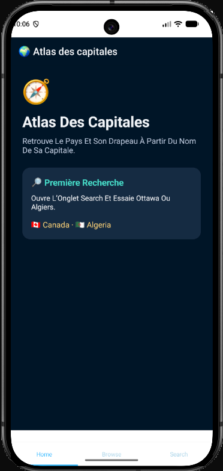
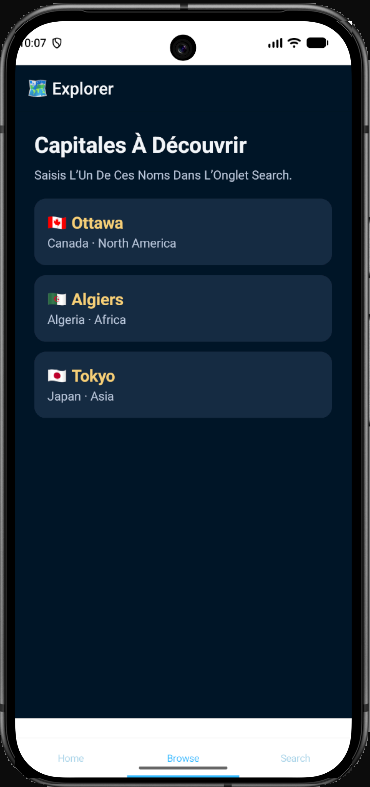
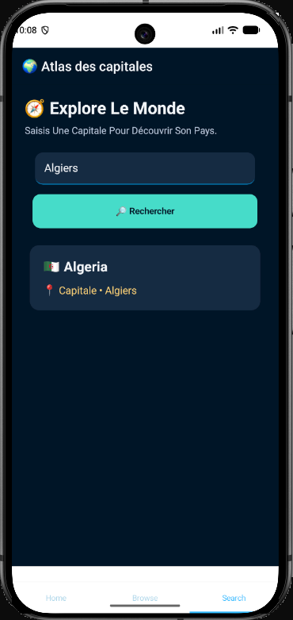
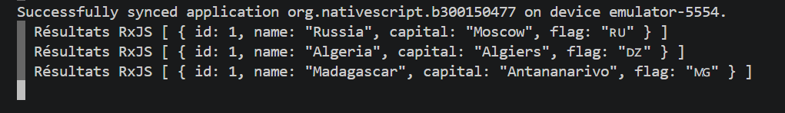
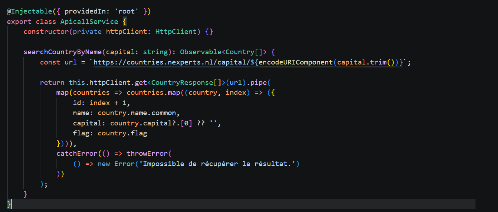

# 🌍 Atlas des capitales

**Labo 5 — RxJS · INF1083**  
**Étudiant :** Benabbas Anis — `300150477`

Atlas des capitales est une application Android créée avec NativeScript, Angular et RxJS. Elle permet de rechercher un pays à partir du nom anglais de sa capitale et d’afficher son drapeau 🇨🇦 🇩🇿 🇯🇵.

## 🧭 Les trois onglets

- **Home** présente l’application et indique comment lancer une recherche.
- **Browse** propose des capitales à essayer, dont Ottawa, Algiers et Tokyo.
- **Search** interroge l’API et affiche le pays, son drapeau et sa capitale.

## ⚙️ Comment fonctionne la recherche

Le champ de saisie utilise `ngModel`. Lorsqu’on appuie sur **Rechercher**, `ApicallService` interroge l’API avec `HttpClient`. Le service retourne un `Observable<Country[]>`. L’opérateur RxJS `map` transforme les données reçues et `catchError` transmet les erreurs au composant. Le composant s’abonne au résultat avec `subscribe` et affiche les pays dans un `ListView`.

## ▶️ Lancer le projet

Avec NativeScript CLI installé et un émulateur Android démarré, exécuter ces commandes depuis le dossier de ce README.

```powershell
cd b300150477
npm ci
ns run android
```

Dans l’onglet **Search**, essayer `Ottawa` pour obtenir **🇨🇦 Canada** ou `Algiers` pour obtenir **🇩🇿 Algeria**.

## 📸 Captures d’écran

### Accueil



### Explorer



### Recherche d’Algiers



### Résultat RxJS dans le terminal



### Service HTTP et RxJS

