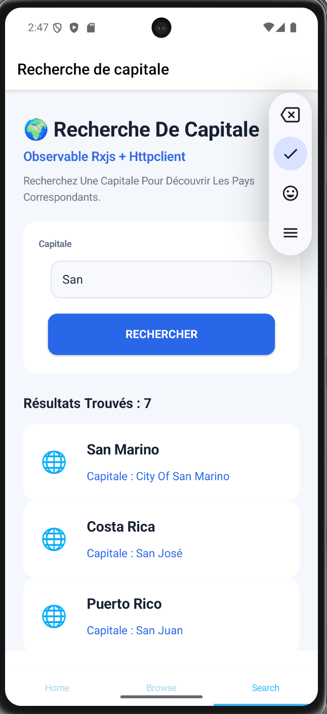
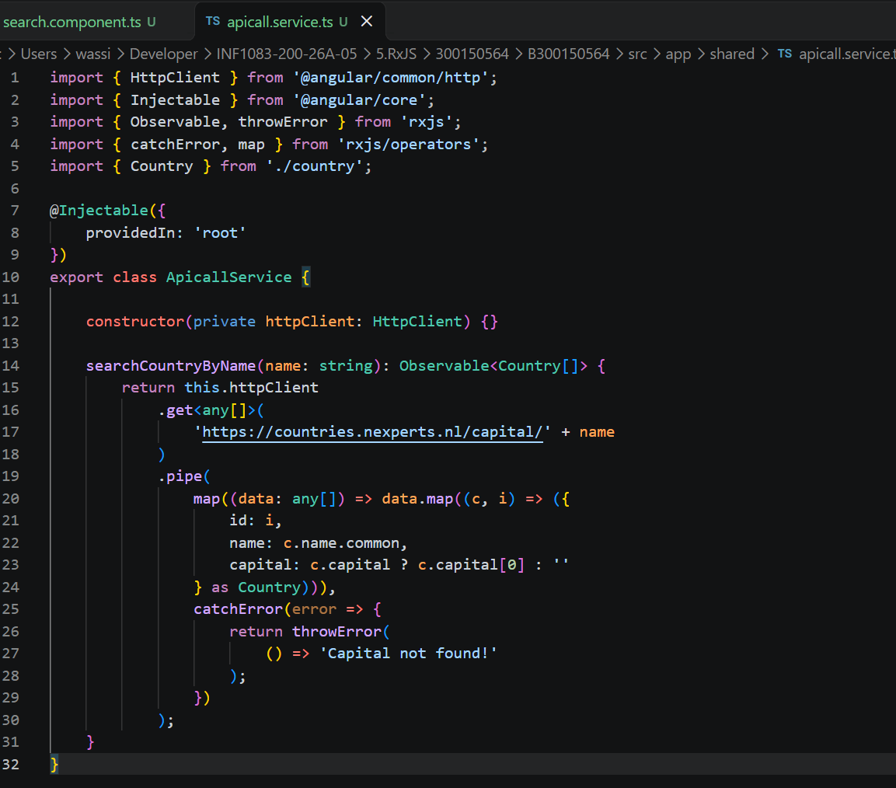
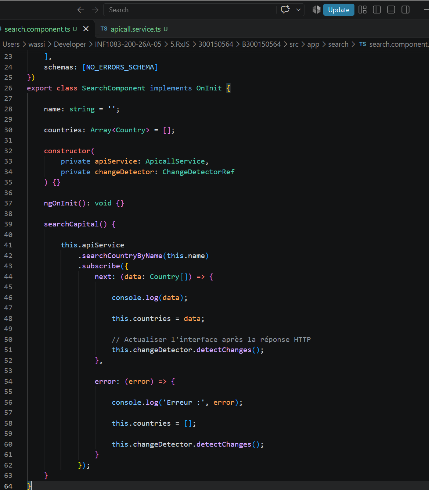
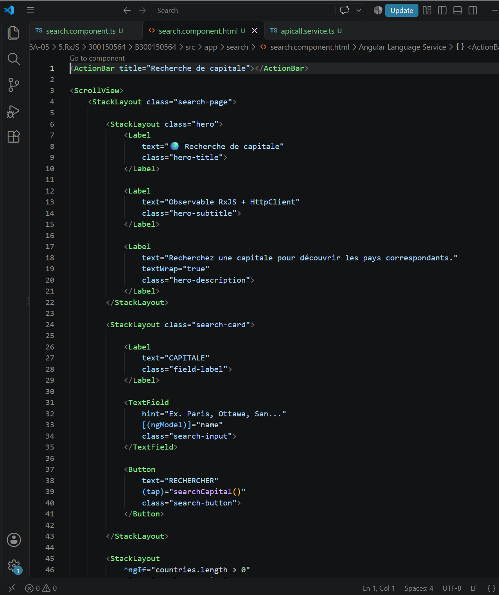
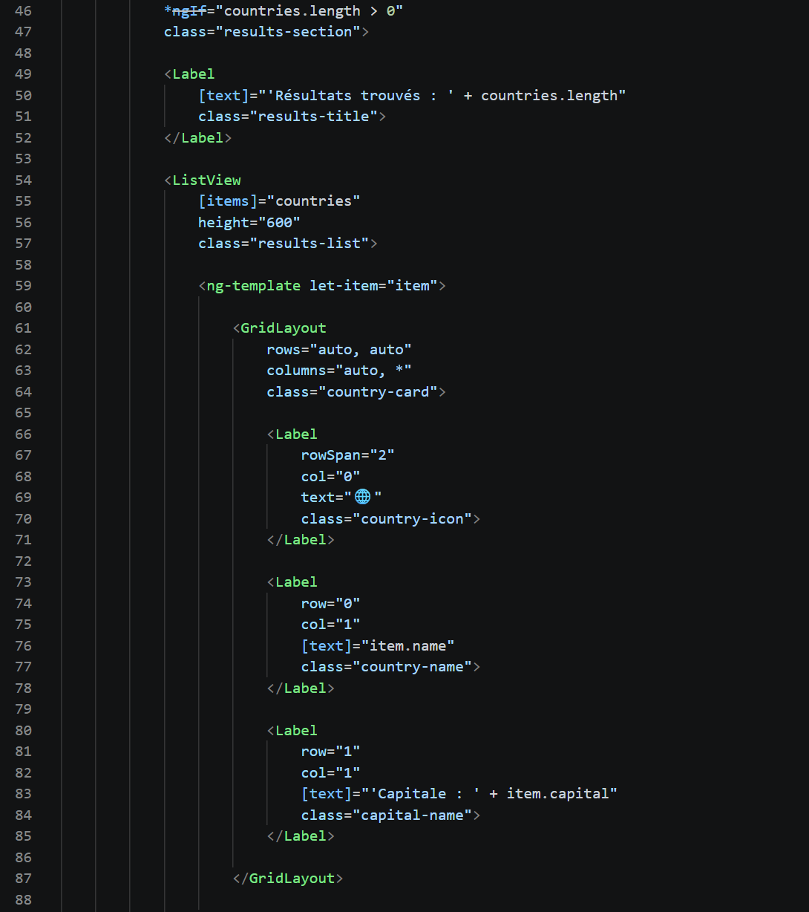
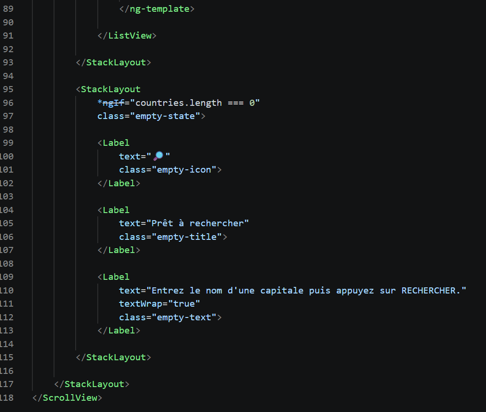
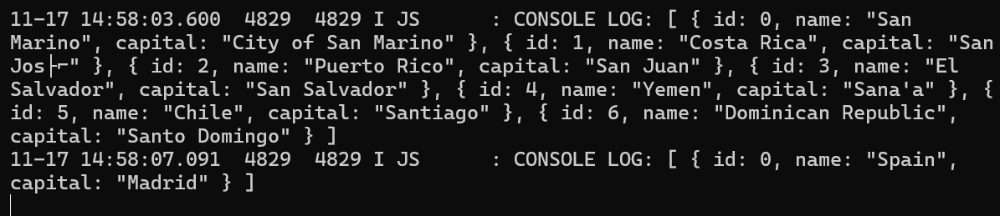

# 5.RxJS — Recherche de capitale 🌍

**Étudiant :** Ouassim Ahmed Benamira  
**Numéro étudiant :** 300150564  
**Cours :** INF1083-200-26A-05 — Développement d'applications

---

## 🎯 Objectif du TP

L'objectif de ce travail est de comprendre l'utilisation de **RxJS** dans une application **NativeScript avec Angular**.

L'application permet de rechercher une capitale et d'afficher les pays correspondants à partir d'une API externe.

Ce TP permet principalement d'utiliser :

- `HttpClient` pour effectuer une requête HTTP ;
- les `Observable` de RxJS pour gérer les données asynchrones ;
- `map()` pour transformer les données reçues ;
- `catchError()` pour gérer les erreurs ;
- `subscribe()` pour récupérer le résultat de l'Observable ;
- `ngModel` pour récupérer la valeur entrée par l'utilisateur ;
- `ListView` pour afficher les résultats.

---

## 📱 Résultat final

L'application possède une interface permettant d'entrer le nom d'une capitale.

Lorsqu'on appuie sur **RECHERCHER**, l'application interroge l'API et affiche les pays correspondants.



Dans cet exemple, la recherche `San` retourne plusieurs résultats comme :

- San Marino — City of San Marino
- Costa Rica — San José
- Puerto Rico — San Juan
- El Salvador — San Salvador
- Yemen — Sana'a
- Chile — Santiago
- Dominican Republic — Santo Domingo

---

## 🏗️ Création du projet

Le projet NativeScript a été créé avec le modèle de navigation par onglets :

```powershell
ns create B300150564 --template @nativescript/template-tab-navigation-ng
```

Le projet se trouve dans :

```text
5.RxJS/
└── 300150564/
    ├── README.md
    ├── images/
    └── B300150564/
```

---

## 📂 Structure principale

Les fichiers importants utilisés dans le TP sont :

```text
B300150564/
└── src/
    └── app/
        ├── shared/
        │   ├── country.ts
        │   ├── apicall.service.ts
        │   └── data.service.ts
        │
        ├── search/
        │   ├── search.component.ts
        │   ├── search.component.html
        │   └── search.module.ts
        │
        └── app.module.ts
```

---

## 🌎 Modèle `Country`

Le fichier `country.ts` représente les informations nécessaires pour chaque pays.

```typescript
export class Country {
    id: number;
    name: string;
    capital: string;
}
```

Chaque objet contient :

| Propriété | Description |
|---|---|
| `id` | Identifiant du résultat |
| `name` | Nom du pays |
| `capital` | Capitale du pays |

---

## 🌐 Service API et RxJS

Le fichier `apicall.service.ts` contient le service responsable de la communication avec l'API.



La méthode principale retourne :

```typescript
Observable<Country[]>
```

Cela signifie que le résultat de la requête HTTP est traité comme un **flux de données asynchrone avec RxJS**.

L'appel est effectué vers l'API :

```text
https://countries.nexperts.nl/capital/<nom>
```

Par exemple, une recherche avec `Paris` utilise la capitale saisie pour récupérer le pays correspondant.

### Transformation avec `map()`

Les données retournées par l'API sont transformées en objets `Country` :

```typescript
map((data: any[]) => data.map((c, i) => ({
    id: i,
    name: c.name.common,
    capital: c.capital ? c.capital[0] : ''
} as Country)))
```

Cette transformation permet de conserver uniquement les informations nécessaires à l'application.

### Gestion des erreurs avec `catchError()`

Une erreur de recherche est interceptée avec :

```typescript
catchError(error => {
    return throwError(
        () => 'Capital not found!'
    );
})
```

Cela évite de laisser une erreur HTTP non gérée dans l'application.

---

## 🔄 Utilisation de l'Observable

La recherche est déclenchée dans `search.component.ts`.



La méthode :

```typescript
searchCapital()
```

appelle le service puis utilise :

```typescript
.subscribe(...)
```

Le fonctionnement est donc :

```text
Utilisateur
    ↓
Entre une capitale
    ↓
searchCapital()
    ↓
ApicallService
    ↓
HttpClient
    ↓
API externe
    ↓
Observable<Country[]>
    ↓
map()
    ↓
subscribe()
    ↓
countries[]
    ↓
Affichage dans le ListView
```

---

## 🔄 Actualisation de l'interface

Après la réponse HTTP, les résultats sont placés dans :

```typescript
this.countries = data;
```

L'interface est ensuite actualisée avec :

```typescript
this.changeDetector.detectChanges();
```

Cette étape a permis de s'assurer que les résultats reçus de manière asynchrone sont immédiatement visibles dans l'interface.

En cas d'erreur :

```typescript
this.countries = [];
this.changeDetector.detectChanges();
```

La liste est donc réinitialisée correctement.

---

## 📝 Formulaire et liaison Angular

L'utilisateur saisit la capitale dans un `TextField`.



La liaison bidirectionnelle est réalisée avec :

```html
[(ngModel)]="name"
```

Le bouton déclenche ensuite la méthode de recherche :

```html
(tap)="searchCapital()"
```

Les principales liaisons utilisées sont :

| Syntaxe | Utilisation |
|---|---|
| `[(ngModel)]` | Liaison entre le TextField et `name` |
| `(tap)` | Déclenche la recherche |
| `[items]` | Envoie les pays au ListView |
| `[text]` | Affiche une valeur dynamique |
| `*ngIf` | Affiche ou masque une section |

---

## 📋 Affichage des résultats

Les pays retournés par l'API sont affichés dans un `ListView`.



La liste utilise :

```html
<ListView [items]="countries">
```

Pour chaque résultat, l'application affiche :

- une icône 🌐 ;
- le nom du pays ;
- sa capitale.

Le nombre de résultats est également affiché avec :

```html
[text]="'Résultats trouvés : ' + countries.length"
```

---

## 🔎 État initial de l'application

Lorsqu'aucune recherche n'a encore retourné de résultat, l'application affiche un état initial.



La condition utilisée est :

```html
*ngIf="countries.length === 0"
```

L'utilisateur voit alors le message :

> **Prêt à rechercher**

avec une indication lui demandant d'entrer une capitale.

---

## 🎨 Personnalisation de l'interface

L'interface de base a été améliorée afin de rendre l'application plus claire et agréable à utiliser.

Les améliorations comprennent :

- un en-tête pour présenter la fonction de l'application ;
- une zone de recherche clairement identifiable ;
- un bouton **RECHERCHER** ;
- des cartes pour présenter les pays ;
- un compteur de résultats ;
- un état initial lorsqu'aucun résultat n'est affiché ;
- une distinction visuelle entre le nom du pays et sa capitale.

---

## 🧪 Vérification avec la console

Les données retournées par l'Observable ont également été vérifiées dans la console Android.



Pour la recherche `San`, la console retourne plusieurs objets :

```text
San Marino          → City of San Marino
Costa Rica          → San José
Puerto Rico         → San Juan
El Salvador         → San Salvador
Yemen               → Sana'a
Chile               → Santiago
Dominican Republic  → Santo Domingo
```

Une autre recherche avec `Mad` retourne également :

```text
Spain → Madrid
```

Cela confirme que :

1. la requête HTTP est exécutée ;
2. l'API retourne les données ;
3. RxJS transmet correctement les résultats ;
4. `map()` transforme les données ;
5. `subscribe()` reçoit le tableau ;
6. l'interface affiche les résultats.

---

## ▶️ Exécution de l'application

L'application peut être lancée sur l'émulateur Android avec :

```powershell
ns run android
```

Pour vérifier les appareils disponibles :

```powershell
adb devices
```

L'émulateur utilisé pendant le TP était :

```text
emulator-5554
```

---

## 🛠️ Problèmes rencontrés et solutions

### 1. Composant Angular standalone

Pendant la configuration du projet, Angular indiquait que `SearchComponent` était un composant standalone et qu'il ne pouvait pas être déclaré directement dans un `NgModule`.

La configuration du composant et de ses imports a donc été adaptée à la structure de la version actuelle de NativeScript/Angular.

---

### 2. Éléments NativeScript non reconnus

Certains éléments comme `StackLayout` et certaines propriétés du `ListView` n'étaient pas reconnus au début.

Les imports NativeScript nécessaires et le schéma approprié ont été configurés pour permettre à Angular de reconnaître correctement les composants NativeScript.

---

### 3. Version Java utilisée par Gradle

La compilation Android échouait parce que `JAVA_HOME` pointait encore vers **Java 8**, alors que la version actuelle du plugin Android nécessite une version plus récente de Java.

Le projet a été compilé avec **JDK 17** en corrigeant `JAVA_HOME`.

Après cette correction :

```text
Project successfully built.
```

---

### 4. Commande `adb` non reconnue

Dans une nouvelle fenêtre PowerShell, `adb` n'était pas disponible dans le `PATH`.

Le chemin du SDK Android a été configuré avec :

```powershell
$env:ANDROID_HOME = "$env:LOCALAPPDATA\Android\Sdk"
$env:PATH += ";$env:ANDROID_HOME\platform-tools"
```

La commande suivante a ensuite confirmé que l'émulateur était disponible :

```powershell
adb devices
```

---

### 5. Actualisation après la réponse HTTP

Les données étaient bien reçues de manière asynchrone, mais il fallait s'assurer que l'interface soit actualisée immédiatement.

La solution utilisée a été :

```typescript
this.changeDetector.detectChanges();
```

après la réception des données et lors de la gestion d'une erreur.

---

### 6. Avertissements Sass

La compilation affiche certains avertissements de dépréciation Sass provenant des dépendances utilisées par NativeScript.

Ces messages sont des **avertissements** et n'empêchent pas la compilation ni l'exécution de l'application.

---

## ✅ Résultat

Le TP est fonctionnel.

L'application permet de :

- saisir une capitale ;
- envoyer une requête HTTP ;
- recevoir les données avec un `Observable` RxJS ;
- transformer la réponse avec `map()` ;
- gérer les erreurs avec `catchError()` ;
- récupérer les résultats avec `subscribe()` ;
- afficher dynamiquement les pays correspondants dans l'application ;
- vérifier les données reçues dans la console Android.

---

## 🏁 Conclusion

Ce TP m'a permis de comprendre comment utiliser **RxJS avec HttpClient dans NativeScript et Angular**.

J'ai appris à manipuler un `Observable`, transformer les données reçues d'une API et afficher les résultats de manière dynamique dans une application mobile.