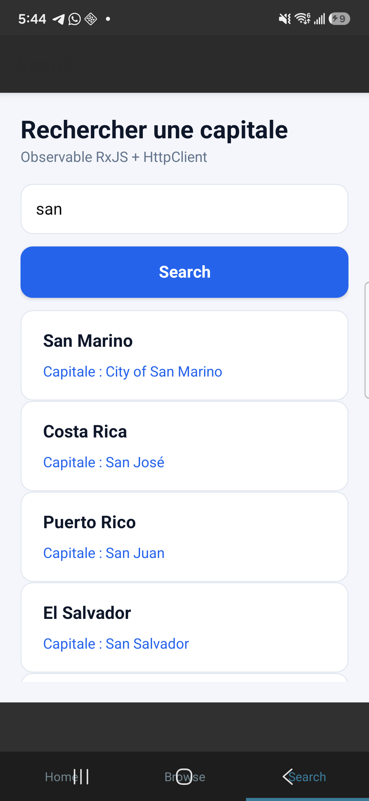
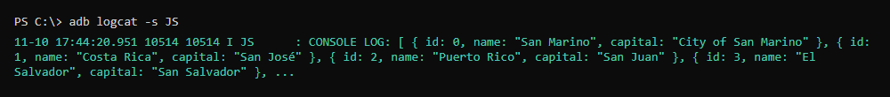

# 300151315 - RxJS

Application créée par **Toumi Ayoub**.

## Description
Application mobile NativeScript (Angular) `b300151315` avec onglets. Dans l'onglet **Search**, on saisit une capitale, puis le bouton **Search** appelle l'API `https://countries.nexperts.nl/capital/<nom>` avec `HttpClient`.

Le service retourne un `Observable<Country[]>` (RxJS) et les pays trouvés s'affichent dans un `ListView`.

## Création du projet
NativeScript, Android Studio et le SDK Android étaient déjà installés sur mon PC depuis les laboratoires précédents.

```
ns create b300151315 --template @nativescript/template-tab-navigation-ng
cd b300151315
code .
```

## Exécution
```
ns run android
```

## Fichiers créés et modifiés

Le modèle n'a pas de fichier `angular.json`, donc les fichiers ont été créés à la main (pas de `ng generate`).

| Fichier | Rôle |
|---------|------|
| `src/app/shared/country.ts` | Modèle `Country` (`id`, `name`, `capital`) |
| `src/app/shared/apicall.service.ts` | Service `ApicallService` : `HttpClient.get()` + opérateurs RxJS `map` et `catchError` |
| `src/app/app.module.ts` | Ajout de `NativeScriptHttpClientModule` |
| `src/app/search/search.module.ts` | Ajout de `NativeScriptFormsModule` (pour `ngModel`) |
| `src/app/search/search.component.ts` | Propriétés `name` et `countries`, méthode `searchCapital()` avec `subscribe()` |
| `src/app/search/search.component.html` | `TextField` avec `[(ngModel)]`, bouton `(tap)`, `ListView` avec `[items]` |
| `src/_app-common.scss` | Style de la page Search |

### Service (RxJS)
```typescript
searchCountryByName(name: string): Observable<Country[]> {
    return this.httpClient
        .get<any[]>('https://countries.nexperts.nl/capital/' + name)
        .pipe(
            map((data: any[]) => data.map((c, i) => ({
                id: i,
                name: c.name.common,
                capital: c.capital ? c.capital[0] : ''
            } as Country))),
            catchError(error => throwError(() => 'Capital not found!'))
        );
}
```

### Composant Search
```typescript
searchCapital() {
    this.apiService.searchCountryByName(this.name).subscribe({
        next: (data: Country[]) => {
            console.log(data);
            this.countries = data;
        },
        error: (message: string) => {
            this.countries = [];
            this.erreur = message;
        },
    });
}
```

J'ai ajouté le cas `error` dans `subscribe()` : si la capitale n'existe pas, le message **Capital not found!** s'affiche sous le bouton.

Angular 22 fonctionne sans `zone.js` : l'écran ne se met pas à jour tout seul quand la réponse de l'API arrive. J'appelle donc `this.changeDetector.detectChanges()` (avec `ChangeDetectorRef` injecté dans le constructeur) après avoir reçu les pays.

## Résultat

Recherche de « san » sur le téléphone (Samsung Galaxy S24) :



### Console
Le tableau `Country[]` retourné par l'`Observable` et affiché avec `console.log(data)`, vu avec `adb logcat` :



## Problèmes rencontrés et solutions

| Problème | Solution |
|----------|----------|
| `ng generate` ne fonctionne pas (pas de `angular.json`) | Fichiers `country.ts` et `apicall.service.ts` créés à la main |
| Mes autres labos NativeScript sont installés sur le même téléphone | Identifiant propre à ce labo : `org.nativescript.rxjs.b300151315` dans `nativescript.config.ts` |
| Disque C: plein | Cache npm, dossier temporaire et Gradle déplacés sur D: |
| La liste restait vide alors que la console affichait les pays | Angular 22 sans `zone.js` : ajout de `ChangeDetectorRef.detectChanges()` |
| Téléphone en mode sombre : textes du modèle illisibles | Couleurs propres à la page Search (fond clair, cartes blanches) |
| Onglets cachés sous les boutons du téléphone (Android 15) | L'application s'ouvre directement sur l'onglet **Search** (`[selectedIndex]="2"`) |
