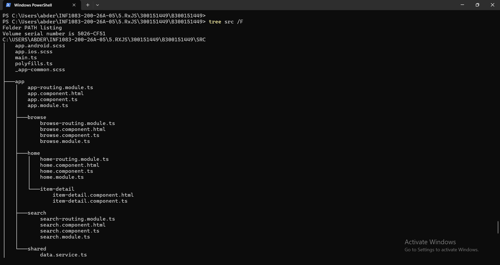
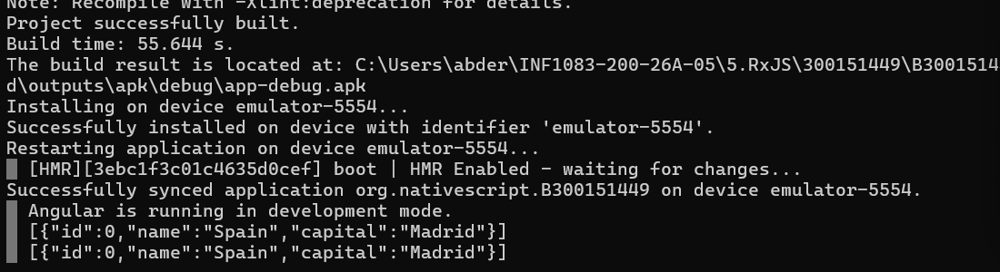
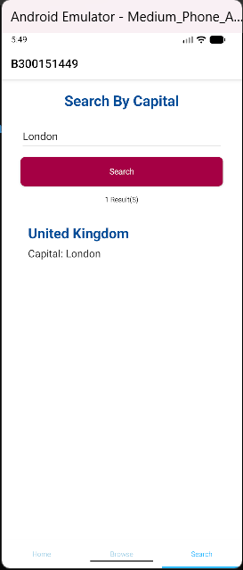

# Laboratoire 5 — RxJS

**Cours :** INF1083  
**Étudiant :** 300151449  
**Projet :** B300151449

## Objectif

Créer une application NativeScript Angular avec onglets permettant de rechercher un pays par sa capitale via une API REST et RxJS.

## Exécution

```powershell
cd B300151449
npm.cmd install
ns.cmd run android
```

## Fonctionnement

Dans l’onglet Search, saisir une capitale puis appuyer sur Search. Le binding `[(ngModel)]` relie le champ à la propriété `name`. Le service `ApicallService` utilise `HttpClient` pour interroger `https://countries.nexperts.nl/capital/` et retourne un `Observable<Country[]>`. Les opérateurs `map` et `catchError` transforment les données et gèrent les erreurs. Le composant s’abonne avec `subscribe` et affiche les résultats dans un `ListView`. `ChangeDetectorRef.detectChanges()` actualise l’interface après la réponse.

Le modèle Country contient `id`, `name` et `capital`. Les modules NativeScriptHttpClientModule et NativeScriptFormsModule permettent les requêtes HTTP et les formulaires Template Driven. L’API utilisée ne nécessite pas de clé RapidAPI dans le code fourni.

## Captures et résultats

### Structure du projet initial



### Réponse API dans la console — Madrid

```json
[{"id":0,"name":"Spain","capital":"Madrid"}]
```



### Recherche sur Android — London

La recherche affiche United Kingdom, Capital: London et un résultat.



## Conclusion

Les tests confirment la récupération des données REST et leur affichage dans l’application Android grâce à RxJS.
