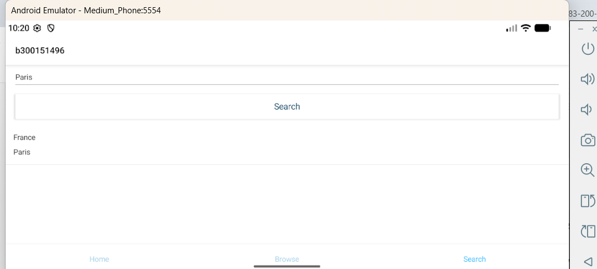
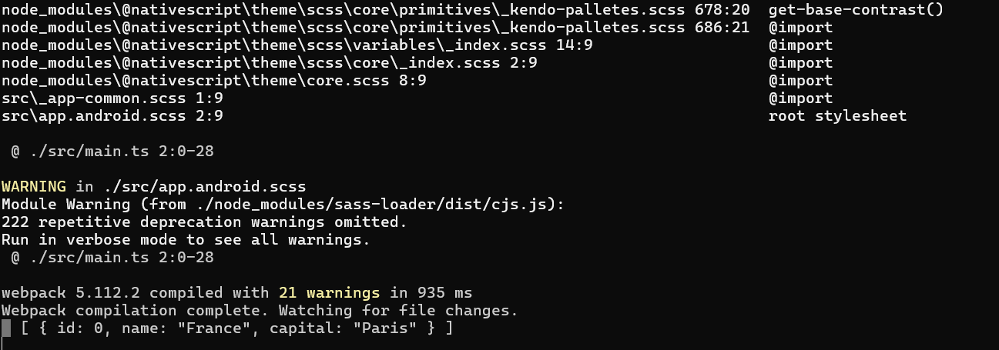

# Labo RxJS — 300151496

## 🎯 Objectif
Comprendre RxJS, les Observables et HttpClient dans une application NativeScript, avec les Template Driven Forms d'Angular.

## 🚀 Réalisation
- Projet créé avec `ns create b300151496 --template @nativescript/template-tab-navigation-ng`
- **Modèle** (`src/app/shared/country.ts`) : classe `Country` avec `id`, `name` et `capital`.
- **Service** (`src/app/shared/apicall.service.ts`) : `ApicallService` utilise `HttpClient` et retourne un `Observable<Country[]>` ; `searchCountryByName()` appelle l'API avec `map` et `catchError` de RxJS.
- **HttpClient** : `NativeScriptHttpClientModule` ajouté dans `src/app/app.module.ts`.
- **Composant Search** (`src/app/search/search.component.ts`) : propriétés `name` et `countries`, méthode `searchCapital()` qui s'abonne (`subscribe`) à l'Observable, affiche les données dans la console et remplit la liste.
- **Template Search** (`src/app/search/search.component.html`) : `TextField` lié avec `[(ngModel)]="name"`, bouton `Search` avec `(tap)="searchCapital()"`, et `ListView` avec `[items]="countries"` affichant le nom et la capitale.
- **Formulaires** : `NativeScriptFormsModule` ajouté dans `src/app/search/search.module.ts` pour activer `ngModel`.

## ⚠️ Note sur l'API
L'API du labo (restcountries-v1 sur RapidAPI) ne répond plus : elle retourne 404 même dans l'outil de test officiel de RapidAPI (vérifié avec une clé valide et une capitale valide). L'API restcountries.com v3.1 est également dépréciée, et la v5 exige une clé payante. Le service utilise donc l'API publique **countries.nexperts.nl** (gratuite, sans clé), qui offre le même endpoint `/capital/{nom}` ; la réponse est adaptée vers le modèle `Country` avec `map` (`name.common` → `name`, `capital[0]` → `capital`).

## ✅ Résultat
En tapant une capitale (Paris) et en appuyant sur « Search », le pays correspondant s'affiche dans la liste, et les données s'affichent dans la console :
`[{ id: 0, name: "France", capital: "Paris" }]`

## 🖼️ Captures

