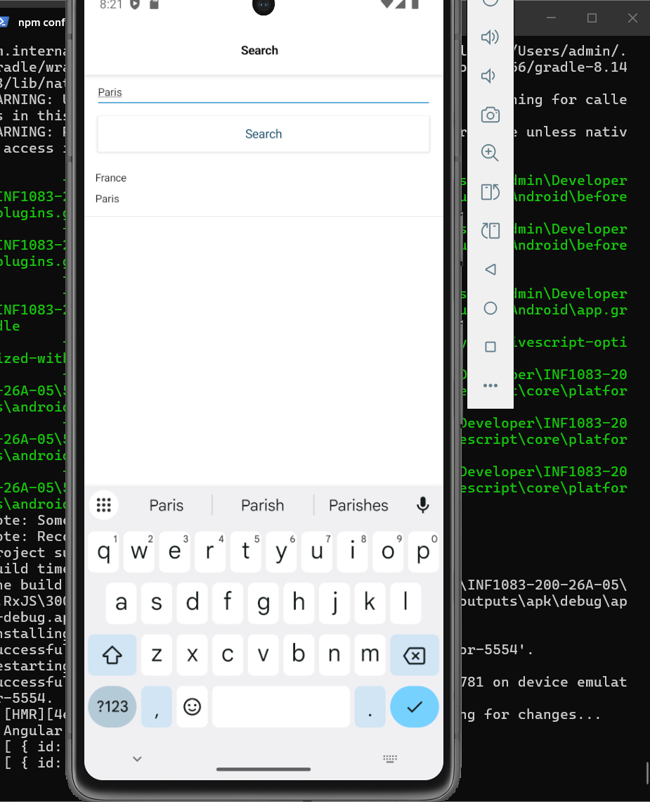
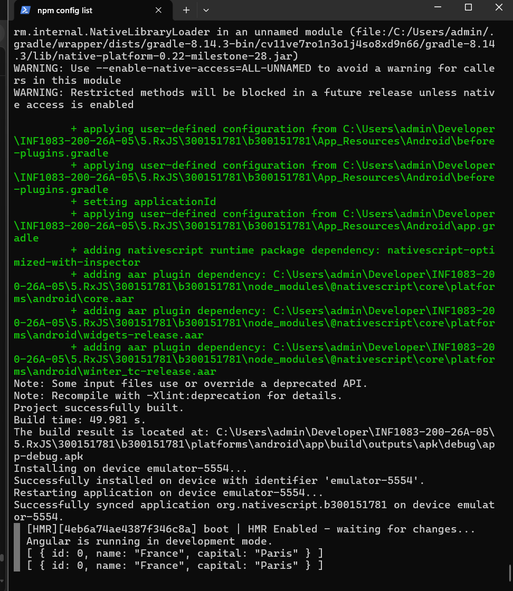
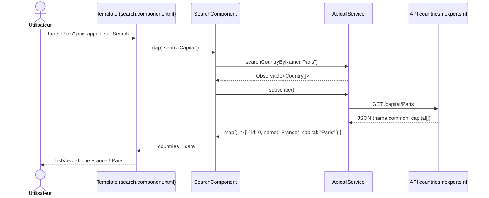

# :iphone: Labo RxJS — Recherche de pays par capitale


| | |
|---|---|
| **Étudiant** | Lounes Allouti — :id: 300151781 — :octocat: [lounesallouti](https://github.com/lounesallouti) |
| **Cours** | INF1083 — Labo 5 : RxJS |
| **Projet** | [`b300151781`](b300151781) — NativeScript Angular, template `tab-navigation-ng` |

---

## :bookmark_tabs: Table des matières

1. [Objectif](#dart-objectif)
2. [Résultat](#white_check_mark-résultat)
3. [Architecture](#building_construction-architecture)
4. [Structure du projet](#file_folder-structure-du-projet)
5. [Réalisation pas à pas](#hammer_and_wrench-réalisation-pas-à-pas)
6. [Concepts RxJS utilisés](#books-concepts-rxjs-utilisés)
7. [Note sur l'API](#warning-note-sur-lapi)
8. [Lancer le projet](#arrow_forward-lancer-le-projet)
9. [Ce que j'ai appris](#bulb-ce-que-jai-appris)

---

## :dart: Objectif

Construire une application mobile qui **cherche un pays à partir du nom de sa capitale**, en utilisant :

- **HttpClient** pour appeler une API REST ;
- **RxJS** et les **Observables** pour traiter la réponse asynchrone ;
- les **Template Driven Forms** d'Angular (`ngModel`) pour lier le champ de saisie.

---

## :white_check_mark: Résultat

L'utilisateur tape **`Paris`** dans l'onglet **Search** et appuie sur **Search** : l'application affiche
**France / Paris**, et le `console.log` du composant affiche l'objet reçu.

<table>
  <tr>
    <th>Application (émulateur Pixel 7)</th>
    <th>Console (<code>ns run android</code>)</th>
  </tr>
  <tr>
    <td align="center"></td>
    <td align="center"></td>
  </tr>
</table>

```text
Project successfully built.
Successfully synced application org.nativescript.b300151781 on device emulator-5554.
[ { id: 0, name: "France", capital: "Paris" } ]
```

---

## :building_construction: Architecture



> :information_source: L'Observable est **paresseux** : la requête HTTP part seulement au moment du `subscribe()`.

---

## :file_folder: Structure du projet

```text
b300151781/src/app/
├── app.module.ts              <- ajout de NativeScriptHttpClientModule
├── shared/
│   ├── country.ts             <- modèle de données (nouveau)
│   └── apicall.service.ts     <- service HTTP + RxJS (nouveau)
└── search/
    ├── search.module.ts       <- ajout de NativeScriptFormsModule
    ├── search.component.ts    <- logique : searchCapital() + subscribe
    └── search.component.html  <- vue : TextField, Button, ListView
```

---

## :hammer_and_wrench: Réalisation pas à pas

### 1. Création du projet

```bash
ns create b300151781 --template @nativescript/template-tab-navigation-ng
```

Le template récent n'a pas de fichier `angular.json` : les commandes `ng generate` ne fonctionnent pas,
les fichiers ont donc été créés à la main.

### 2. Modèle — [`shared/country.ts`](b300151781/src/app/shared/country.ts)

```typescript
export class Country {
  id: number
  name: string
  capital: string
}
```

### 3. Service — [`shared/apicall.service.ts`](b300151781/src/app/shared/apicall.service.ts)

```typescript
searchCountryByName(name: string): Observable<Country[]> {
  return this.httpClient.get<any[]>('https://countries.nexperts.nl/capital/' + name).pipe(
    map((data: any[]) =>
      data.map((c, i) => ({ id: i, name: c.name.common, capital: c.capital ? c.capital[0] : '' }) as Country),
    ),
    catchError(() => throwError(() => 'Capital not found!')),
  )
}
```

### 4. HttpClient — [`app.module.ts`](b300151781/src/app/app.module.ts)

```typescript
imports: [NativeScriptModule, NativeScriptHttpClientModule, AppRoutingModule],
```

### 5. Composant — [`search/search.component.ts`](b300151781/src/app/search/search.component.ts)

```typescript
searchCapital() {
  this.message = ''
  this.apiService.searchCountryByName(this.name).subscribe({
    next: (data: Country[]) => {
      console.log(data)
      this.countries = data
    },
    error: (err: string) => {
      console.log(err)
      this.countries = []
      this.message = err
    },
  })
}
```

> :sparkles: **Amélioration par rapport à l'énoncé :** le callback `error` affiche le message
> `Capital not found!` à l'écran quand la capitale n'existe pas, au lieu de l'ignorer.

### 6. Template — [`search/search.component.html`](b300151781/src/app/search/search.component.html)

```html
<StackLayout class="form">
  <TextField class="input" hint="Capital" [(ngModel)]="name"></TextField>
  <Button text="Search" class="btn btn-primary" (tap)="searchCapital()"></Button>
  <Label *ngIf="message" [text]="message" class="text-danger"></Label>
  <ListView [items]="countries" height="650">
    <ng-template let-item="item">
      <StackLayout>
        <Label [text]="item.name"></Label>
        <Label [text]="item.capital"></Label>
      </StackLayout>
    </ng-template>
  </ListView>
</StackLayout>
```

| Binding | Rôle |
|---|---|
| `[(ngModel)]="name"` | Liaison bidirectionnelle entre le champ et la propriété `name` |
| `(tap)="searchCapital()"` | Lance la recherche au toucher du bouton |
| `[items]="countries"` | Affiche la collection dans le `ListView` |
| `*ngIf="message"` | Affiche l'erreur seulement si elle existe |

### 7. Formulaires — [`search/search.module.ts`](b300151781/src/app/search/search.module.ts)

```typescript
imports: [NativeScriptCommonModule, NativeScriptFormsModule, SearchRoutingModule],
```

Sans `NativeScriptFormsModule`, la directive `ngModel` n'est pas reconnue.

---

## :books: Concepts RxJS utilisés

| Concept | Où | Rôle |
|---|---|---|
| `Observable<T>` | `apicall.service.ts` | Flux de données asynchrone retourné par le service |
| `pipe()` | `apicall.service.ts` | Enchaîne les opérateurs sur le flux |
| `map()` | `apicall.service.ts` | Transforme la réponse JSON en objets `Country` |
| `catchError()` | `apicall.service.ts` | Intercepte une erreur HTTP |
| `throwError()` | `apicall.service.ts` | Renvoie un Observable d'erreur avec un message clair |
| `subscribe({ next, error })` | `search.component.ts` | Déclenche la requête et reçoit les données ou l'erreur |

---

## :warning: Note sur l'API

L'API d'origine du labo (restcountries sur RapidAPI) ne répond plus. Le service utilise l'API publique
**countries.nexperts.nl**, gratuite et sans clé, qui offre le même point d'accès `/capital/{nom}`.
L'opérateur `map` adapte sa réponse (`name.common`, `capital[0]`) au modèle `Country`.

---

## :arrow_forward: Lancer le projet

```bash
cd b300151781
npm install
ns run android
```

Prérequis : NativeScript CLI 9, Android SDK et un émulateur (testé sur **Pixel 7**, `emulator-5554`).
Le dossier `node_modules` n'est pas versionné : `npm install` le recrée.

---

## :bulb: Ce que j'ai appris

- Un **Observable** ne fait rien tant qu'on ne s'y **abonne** pas.
- Les **opérateurs** RxJS (`map`, `catchError`) se combinent dans `pipe()` pour transformer et sécuriser un flux.
- `HttpClient` doit être fourni par un **module** (`NativeScriptHttpClientModule`) avant d'être injecté dans un service.
- `ngModel` nécessite `NativeScriptFormsModule` dans le module du composant.
- Un émulateur Android a besoin de beaucoup d'espace disque : il a fallu libérer de la place pour qu'il démarre.
