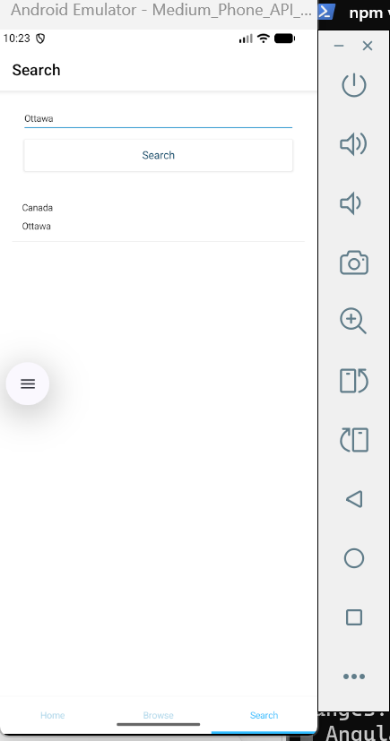

# Recherche par capitale avec RxJS

Lyes Medjahed · INF1083 · 300153676

Dans l’onglet **Search**, saisir une capitale, par exemple **Ottawa**, puis appuyer sur **Search**. La liste affiche le pays et sa capitale. Le formulaire utilise `ngModel`. Le service interroge l’API du cours avec `HttpClient` et transforme la réponse en `Observable<Country[]>`.

## Lancement sur Android

Extraire le dossier `b300153676` de [l’archive du projet](./RxJS-300153676.zip) et ouvrir PowerShell dans ce dossier.

```powershell
npm.cmd ci
ns.cmd run android
```

## Test sur Android

La recherche de la capitale Ottawa affiche le pays Canada dans l’émulateur Android.


