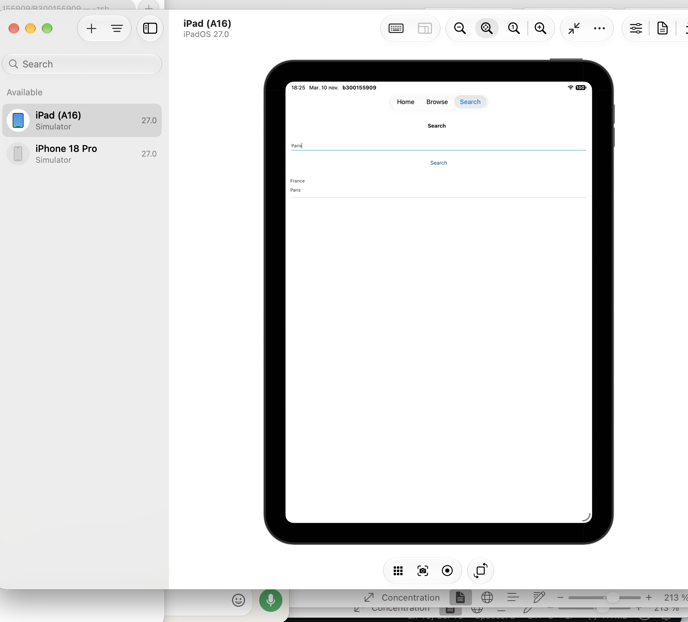
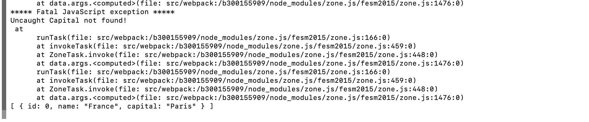

# 300155909 - RxJS

Application créée par **Rahma Taib**.

## Description
Application NativeScript (Angular) avec onglets. Dans l'onglet **Search**, on saisit une capitale et le bouton **Search** appelle l'API `https://countries.nexperts.nl/capital/<nom>` avec `HttpClient`. Le service retourne un `Observable<Country[]>` (RxJS) et les pays s'affichent dans un `ListView`.

## Création du projet
```
ns create b300155909 --template @nativescript/template-tab-navigation-ng
cd b300155909
code .
```

## Exécution
```
ns run ios
```

## Fichiers créés et modifiés

| Fichier | Rôle |
|---------|------|
| `src/app/shared/country.ts` | Modèle `Country` (id, name, capital) |
| `src/app/shared/apicall.service.ts` | Service avec `HttpClient`, `map` et `catchError` (RxJS) |
| `src/app/app.module.ts` | Ajout de `NativeScriptHttpClientModule` |
| `src/app/search/search.module.ts` | Ajout de `NativeScriptFormsModule` |
| `src/app/search/search.component.ts` | Méthode `searchCapital()` avec `subscribe()` |
| `src/app/search/search.component.html` | `TextField` avec `[(ngModel)]`, bouton, `ListView` |

## Résultat

### Application


### Terminal


## Problèmes rencontrés et solutions

| Problème | Solution |
|----------|----------|
| Projet créé au mauvais endroit (dans `4.Forms`) | Projet recréé dans `5.RxJS/300155909` et code copié |
| La liste restait vide (Angular sans `zone.js`) | `ChangeDetectorRef.detectChanges()` après la réponse de l'API |
