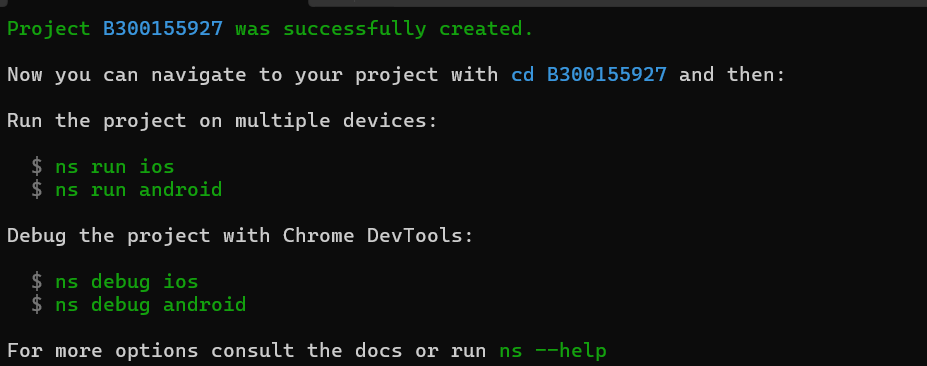
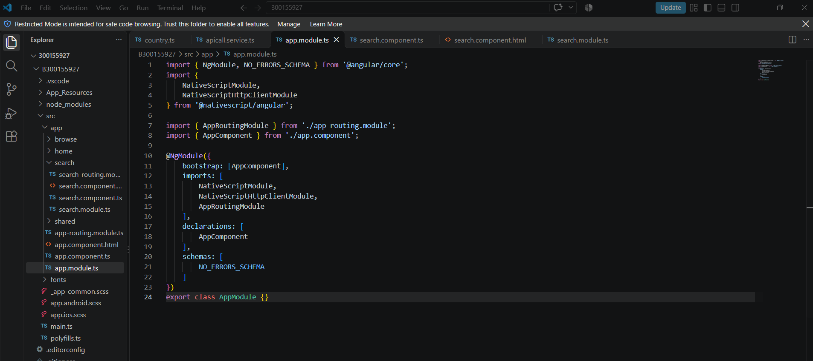
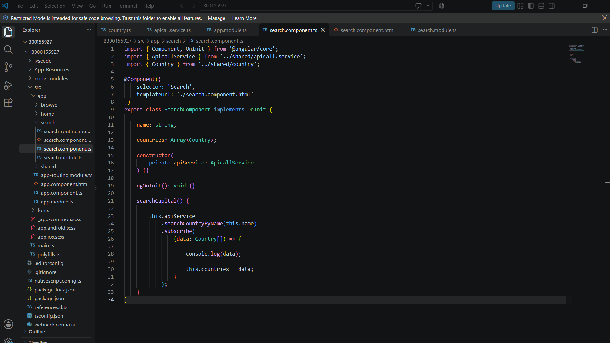
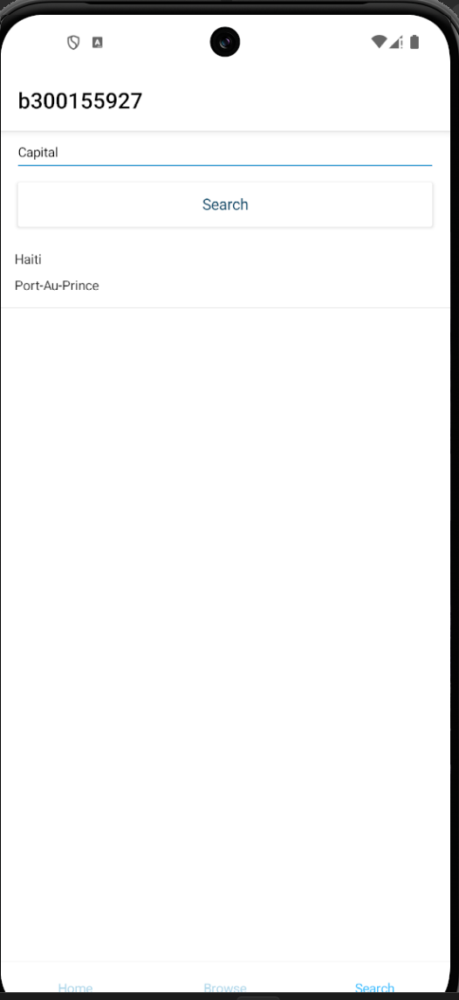

# 3001555927

# Projet NativeScript — Recherche de pays — B300155927

Documentation des étapes de création d'une application mobile avec **NativeScript** et Angular : une recherche de pays par capitale, avec une API, testée sur un émulateur Android.

## Environnement

| Élément | Détail |
|---|---|
| Framework | NativeScript (avec Angular) |
| Nom du projet | `B300155927` |
| Éditeur | Visual Studio Code |
| Fonction | Recherche de pays par capitale (service API) |
| Test | Émulateur Android |

## Étapes

### 1. Création du projet

Le projet est créé avec la ligne de commande NativeScript (`ns`). PowerShell affiche le message **« Project B300155927 was successfully created »** et propose les commandes suivantes : entrer dans le dossier (`cd B300155927`), lancer l'application (`ns run android` ou `ns run ios`) et déboguer (`ns debug android`).



### 2. Le module principal — `app.module.ts`

Le fichier `app.module.ts` est le point de départ de l'application. Il rassemble les morceaux du projet :

- il importe `NativeScriptModule` (le module de base de NativeScript) et `NativeScriptHttpClientModule` (pour appeler une API sur Internet) ;
- il importe `AppRoutingModule`, qui gère la navigation entre les pages (`home`, `browse`, `search`) ;
- `bootstrap: [AppComponent]` veut dire que l'application démarre sur le composant `AppComponent` ;
- `schemas: [NO_ERRORS_SCHEMA]` permet d'utiliser les balises NativeScript dans les écrans.

Dans l'explorateur de VS Code, on voit la structure du projet : le dossier `src/app/` contient les dossiers `browse`, `home`, `search` et `shared`, ainsi que les fichiers `app-routing.module.ts`, `app.component.html`, `app.component.ts` et `app.module.ts`.



### 3. Le composant de recherche — `search.component.ts`

Le fichier `search.component.ts` contient le code de l'écran de recherche (`selector: 'Search'`) :

- il importe `ApicallService` (le service qui appelle l'API) et `Country` (le modèle d'un pays), tous les deux dans le dossier `shared` ;
- la variable `name` contient le texte tapé par l'utilisateur ;
- la variable `countries` contient la liste des pays trouvés ;
- la fonction `searchCapital()` appelle `this.apiService.searchCountryByName(this.name)`, puis avec `.subscribe()` elle reçoit les données, les affiche dans la console (`console.log(data)`) et les met dans `this.countries` pour les montrer à l'écran.



### 4. La recherche en marche

Sur l'émulateur, l'écran **Search** montre un champ **Capital** et un bouton **Search**. En bas de l'écran, on voit les onglets **Home**, **Browse** et **Search**.

Après la recherche, l'application affiche le résultat : le pays **Haïti** et sa capitale **Port-Au-Prince**. La recherche avec l'API fonctionne.



## Commandes utilisées

```powershell
ns create B300155927   # créer le projet
cd B300155927          # entrer dans le dossier
ns run android         # lancer sur l'émulateur Android
ns debug android       # déboguer avec Chrome DevTools
```
