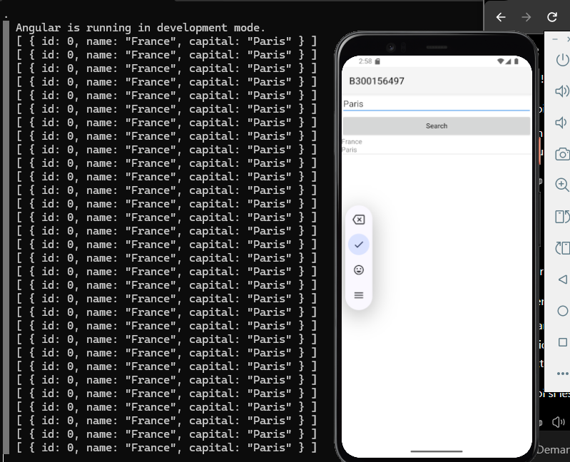
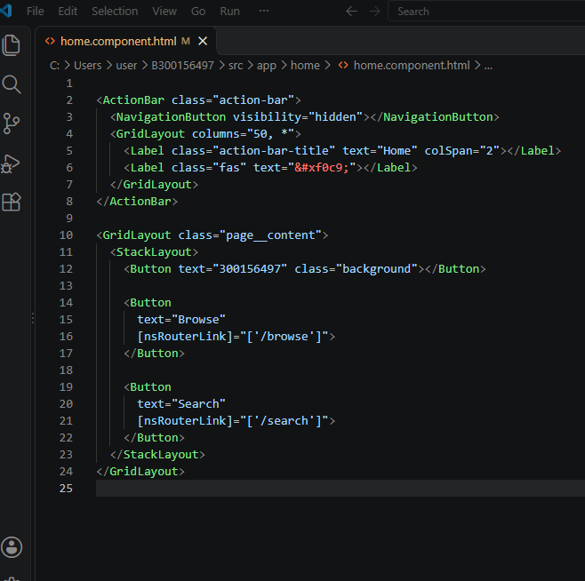

# 🚀 TP RxJS – Développement d'une application mobile

**Cours :** INF1083 – Collège Boréal  
**Numéro étudiant :** 300156497

## 🟦 1. Préparation de l'environnement

Nous avons commencé par ouvrir le projet dans Visual Studio Code et utiliser PowerShell pour exécuter les commandes.

### 💻 Commandes utilisées

Ouvrir le projet :

```powershell
code .
```

Compiler le projet Android :

```powershell
ns build android
```

Lancer l'application :

```powershell
ns run android
```

Arrêter l'exécution :

```text
Ctrl + C
```

---

## 🟩 2. Travail réalisé dans Visual Studio Code

Nous avons utilisé Visual Studio Code pour créer les fichiers, organiser le projet et écrire le code TypeScript et HTML.

### 📂 A. Création des dossiers et fichiers

Dans l'explorateur de VS Code, nous avons créé les dossiers :

- `search`
- `shared`

Puis nous avons créé les fichiers suivants :

```text
src/app/
├── home/
│   └── home.component.html
├── browse/
│   ├── browse.component.ts
│   └── browse.component.html
├── search/
│   ├── search.component.ts
│   └── search.component.html
├── shared/
│   ├── country.ts
│   └── apicall.service.ts
└── app.routes.ts
```

### 📝 B. Ouverture des fichiers avec PowerShell

Nous avons utilisé la commande `code` pour ouvrir directement les fichiers dans VS Code.

Ouvrir la page Home :

```powershell
code src/app/home/home.component.html
```

Ouvrir le composant Search :

```powershell
code src/app/search/search.component.ts
```

Ouvrir l'interface Search :

```powershell
code src/app/search/search.component.html
```

Ouvrir le service API :

```powershell
code src/app/shared/apicall.service.ts
```

Ouvrir la classe Country :

```powershell
code src/app/shared/country.ts
```

### ⚙️ C. Programmation réalisée

Nous avons écrit et modifié plusieurs parties du code :

- `country.ts` : création de la classe Country avec les propriétés `id`, `name` et `capital`.
- `apicall.service.ts` : importation de HttpClient et RxJS, création de la méthode de recherche et gestion des erreurs.
- `search.component.ts` : création de la fonction `searchCapital()` pour appeler le service et récupérer les résultats.
- `search.component.html` : création du champ Capital, du bouton Search et de la liste des résultats.
- `app.routes.ts` : ajout de la route Search.
- `home.component.html` : ajout du bouton Search pour accéder à la nouvelle page.


## 🟨 3. Page Browse 🎬

Nous avons travaillé sur la page Browse pour afficher notre numéro étudiant et créer un bouton Animate.

Avec NativeScript, nous avons réalisé plusieurs animations :

- Disparition et apparition.
- Déplacement.
- Agrandissement et réduction.
- Rotation.

Le bouton Animate permet d'exécuter ces animations.

---

## 🟪 4. Service API et RxJS 🌐

Nous avons créé le fichier `apicall.service.ts` pour communiquer avec une API externe et rechercher un pays à partir de sa capitale.

### 🔗 API utilisée

```text
https://countries.nexperts.nl/capital/{name}
```

Exemple de recherche :

```text
https://countries.nexperts.nl/capital/Paris
```

### ⚙️ Méthodes et opérateurs utilisés

| Élément | Fonction |
|---|---|
| `HttpClient` | Effectuer les requêtes HTTP |
| `Observable` | Gérer les données asynchrones |
| `get()` | Récupérer les données de l'API |
| `map()` | Transformer les données reçues |
| `catchError()` | Gérer les erreurs |
| `throwError()` | Retourner une erreur |

---

## 🟧 5. Page Search 🔎

Nous avons créé le composant Search avec deux fichiers :

- `search.component.ts`
- `search.component.html`
  [images alt](https://github.com/CollegeBoreal/INF1083-200-26A-05/blob/main/5.RxJS/300156497/images/Capture%20d'%C3%A9cran%202026-11-16%20215528.png?raw=true)

La page contient un champ Capital, un bouton Search et une liste pour afficher les pays trouvés.

Lorsque l'utilisateur saisit le nom d'une capitale, le composant appelle le service API et affiche les résultats.

### 🧪 Test effectué

| Recherche | Résultat |
|---|---|
| Paris | France |

<badge color="success">Recherche réussie</badge>

---

## 🟦 6. Configuration de la navigation

Nous avons modifié `app.routes.ts` pour configurer les différentes pages :

- `/home` : page d'accueil.
- `/browse` : page des animations.
- `/search` : page de recherche.


Nous avons ensuite ajouté le bouton Search dans la page Home pour accéder au composant Search.

---

## 🟩 7. Configuration et dépannage Android 🤖

Nous avons utilisé Android Studio Device Manager pour créer et démarrer l'émulateur Pixel 4.

Nous avons également utilisé ADB pour vérifier la connexion entre l'émulateur et le projet.

### Commandes utilisées

Démarrer ADB :

```powershell
adb start-server
```

Vérifier les appareils :

```powershell
adb devices
```

Arrêter ADB :

```powershell
adb kill-server
```

Reconnecter un appareil hors ligne :

```powershell
adb reconnect offline
```

Fermer l'émulateur :

```powershell
adb -s emulator-5554 emu kill
```

Fermer un processus bloqué :

```powershell
taskkill /PID 3580 /F
```

---

## 🟪 8. Compilation et tests de l'application 📱

Après avoir terminé le code, nous avons compilé et lancé l'application sur l'émulateur Android.

Compiler :

```powershell
ns build android
```

Lancer :

```powershell
ns run android
```

Nous avons vérifié les trois parties :

- Home : affichage du numéro étudiant et navigation.
- Browse : fonctionnement du bouton Animate.
- Search : recherche de Paris et affichage de France.

---

## 🟧 9. Publication sur GitHub 📤

Après les tests, nous avons utilisé Git pour enregistrer les modifications et publier le travail sur GitHub.

### 💻 Commandes utilisées

**1. Vérifier les modifications :**

```powershell
git status
```

**2. Ajouter tous les fichiers :**

```powershell
git add .
```

**3. Créer un commit :**

```powershell
git commit -m "Complete RxJS TP with country search"
```

**4. Envoyer le travail sur GitHub :**

```powershell
git push origin master
```

### 🔗 Dépôt GitHub

https://github.com/CollegeBoreal/INF1083-200-26A-05

- Branche : `master`
- Dernier commit : `15b123c`

---

## 🏁 10. Résultat final

À la fin du TP, nous avons réalisé :

- ✅ Création et organisation des fichiers dans VS Code.
- ✅ Développement des pages Home, Browse et Search.
- ✅ Création d'un service API.
- ✅ Utilisation de HttpClient et RxJS.
- ✅ Configuration de la navigation.
- ✅ Animations avec NativeScript.
- ✅ Tests sur l'émulateur Android.
- ✅ Publication du projet sur GitHub.

