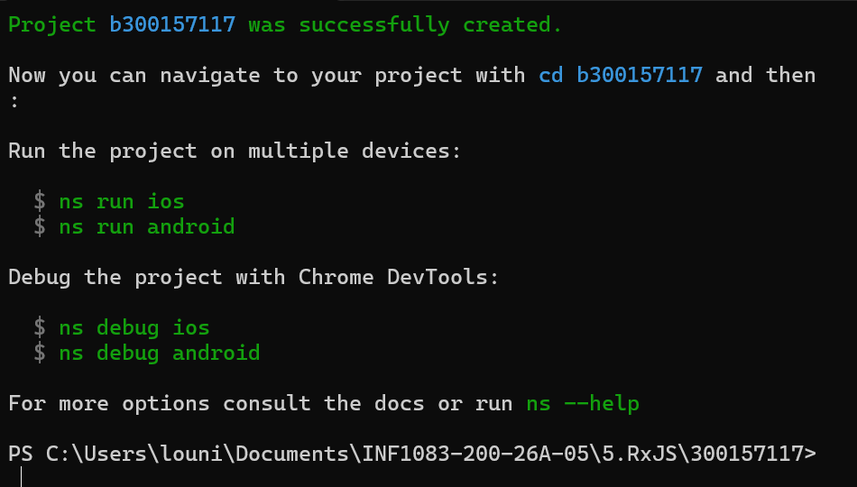
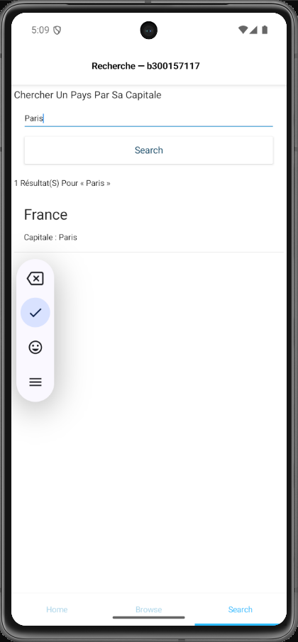
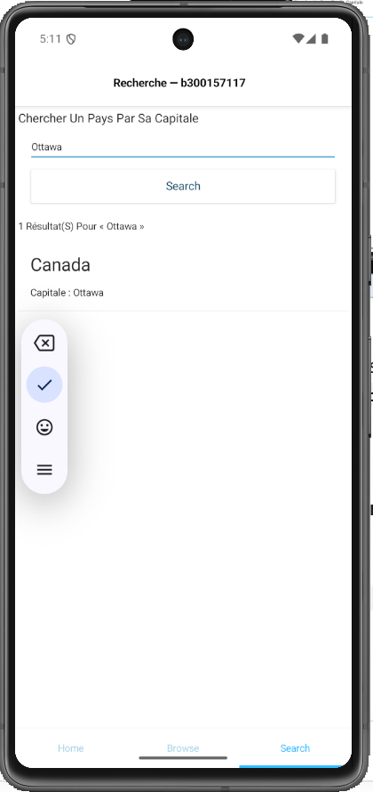
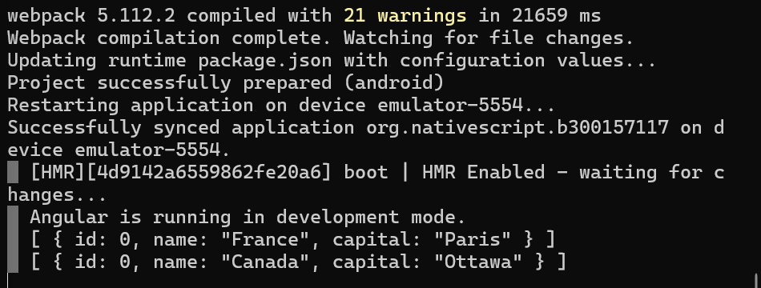

# 🛰️ RxJS — Accès à des données — INF1083

**Étudiant :** Rayan Lounis  
**Matricule :** 300157117  
**GitHub :** [lounisrayan](https://github.com/lounisrayan)  
**Cours :** INF1083 — Développement d'applications  
**Session :** Automne 2026  

---

## 🎯 Objectif

Construire un accès à des données dans une application **NativeScript Angular** avec :

- **RxJS** (`Observable`, `pipe`, `map`, `catchError`, `subscribe`)
- **`HttpClient`** (`NativeScriptHttpClientModule`)
- **Template Driven Forms** (`[(ngModel)]` avec `NativeScriptFormsModule`)

L'utilisateur tape une **capitale**, appuie sur **Search**, et les pays correspondants s'affichent dans un `ListView`.

Projet réalisé : **`b300157117`** (modèle *tab-navigation-ng*, NativeScript 9 + Angular 22, émulateur Pixel 7 — Android 15)

```text
5.RxJS/300157117/
├── README.md
├── images/
└── b300157117/
    └── src/app/
        ├── app.module.ts                  ← 🅳️ NativeScriptHttpClientModule
        ├── shared/
        │   ├── country.ts                 ← 🅱️ modèle Country
        │   └── apicall.service.ts         ← 🅲️ service RxJS + HttpClient
        └── search/
            ├── search.module.ts           ← 🆖 NativeScriptFormsModule
            ├── search.component.ts        ← 🆎 searchCapital()
            └── search.component.html      ← 🆑 TextField + Button + ListView
```

---

## ▶️ Exécuter le projet

```powershell
cd 5.RxJS\300157117\b300157117
ns run android
```

Puis ouvrir l'onglet **Search** 🔍.

---

## 🅰️ 1. Création du projet

```powershell
cd 5.RxJS\300157117
ns create b300157117 --template @nativescript/template-tab-navigation-ng
```



---

## 🅱️ 2. Modèle de données — `shared/country.ts`

```typescript
export class Country {
  id!: number;
  name!: string;
  capital!: string;
}
```

## 🅲️ 3. Service — `shared/apicall.service.ts`

```typescript
@Injectable({ providedIn: 'root' })
export class ApicallService {

  constructor(private httpClient: HttpClient) {}

  searchCountryByName(name: string): Observable<Country[]> {
    const capitale = encodeURIComponent(name.trim());

    return this.httpClient
      .get<any[]>('https://countries.nexperts.nl/capital/' + capitale)
      .pipe(
        // API de secours si la 1re ne répond pas (même format de réponse)
        catchError(() =>
          this.httpClient.get<any[]>('https://restcountries.com/v3.1/capital/' + capitale)
        ),
        // map : transformer la réponse en tableau de Country
        map((data: any[]) =>
          data.map((c, i) => ({
            id: i,
            name: c.name.common,
            capital: c.capital ? c.capital[0] : '',
          }) as Country)
        ),
        // catchError : message clair si la capitale n'existe pas
        catchError(() => throwError(() => 'Capital not found!'))
      );
  }
}
```

| Opérateur RxJS | Rôle |
|---|---|
| `Observable<Country[]>` | flux de données asynchrone renvoyé par le service |
| `pipe()` | enchaîne les opérateurs |
| `map()` | transforme la réponse de l'API (`name.common` → `name`, `capital[0]` → `capital`) |
| `catchError()` | gère les erreurs (API de secours, puis message « Capital not found! ») |
| `throwError()` | renvoie une erreur dans l'Observable |
| `subscribe()` | déclenche la requête et reçoit les données (dans le composant) |

## 🅳️ 4. HttpClient — `app.module.ts`

```typescript
import { NativeScriptHttpClientModule, NativeScriptModule } from '@nativescript/angular'

@NgModule({
  bootstrap: [AppComponent],
  imports: [NativeScriptModule, NativeScriptHttpClientModule, AppRoutingModule],
  declarations: [AppComponent],
  schemas: [NO_ERRORS_SCHEMA],
})
export class AppModule {}
```

## 🆖 5. Formulaires — `search/search.module.ts`

```typescript
import { NativeScriptCommonModule, NativeScriptFormsModule } from '@nativescript/angular'

@NgModule({
  imports: [NativeScriptCommonModule, NativeScriptFormsModule, SearchRoutingModule],
  declarations: [SearchComponent],
  schemas: [NO_ERRORS_SCHEMA],
})
export class SearchModule {}
```

## 🆎 6. Composant — `search/search.component.ts`

```typescript
export class SearchComponent implements OnInit {

  name = ''
  countries = signal<Array<Country>>([])
  message = signal('')

  constructor(private apiService: ApicallService) {}

  ngOnInit(): void {}

  searchCapital() {
    this.apiService.searchCountryByName(this.name).subscribe({
      next: (data: Country[]) => {
        console.log(data)
        this.countries.set(data)
        this.message.set(data.length + ' résultat(s) pour « ' + this.name + ' »')
      },
      error: (erreur: string) => {
        console.log(erreur)
        this.countries.set([])
        this.message.set(erreur)
      },
    })
  }
}
```

> Angular 22 n'actualise plus l'écran automatiquement (mode *zoneless*) : j'utilise des **`signal()`** pour que la liste se mette à jour quand les données arrivent.

## 🆑 7. Template — `search/search.component.html`

```html
<StackLayout class="form p-4">

  <TextField class="input" hint="Capital" [(ngModel)]="name"></TextField>

  <Button text="Search" class="btn btn-primary" (tap)="searchCapital()"></Button>

  <Label [text]="message()" textWrap="true"></Label>

  <ListView [items]="countries()" height="650">
    <ng-template let-item="item">
      <StackLayout class="p-10">
        <Label [text]="item.name" class="h2"></Label>
        <Label [text]="'Capitale : ' + item.capital"></Label>
      </StackLayout>
    </ng-template>
  </ListView>

</StackLayout>
```

| Binding | Rôle |
|---|---|
| `[(ngModel)]="name"` | liaison bidirectionnelle entre le `TextField` et la propriété `name` |
| `(tap)="searchCapital()"` | lance la recherche quand on touche le bouton |
| `[items]="countries()"` | affiche la collection dans le `ListView` |

---

## ✅ 8. Résultat

| Recherche « Paris » | Recherche « Ottawa » |
|---|---|
|  |  |

Données reçues et affichées dans la console :



```text
[ { id: 0, name: "France", capital: "Paris" } ]
[ { id: 0, name: "Canada", capital: "Ottawa" } ]
```

---

## ⚠️ Notes

- **API :** l'API du labo sur RapidAPI (restcountries-v1) ne répond plus. Le service utilise l'API publique **countries.nexperts.nl** (gratuite, sans clé, même route `/capital/{nom}`), avec **restcountries.com v3.1** comme API de secours grâce à `catchError`.
- **Premier lancement :** `Application ... is not running` apparaît parfois juste après l'installation ; il suffit de relancer `ns run android`.

## 📝 Conclusion

J'ai construit un accès à des données avec RxJS : le service retourne un `Observable`, les opérateurs `map` et `catchError` transforment la réponse et gèrent les erreurs, et le composant s'abonne avec `subscribe` pour afficher les pays dans un `ListView`, à partir d'une saisie liée par `[(ngModel)]`.

---

<p align="center"><b>🛰️ INF1083 — RxJS | 300157117</b></p>
