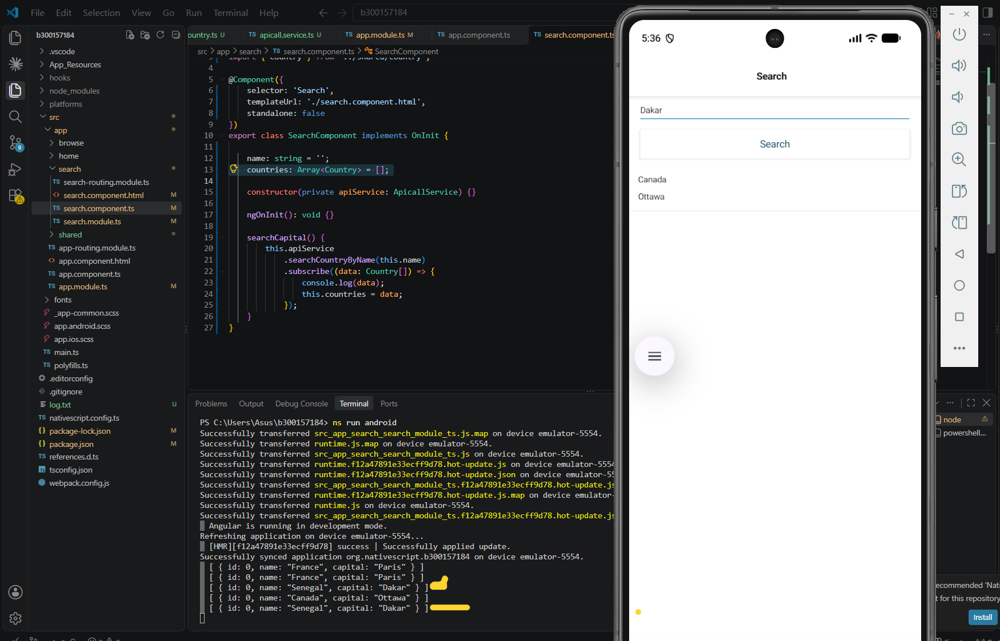
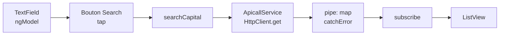

# 🛰️ Labo 5 – RxJS : recherche de pays par capitale

**Étudiant :** 300157184
**Cours :** INF1083 – Développement d'applications mobiles
**Projet :** [`b300157184`](b300157184)

Application mobile **NativeScript + Angular** qui recherche un pays à partir du nom de sa capitale. Les données proviennent d'une API REST, récupérées avec `HttpClient` et manipulées sous forme de flux asynchrones avec **RxJS**.

---

## 📱 Résultat

| Recherche « Dakar » | Données reçues (console) |
|:---:|:---:|
|  |  |

---

## 🧰 Environnement et versions

| Outil | Version |
|---|---|
| Système | Windows 11 |
| Node.js | `X.X.X` (`node -v`) |
| NativeScript CLI | `X.X.X` (`ns --version`) |
| @nativescript/core | 9.1.3 |
| Angular | `X.X.X` (`npm ls @angular/core`) |
| webpack | **5.97.1** (version fixée, voir problème n°4) |
| Émulateur | Android – Pixel 7 |

---

## 🗂️ Structure du projet

```
b300157184/
└── src/app/
    ├── app.module.ts              ← ajout de NativeScriptHttpClientModule
    ├── shared/
    │   ├── country.ts             ← modèle de données
    │   └── apicall.service.ts     ← service HTTP + opérateurs RxJS
    └── search/
        ├── search.component.ts    ← logique de recherche
        ├── search.component.html  ← formulaire + liste
        └── search.module.ts       ← ajout de NativeScriptFormsModule
```


---

## 🔄 Fonctionnement



1. L'utilisateur saisit une capitale. Grâce à `[(ngModel)]="name"`, la valeur est copiée automatiquement dans la propriété `name`.
2. Le bouton déclenche `searchCapital()` avec `(tap)`.
3. Le service envoie une requête `GET` et retourne un `Observable<Country[]>`.
4. Dans `pipe()`, l'opérateur `map` transforme la réponse de l'API en objets `Country`, et `catchError` intercepte les erreurs.
5. Le composant s'abonne avec `subscribe()` : c'est **l'abonnement qui déclenche la requête**. Les résultats sont placés dans `countries` et affichés par le `ListView`.

---

## 💡 Notions RxJS utilisées

| Notion | Rôle dans le projet |
|---|---|
| `Observable<T>` | Flux de données qui arrivera plus tard (réponse HTTP) |
| `pipe()` | Enchaîne des opérateurs sur le flux |
| `map` | Transforme chaque réponse en `Country[]` |
| `catchError` | Remplace une erreur HTTP par un message clair (`Capital not found!`) |
| `throwError` | Crée un Observable qui émet une erreur |
| `subscribe()` | S'abonne au flux et déclenche la requête |

### Extrait du service

```typescript
searchCountryByName(name: string): Observable<Country[]> {
    return this.httpClient
        .get<any[]>('https://countries.nexperts.nl/capital/' + name)
        .pipe(
            map((data: any[]) => data.map((c, i) => ({
                id: i,
                name: c.name.common,
                capital: c.capital ? c.capital[0] : ''
            } as Country))),
            catchError(() => throwError(() => 'Capital not found!'))
        );
}
```

### Les 3 types de binding Angular

| Syntaxe | Sens | Exemple |
|---|---|---|
| `[(ngModel)]` | Deux sens (vue ⇄ composant) | `[(ngModel)]="name"` |
| `(événement)` | Vue → composant | `(tap)="searchCapital()"` |
| `[propriété]` | Composant → vue | `[items]="countries"` |

---

## 🐞 Problèmes rencontrés et solutions

| # | Problème | Cause | Solution |
|:-:|---|---|---|
| 1 | `touch` introuvable | Commande Mac/Linux | `ni fichier` dans PowerShell |
| 2 | `has no initializer` | TypeScript en mode strict | `id!: number;` ou `name: string = '';` |
| 3 | Imports `../shared` en erreur | Code collé dans `app.component.ts` | `git checkout src/app/app.component.ts` |
| 4 | `Cannot find module 'webpack/lib/ExternalModuleFactoryPlugin'` | webpack trop récent | `npm install webpack@5.97.1 --save-dev` |
| 5 | `NG6008: Component is standalone` | Angular récent : standalone par défaut | `standalone: false` dans `@Component` |
| 6 | `JIT compilation failed` | Conséquence du n°5 | Corriger le n°5 puis relancer |
| 7 | `git push` rejeté (`fetch first`) | Quelqu'un a poussé avant moi | `git pull --no-edit` puis `git push` |

### 1. `touch` ne fonctionne pas sur Windows

Les commandes de l'énoncé (`touch`, `mkdir -p`) sont faites pour Mac/Linux.

```powershell
mkdir src/app/shared
ni src/app/shared/country.ts
```

### 2. Erreur TypeScript « Property has no initializer »

Le projet est en mode **strict** : chaque propriété doit avoir une valeur au départ.

```typescript
id!: number;          // « ! » = sera remplie plus tard
name: string = '';    // ou une valeur initiale
```

### 3. Code collé dans le mauvais fichier

J'ai collé le code de `search.component.ts` dans `app/app.component.ts`. Les chemins `../shared/...` étaient alors invalides. Restauration de l'original avec git :

```powershell
git checkout src/app/app.component.ts
```

### 4. webpack : `MODULE_NOT_FOUND`


Le terminal n'affichait que la fin de l'erreur. Pour lire le message complet, j'ai enregistré la sortie dans un fichier :

```powershell
ns build android *> log.txt
```

Ligne trouvée :
```
Error: Cannot find module 'webpack/lib/ExternalModuleFactoryPlugin'
```

La version de webpack installée ne contient plus ce fichier, utilisé par `@nativescript/webpack`.

```powershell
npm install webpack@5.97.1 --save-dev
```

### 5. Angular : `NG6008 – Component SearchComponent is standalone`


Depuis les versions récentes d'Angular, un composant est **standalone** par défaut et ne peut plus être déclaré dans `declarations` d'un `NgModule`.

```typescript
@Component({
    selector: 'Search',
    templateUrl: './search.component.html',
    standalone: false
})
```

### 6. `JIT compilation failed` / `'@angular/compiler' is not available`


Le module n'ayant pas pu être compilé **à l'avance** (AOT) à cause du n°5, Angular essayait de le compiler **sur le téléphone** (JIT), ce qui est impossible. Après correction : `Ctrl + C`, puis `ns run android`.

### 7. `git push` rejeté


```
! [rejected]  main -> main (fetch first)
```

Un autre étudiant avait poussé entre-temps. GitHub refuse pour ne rien écraser.

```powershell
git pull --no-edit
git push
```

---

## ⚠️ Conseils pour les autres étudiants

**Environnement**
- Sur Windows, utilisez `ni` au lieu de `touch`.
- Les commandes `ng generate` ne fonctionnent pas : le modèle NativeScript n'a pas de `angular.json`. Créez les fichiers à la main.
- Si une erreur est coupée dans le terminal, enregistrez-la : `ns build android *> log.txt`, puis cherchez `Error` dans le fichier.
- Les avertissements `npm warn`, `DEP0190`, `vulnerabilities` et les *warnings* sass ne sont **pas bloquants**.
- Ne lancez **pas** `npm audit fix --force` : ça peut casser les versions du projet.
- Si `node_modules` semble abîmé : `ns clean`, puis `npm install`.

**Code**
- Si vous remplacez tout le contenu d'un composant, gardez `standalone: false`.
- L'énoncé mentionne `[tap]` dans les notes, mais la bonne syntaxe est **`(tap)`** (événement).
- Vérifiez le nom du fichier dans l'onglet de VS Code avant de coller : `app.component.ts` ≠ `search/search.component.ts`.

**Émulateur**
- Au premier lancement, cochez *Always allow from this computer* puis **Allow** (débogage USB).
- L'avertissement de RAM minimale n'empêche pas l'émulateur de fonctionner.
- Ne fermez pas la fenêtre noire de l'émulateur : elle le ferait s'arrêter.

**Git (dépôt partagé)**
- Toujours `git pull` avant de commencer et avant `git push`.
- N'ajoutez que **votre** dossier : `git add 5.RxJS/VOTRE_ID`, jamais `git add .`
- Vérifiez avec `git status` avant chaque commit.
- **Jamais** `git push --force` : ça efface le travail des autres.
- N'envoyez pas `node_modules` ni `platforms` (ils se régénèrent avec `npm install`).

---

## ▶️ Lancer le projet

```powershell
cd b300157184
npm install
ns run android
```

Dans l'onglet **Search**, saisissez une capitale (ex. `ottawa`, `paris`, `dakar`) puis appuyez sur **Search**.
