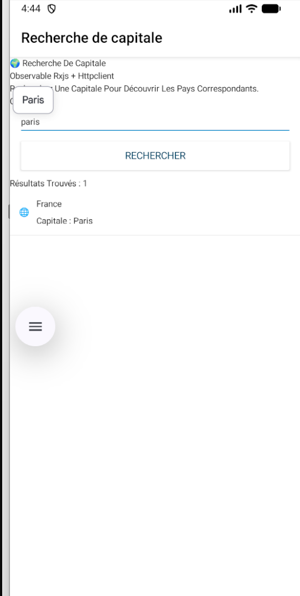
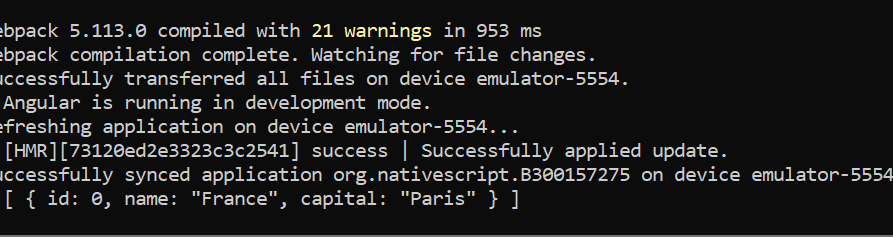
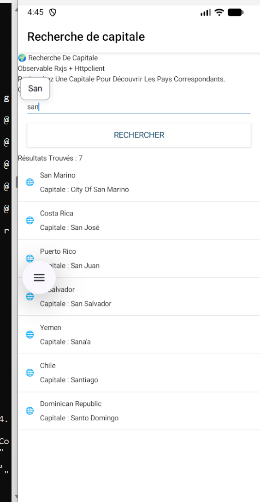
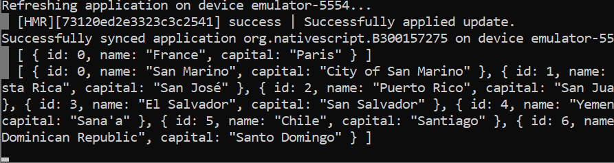

# TP 5 — RxJS : Recherche de capitales 🌍

**Étudiant :** Yahia Benkara  
**Matricule :** 300157275  
**Cours :** INF1083-200-26A-05 — Développement d’applications

## Objectif

Créer une application mobile NativeScript Angular qui recherche des pays à partir du nom d’une capitale. Le service utilise `HttpClient` et un `Observable<Country[]>` RxJS pour obtenir les résultats de l’API et les afficher dans un `ListView`.

## Résultat de l’application

### Recherche « Paris »



La recherche `Paris` renvoie **France — Paris**.



### Recherche « San »



La recherche `San` renvoie sept résultats : San Marino, Costa Rica, Puerto Rico, El Salvador, Yemen, Chili et République dominicaine.



## Création du projet

```powershell
ns create B300157275 --template @nativescript/template-tab-navigation-ng
```

Le projet se trouve dans `5.RxJS/300157275/B300157275`.

## Structure et fichiers

- `src/app/shared/country.ts` : modèle avec `id`, `name` et `capital`.
- `src/app/shared/apicall.service.ts` : service Angular qui appelle l’API des capitales.
- `src/app/search/search.component.ts` : lancement de la recherche et traitement des résultats avec `subscribe()`.
- `src/app/search/search.component.html` : champ de recherche, bouton et liste des pays.
- `src/app/search/search.module.ts` : import de `NativeScriptFormsModule`.
- `src/app/app.module.ts` : import de `NativeScriptHttpClientModule`.

## Fonctionnement RxJS

1. L’utilisateur entre une capitale dans un `TextField` lié à `name` par `[(ngModel)]`.
2. Le bouton **RECHERCHER** appelle `searchCapital()`.
3. `ApicallService` envoie une requête HTTP vers `https://countries.nexperts.nl/capital/` suivie du terme saisi.
4. `HttpClient` retourne un `Observable` ; l’opérateur `map()` transforme la réponse en objets `Country`.
5. `catchError()` intercepte les erreurs éventuelles.
6. `subscribe()` reçoit les résultats, les stocke dans `countries` et l’interface les affiche avec `ListView`.
7. `ChangeDetectorRef.detectChanges()` actualise l’affichage après la réponse HTTP.

## Vérification Android

L’application a été compilée et lancée avec :

```powershell
ns run android
```

L’émulateur Android `emulator-5554` a affiché les résultats attendus pour `Paris` et `San`. Les objets correspondants sont également visibles dans la console NativeScript.

## Difficultés et corrections

- Le composant de référence utilisait une configuration Angular standalone incompatible avec le module généré. Le composant a été adapté avec `standalone: false`, et les propriétés `imports` et `schemas` propres au composant standalone ont été retirées.
- Le fichier `search.component.css`, référencé dans `styleUrls`, a été créé.
- Les modules `NativeScriptFormsModule` et `NativeScriptHttpClientModule` ont été configurés.
- La compilation a affiché des avertissements de dépréciation Sass non bloquants.

## Conclusion

Ce TP m’a permis de pratiquer les observables RxJS, les appels HTTP, la transformation des données avec `map()`, la gestion des erreurs avec `catchError()` et l’affichage de résultats asynchrones dans une application NativeScript Angular.

## Références

- [Consignes du TP 5 — Collège Boréal](https://github.com/CollegeBoreal/INF1083-200-26A-05/tree/main/5.RxJS)
- [Exemple de structure et d’implémentation — étudiant 300150564](https://github.com/CollegeBoreal/INF1083-200-26A-05/tree/main/5.RxJS/300150564)
