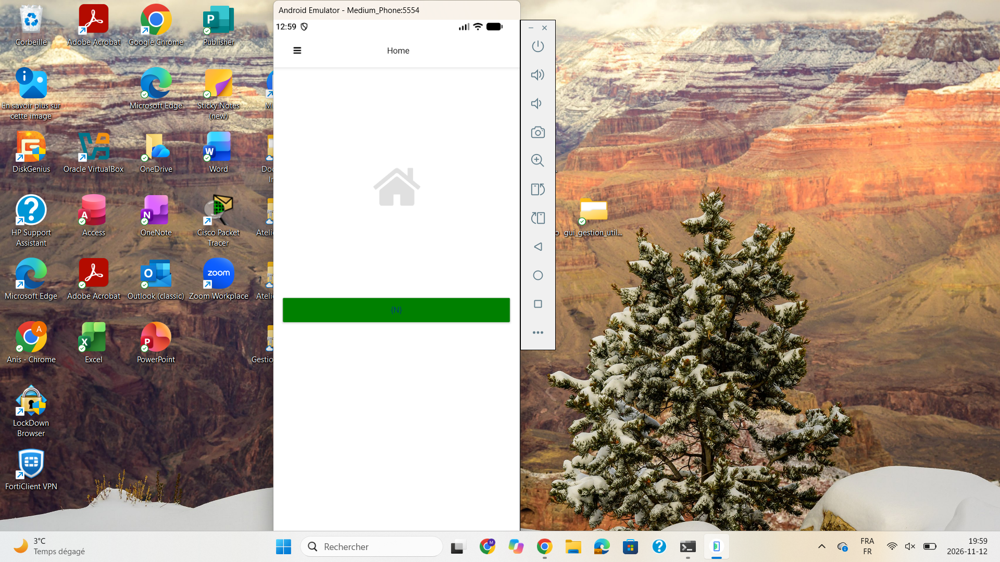
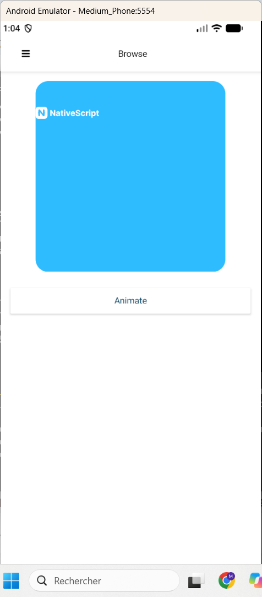

# Labo 6.Animation — INF1083

**Étudiant :** Anis Ouhocine (300151496)
**Cours :** INF1083 — Développement d'applications mobiles
**Projet :** `b300151496` (NativeScript + Angular)
**Modèle :** `@nativescript/template-drawer-navigation-ng`
**Dossier de remise :** `6.Animation/300151496/`

## 1. Objectif

Créer une application NativeScript avec deux types d'animations :

1. **Animation déclarative (CSS)** sur la page Home.
2. **Animation impérative (par code)** sur la page Browse.

## 2. Création du projet

Le projet a été créé avec la commande :

```bash
ns create b300151496 --template @nativescript/template-drawer-navigation-ng
```

Environnement : NativeScript CLI 9.1.1, Node 24.21.0, Android SDK, émulateur `Medium_Phone`.

## 3. Partie 1 — Animation déclarative (Home)

### Principe

L'animation est déclarée en CSS (aucun code TypeScript). Elle est définie par `@keyframes` dans le fichier de style du composant et appliquée à un bouton par une classe.

### Fichiers modifiés

- `src/app/home/home.component.html` : le `Label` d'origine est remplacé par un bouton `<Button text="{N}" class="background">`.
- `src/app/home/home.component.scss` (nouveau fichier) :

```scss
@keyframes bgAnimation {
    from { background-color: red; }
    to { background-color: green; }
}
.background {
    animation-name: bgAnimation;
    animation-duration: 2s;
    animation-fill-mode: forwards;
}
```

- `src/app/home/home.component.ts` : ajout de `styleUrls: ['./home.component.scss']` au décorateur `@Component` pour brancher le style.

### Résultat

Au chargement de la page Home, le bouton passe du rouge au vert en 2 secondes, puis reste vert (`forwards`).



## 4. Partie 2 — Animation impérative (Browse)

### Principe

L'animation est commandée par le code TypeScript. Un tap sur le bouton « Animate » appelle `animate(cible)`, qui enchaîne plusieurs animations sur l'image `#cible` avec des Promises.

### Fichiers modifiés

- `src/app/browse/browse.component.html` : un `StackLayout` avec un `AbsoluteLayout` bleu (300×300, coins arrondis), une `Image #cible` et un bouton « Animate ».
- `src/app/browse/browse.component.ts` : la méthode `animate()` :

```typescript
animate(view: any) {
  view
    .animate({ opacity: 0, duration: 300 })
    .then(() => view.animate({ opacity: 1, duration: 300 }))
    .then(() => view.animate({ translate: { x: 200, y: 200 }, duration: 300 }))
    .then(() => view.animate({ translate: { x: 0, y: 0 }, duration: 300 }))
    .then(() => view.animate({ scale: { x: 5, y: 5 }, duration: 300 }))
    .then(() => view.animate({ scale: { x: 1, y: 1 }, duration: 300 }))
    .then(() => view.animate({ rotate: 180, duration: 300 }))
    .then(() => view.animate({ rotate: 0, duration: 300 }))
    .then(() => console.log('Animation finished'))
    .catch((e) => console.log(e.message))
}
```

L'image fait : disparaître puis réapparaître, se déplacer en diagonale puis revenir, grandir (×5) puis revenir à taille normale, tourner de 180° puis revenir à 0°.

### Résultat

Un tap sur « Animate » anime le logo NativeScript dans le carré bleu.



## 5. Lancer l'application

```bash
cd 6.Animation/300151496/b300151496
ns run android
```

## 6. Tests effectués

| Test | Résultat |
|---|---|
| Compilation webpack | `compiled with 21 warnings`, 0 erreur |
| Home — bouton rouge → vert en 2 s, reste vert | OK (voir `images/accueil.png`) |
| Browse — tap « Animate » anime le logo | OK (voir `images/browse.png`) |
| Navigation par le tiroir (☰ → Browse) | OK |

Les 21 avertissements sont des dépréciations Sass du thème (`@import`, `map-get`), sans rapport avec le labo.

## 7. Défis rencontrés et solutions

### 7.1 Erreurs de copier-coller dans VS Code

Lors de la première tentative, le contenu des fichiers s'est mélangé dans VS Code (le SCSS s'est retrouvé dans un fichier nommé `@keyframes bgAnimation {.css`, le HTML a disparu, le TypeScript a été écrasé).

**Solution :** tout le travail a été refait de A à Z en PowerShell, avec `Set-Content` et des here-strings — aucun fichier n'a été édité à la main dans VS Code. L'ancien projet a été mis de côté (`b300151496-old`) et un projet neuf a été créé.

### 7.2 Erreur TS2345 (type `View`)

La compilation affichait : `error TS2345: Argument of type 'HTMLElement' is not assignable to parameter of type 'View'`. Le vérificateur de types actuel type la référence `#cible` comme `HTMLElement`, alors que le code du labo (écrit pour NativeScript 7) attend un `View`. Ni `$any(cible)` dans le gabarit ni le type `View` n'ont suffi.

**Solution :** le paramètre de `animate()` est typé `any` (`animate(view: any)`), et l'import inutile de `View` a été retiré. L'animation est identique à celle du labo.

### 7.3 Image `res://icon` introuvable

La page Browse affichait un carré bleu vide : l'image `res://icon` n'existe pas dans le modèle actuel (aucun fichier `icon` dans `App_Resources`). L'animation tournait donc sur une image invisible.

**Solution :** l'image est `res://logo` (le logo NativeScript, présent dans le modèle), avec une taille explicite de 100×100 pour qu'elle soit bien visible.

### 7.4 Émulateur : DLL manquantes (qemu)

Au lancement, `qemu-system-x86_64.exe` affichait trois erreurs, une après l'autre : `liblibprotobuf.dll`, puis `libglib2_windows_msvc-x86_64.dll`, puis `Qt6GuiAndroidEmu.dll` introuvables. Ces fichiers existent dans le dossier de l'émulateur, mais pas dans le dossier `qemu/windows-x86_64/` d'où `qemu` se lance.

**Solution :** copie récursive de toutes les DLL de l'émulateur dans `emulator/qemu/windows-x86_64/` (sans écraser les fichiers existants). Après cette copie, les erreurs DLL ont disparu.

### 7.5 Émulateur « offline » et application qui ne se lance pas

Après l'installation, `ns run` affichait « Application ... is not running » et l'application ne s'ouvrait pas, même en touchant son icône. L'émulateur restait « offline » pour `adb`.

**Solution :** démarrage à froid de l'émulateur (`emulator.exe -avd Medium_Phone -no-snapshot-load`), sans charger la sauvegarde (`snapshot`) `default_boot`. Après ce démarrage à froid, l'émulateur a démarré normalement et l'application s'est ouverte.

## 8. Structure du projet

```
6.Animation/300151496/
├── README.md
├── images/
│   ├── accueil.png
│   └── browse.png
└── b300151496/
    └── src/app/
        ├── home/
        │   ├── home.component.html
        │   ├── home.component.scss
        │   └── home.component.ts
        └── browse/
            ├── browse.component.html
            └── browse.component.ts
```
