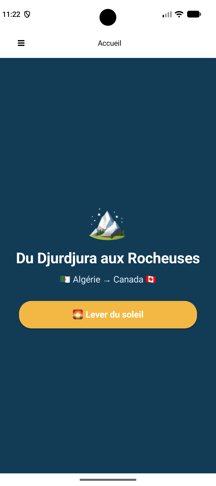
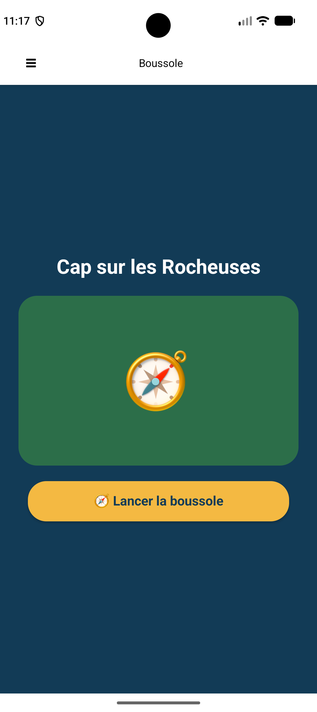
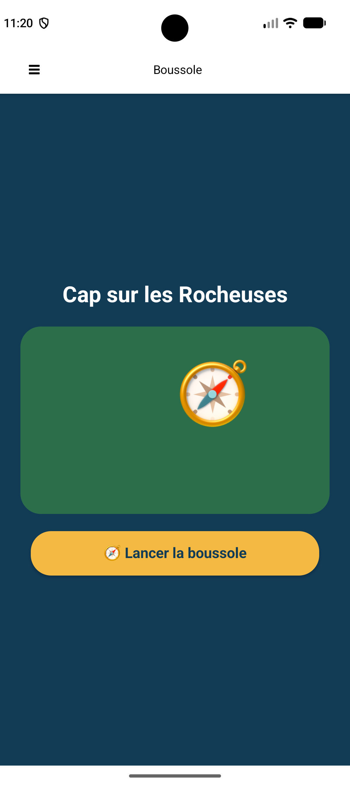
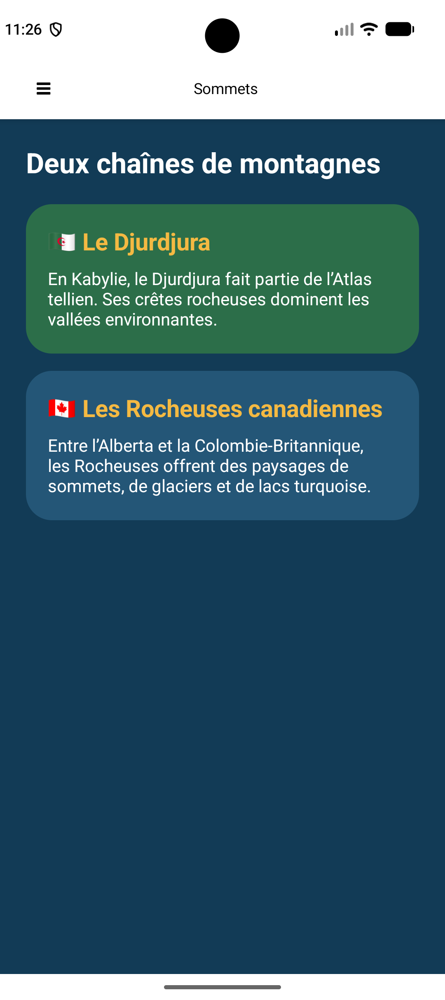
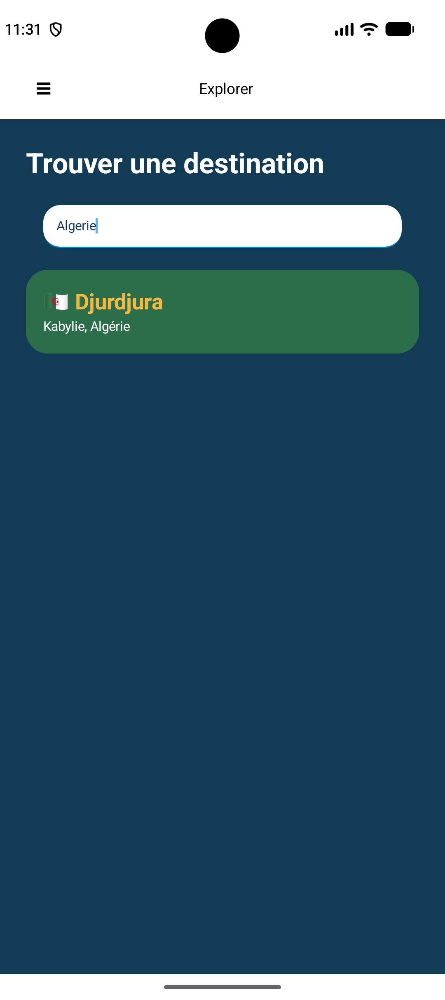
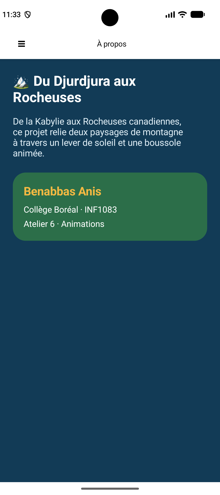
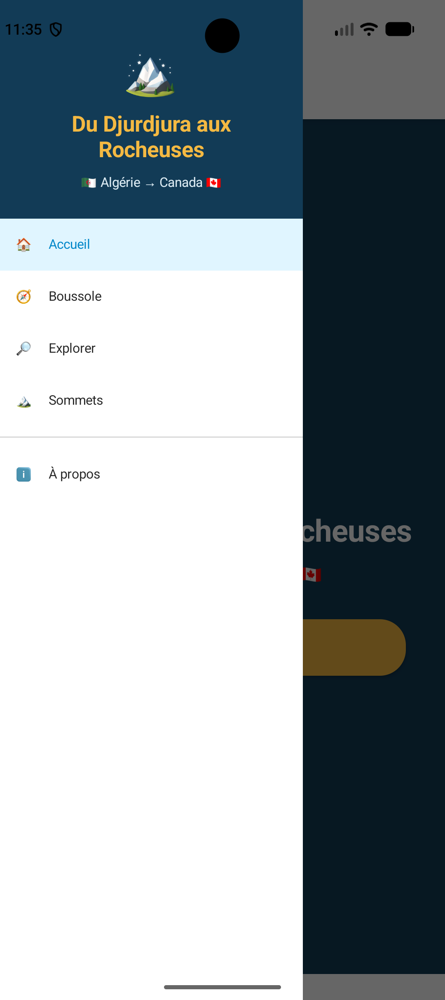

# 🏔️ Du Djurdjura aux Rocheuses

**Benabbas Anis · 300150477**  
**Collège Boréal · INF1083 · Atelier 6 — Animations**

Application mobile réalisée avec NativeScript et Angular. Le thème relie le Djurdjura, en Algérie, aux Rocheuses canadiennes à travers un lever de soleil et une boussole animée. La palette associe le bleu profond (`#123B56`), le vert sapin (`#2C6E49`) et le doré (`#F4B942`).

## Écrans et navigation

| Écran | Contenu |
| --- | --- |
| 🏠 **Accueil** | Présentation du projet et animation du bouton **Lever du soleil**. |
| 🧭 **Boussole** | Démonstration interactive lancée par le bouton **Lancer la boussole**. |
| 🔎 **Explorer** | Recherche de destinations par pays ou par chaîne de montagnes. La recherche ignore la casse et les accents. |
| 🏔️ **Sommets** | Fiches de présentation du Djurdjura et des Rocheuses canadiennes. |
| ℹ️ **À propos** | Présentation du thème, de l’auteur et de l’atelier. |

Le menu latéral donne accès aux cinq écrans et met en évidence la section active.

## Animations

- **Déclarative · SCSS** — À l’ouverture de l’accueil, le bouton **Lever du soleil** passe du bleu au doré en deux secondes grâce à `@keyframes`. Il conserve sa couleur finale.
- **Impérative · TypeScript** — Au toucher du bouton **Lancer la boussole**, une séquence d’appels à `View.animate()` fait disparaître puis réapparaître la boussole, la déplace, l’agrandit et lui fait faire un demi-tour. Elle retrouve ensuite sa position et sa taille initiales.

## Captures d’écran

| Accueil après l’animation | Boussole au repos | Boussole en mouvement |
| :---: | :---: | :---: |
|  |  |  |

| Sommets | Explorer |
| :---: | :---: |
|  |  |

| À propos | Menu latéral |
| :---: | :---: |
|  |  |

## Lancer sur Android

**Prérequis** · Node.js, la CLI NativeScript, un environnement Android configuré et un émulateur démarré.

Depuis le dossier qui contient ce README, exécuter les commandes suivantes :

```powershell
cd b300150477
npm install
ns run android
```

Pour voir l’animation SCSS, observer le bouton **Lever du soleil** au lancement. Pour jouer l’animation TypeScript, ouvrir le menu, choisir **Boussole**, puis appuyer sur **Lancer la boussole**.