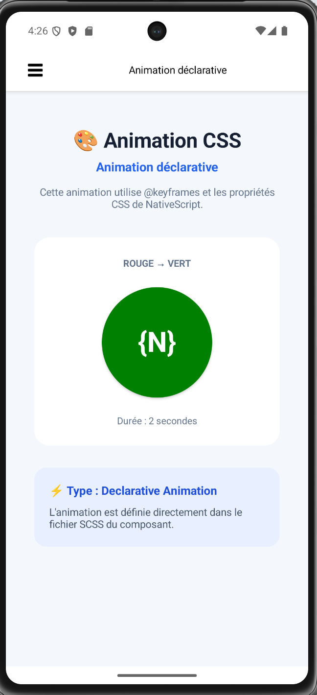
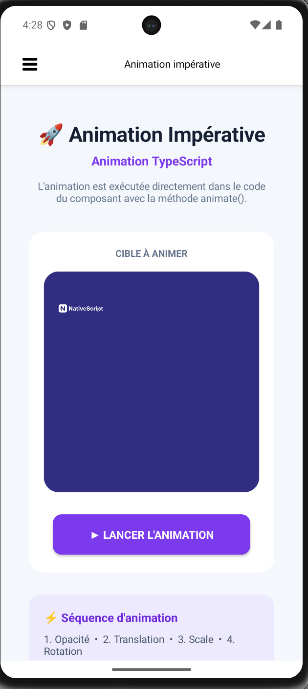
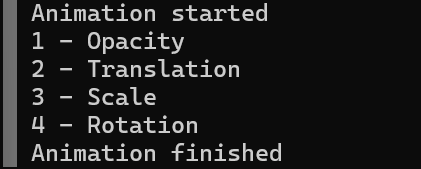

# 🎬 6.Animations — NativeScript

**Étudiant :** Ouassim Ahmed Benamira  
**Numéro étudiant :** 300150564  
**Cours :** INF1083 — Développement d'applications  
**Projet :** B300150564  

---

## 🎯 Objectif

L'objectif de ce laboratoire est de découvrir et d'implémenter deux méthodes d'animation avec **NativeScript** :

1. **Animation déclarative** avec CSS / SCSS et `@keyframes`
2. **Animation impérative** avec TypeScript et la méthode `animate()`

Le projet a été créé avec le modèle NativeScript utilisant une navigation par tiroir :

```powershell
ns create B300150564 --template @nativescript/template-drawer-navigation-ng
```

---

## 🎨 1. Animation déclarative

La première animation est réalisée dans la page **Home**.

Elle utilise une animation CSS définie avec `@keyframes`.

```scss
@keyframes bgAnimation {
    from {
        background-color: red;
        transform: scale(0.85);
    }

    to {
        background-color: green;
        transform: scale(1);
    }
}
```

L'animation est ensuite appliquée au bouton `{N}` :

```scss
.background {
    width: 150;
    height: 150;
    border-radius: 75;
    color: white;
    font-size: 38;
    font-weight: bold;

    animation-name: bgAnimation;
    animation-duration: 2s;
    animation-fill-mode: forwards;
}
```

### ⚙️ Fonctionnement

Au lancement de la page :

- le bouton commence avec une couleur rouge ;
- sa couleur change progressivement vers le vert ;
- l'animation dure **2 secondes** ;
- `animation-fill-mode: forwards` permet de conserver l'état final ;
- un léger changement d'échelle a été ajouté pour rendre l'animation plus visible.

### 📸 Résultat



---

## 🚀 2. Animation impérative

La deuxième animation est réalisée dans la page **Browse**.

Contrairement à l'animation déclarative, cette animation est contrôlée directement dans le code **TypeScript** avec la méthode `animate()`.

La cible à animer est une image NativeScript placée dans un `AbsoluteLayout`.

```html
<AbsoluteLayout
    width="300"
    height="300"
    class="animation-zone">

    <Image
        #cible
        src="res://logo"
        width="60"
        height="60"
        left="20"
        top="20"
        class="target-image">
    </Image>

</AbsoluteLayout>
```

Le bouton suivant permet de lancer l'animation :

```html
<Button
    text="▶ LANCER L'ANIMATION"
    (tap)="animate(cible)"
    class="animate-button">
</Button>
```

### ⚡ Séquence d'animation

Lorsque l'utilisateur appuie sur le bouton, plusieurs animations sont exécutées successivement :

1. diminution de l'opacité ;
2. retour de l'opacité ;
3. translation de l'image ;
4. retour à la position initiale ;
5. agrandissement avec `scale` ;
6. retour à la taille initiale ;
7. rotation à `180°` ;
8. retour à `0°`.

Chaque animation utilise une durée de **300 ms**.

Les différentes étapes sont enchaînées avec des `Promises`.

```typescript
animate(view: any): void {
    const duration = 300;

    console.log("Animation started");

    view.animate({
        opacity: 0,
        duration: duration
    })
    .then(() => {
        console.log("1 - Opacity");

        return view.animate({
            opacity: 1,
            duration: duration
        });
    })
    .then(() => {
        console.log("2 - Translation");

        return view.animate({
            translate: { x: 200, y: 200 },
            duration: duration
        });
    })
    .then(() => {
        return view.animate({
            translate: { x: 0, y: 0 },
            duration: duration
        });
    })
    .then(() => {
        console.log("3 - Scale");

        return view.animate({
            scale: { x: 5, y: 5 },
            duration: duration
        });
    })
    .then(() => {
        return view.animate({
            scale: { x: 1, y: 1 },
            duration: duration
        });
    })
    .then(() => {
        console.log("4 - Rotation");

        return view.animate({
            rotate: 180,
            duration: duration
        });
    })
    .then(() => {
        return view.animate({
            rotate: 0,
            duration: duration
        });
    })
    .then(() => {
        console.log("Animation finished");
    })
    .catch((e) => {
        console.log("Animation error:", e.message);
    });
}
```

### 📸 Interface de l'animation impérative



---

## 🖥️ Vérification dans la console

Des messages ont été ajoutés dans la console pour suivre l'exécution de l'animation :

```text
Animation started
1 - Opacity
2 - Translation
3 - Scale
4 - Rotation
Animation finished
```

Le message **`Animation finished`** confirme que toute la séquence a été exécutée correctement.

### 📸 Console



---

## 🎥 Démonstration vidéo

Une démonstration complète permet de voir les différentes étapes de l'animation impérative.

▶️ **[Voir la vidéo de l'animation](images/animation.mp4)**

La vidéo montre :

- l'opacité ;
- le déplacement ;
- l'agrandissement ;
- la rotation ;
- le retour de la cible à son état initial.

---

## ⚖️ Comparaison des deux méthodes

| Animation déclarative | Animation impérative |
|---|---|
| Définie principalement en CSS / SCSS | Définie dans le code TypeScript |
| Utilise `@keyframes` | Utilise `animate()` |
| Simple à mettre en place | Permet un contrôle plus précis |
| Adaptée aux effets visuels simples | Adaptée aux séquences plus complexes |
| Déclenchée automatiquement | Déclenchée par un bouton |
| Peu de logique TypeScript nécessaire | Plusieurs étapes peuvent être enchaînées |
| Utilise les propriétés d'animation CSS | Utilise des `Promises` |

---

## ✨ Améliorations apportées

En plus des éléments demandés dans le laboratoire, plusieurs améliorations ont été ajoutées tout en conservant les concepts principaux demandés.

### 🎨 Interface

- interface plus claire et moderne ;
- titres pour identifier les deux types d'animation ;
- descriptions directement dans l'application ;
- cartes visuelles pour séparer les démonstrations ;
- couleurs différentes pour les deux types d'animation ;
- bouton personnalisé pour lancer l'animation impérative.

### 🟢 Animation déclarative

- ajout d'un léger effet `scale` ;
- bouton circulaire plus grand ;
- indication de la durée de l'animation ;
- explication du type d'animation directement dans l'interface.

### 🚀 Animation impérative

- création d'une zone dédiée à la cible ;
- utilisation du logo NativeScript comme cible ;
- fond violet foncé pour améliorer la visibilité du logo blanc ;
- affichage de la séquence d'animation dans l'interface ;
- messages dans la console pour vérifier chaque étape ;
- gestion des erreurs avec `.catch()`.

### 📚 Documentation

- captures des deux interfaces ;
- capture de la console ;
- démonstration vidéo de l'animation complète ;
- comparaison entre les deux méthodes d'animation.

---

## 🛠️ Adaptation à la version actuelle

Le projet utilise une version récente de **NativeScript** et **Angular**.

La structure générée par le modèle actuel utilise les composants Angular modernes. Les fichiers du projet ont donc été adaptés à cette structure tout en conservant les concepts demandés dans le laboratoire.

Les composants utilisent notamment :

```typescript
imports: [NativeScriptCommonModule],
schemas: [NO_ERRORS_SCHEMA]
```

Les composants `HomeComponent` et `BrowseComponent` sont ensuite intégrés dans leurs modules respectifs.

Pour l'animation impérative, la cible provenant du template représente la vue NativeScript animée pendant l'exécution.

L'application Android est exécutée avec **Java 17**.

Pendant la compilation, certains avertissements de dépréciation Sass peuvent être affichés par le thème NativeScript. Ils n'empêchent pas la compilation ni le fonctionnement de l'application.

---

## 📁 Structure du travail

```text
300150564/
│
├── README.md
│
├── images/
│   ├── .gitkeep
│   ├── 01-animation-declarative.png
│   ├── 02-animation-imperative.png
│   ├── 03-animation-console.png
│   └── animation.mp4
│
└── B300150564/
    │
    └── src/
        └── app/
            │
            ├── home/
            │   ├── home.component.html
            │   ├── home.component.scss
            │   ├── home.component.ts
            │   └── home.module.ts
            │
            └── browse/
                ├── browse.component.html
                ├── browse.component.scss
                ├── browse.component.ts
                └── browse.module.ts
```

---

## 📚 Concepts utilisés

Ce laboratoire utilise les concepts suivants :

- NativeScript
- Angular
- TypeScript
- HTML NativeScript
- SCSS
- `@keyframes`
- `animation-name`
- `animation-duration`
- `animation-fill-mode`
- `animate()`
- Promises
- `AbsoluteLayout`
- Opacity
- Translation
- Scale
- Rotation
- Gestion des événements `(tap)`
- Console de débogage

---

## ✅ Résultat

Les deux méthodes d'animation fonctionnent correctement.

### Animation déclarative

**Rouge → Vert**

### Animation impérative

**Opacity → Translation → Scale → Rotation → Animation finished**

Les captures d'écran et la vidéo permettent de vérifier visuellement le fonctionnement des deux animations.

---

## 📝 Conclusion

Ce laboratoire m'a permis de comprendre la différence entre une animation **déclarative** et une animation **impérative** dans NativeScript.

L'animation déclarative avec CSS est simple et pratique pour créer des effets visuels, tandis que l'animation impérative avec TypeScript permet de contrôler précisément plusieurs étapes et de créer des séquences plus complexes.

Les deux méthodes peuvent être utilisées selon les besoins de l'application.