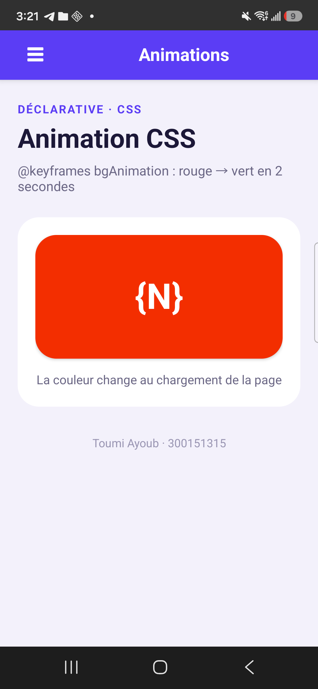
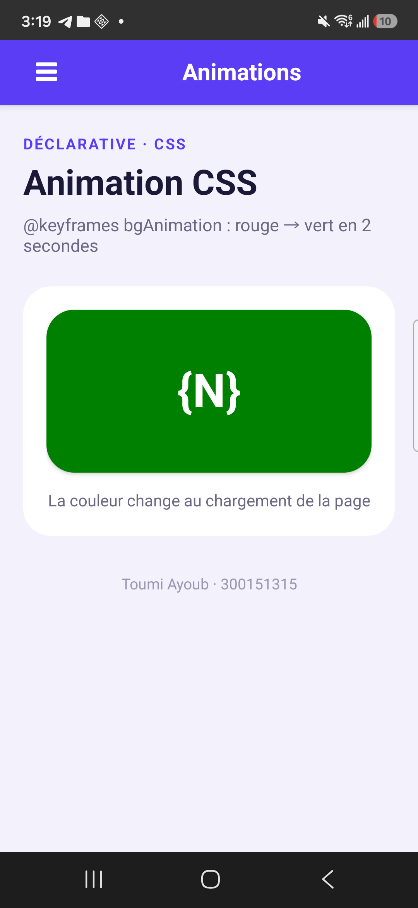
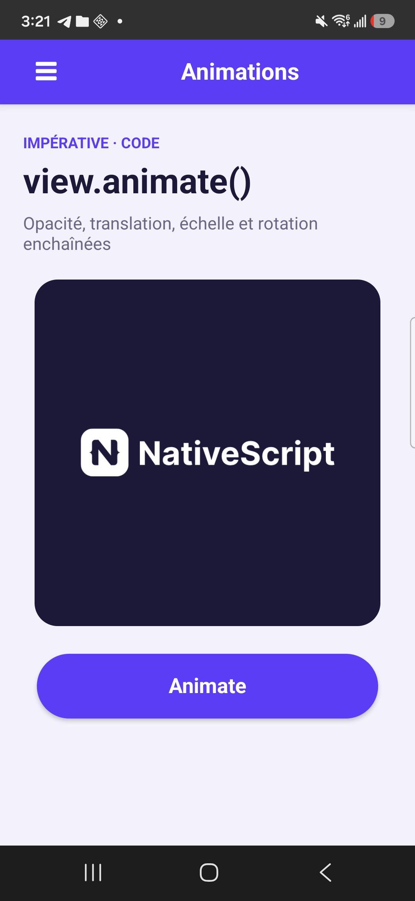
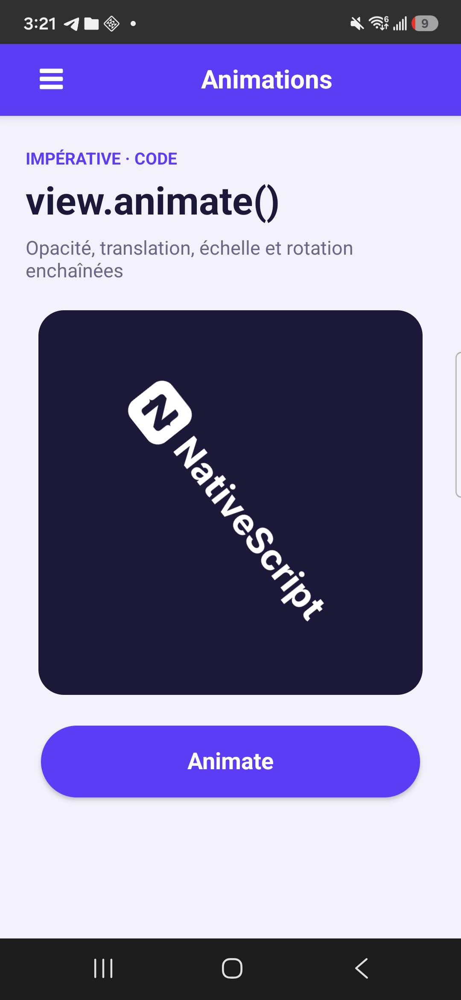

# 300151315 - Animations

Application créée par **Toumi Ayoub**.

## Description
Application mobile NativeScript (Angular) `b300151315` avec un tiroir de navigation (drawer). Elle montre les deux types d'animations :

| Page | Type | Ce qui est animé |
|------|------|------------------|
| **Home** | Déclarative (CSS) | Le bouton `{N}` passe du rouge au vert en 2 secondes (`@keyframes`) |
| **Browse** | Impérative (code) | Le logo disparaît, réapparaît, se déplace, grossit et tourne avec `view.animate()` |

## Création du projet
NativeScript, Android Studio et le SDK Android étaient déjà installés depuis les laboratoires précédents.

```
ns create b300151315 --template @nativescript/template-drawer-navigation-ng
cd b300151315
code .
```

## Exécution
```
ns run android
```

## 🅰️ Animation déclarative (CSS) : composant `Home`

`home.component.html` : le texte d'exemple est remplacé par le bouton :
```html
<Button text="{N}" class="background"></Button>
```

`home.component.scss` (nouveau fichier) :
```css
@keyframes bgAnimation {
    from { background-color: red; }
    to { background-color: green; }
}
.background {
    animation-name: bgAnimation;
    animation-duration: 2s;
    animation-fill-mode: forwards;
}
```

`home.component.ts` : ajout de `styleUrls` :
```typescript
@Component({
  standalone: false,
  selector: 'Home',
  templateUrl: './home.component.html',
  styleUrls: ['./home.component.scss'],
})
```

| Début (rouge) | Fin (vert) |
|---|---|
|  |  |

## 🅱️ Animation impérative (code) : composant `Browse`

`browse.component.html` :
```html
<AbsoluteLayout width="300" height="300" class="stage" borderRadius="20">
  <Image #cible src="res://logo" width="220" height="80" left="40" top="110" stretch="aspectFit"></Image>
</AbsoluteLayout>
<Button text="Animate" (tap)="animate(cible)" class="btn-animate"></Button>
```

`browse.component.ts` : la méthode `animate()` enchaîne les animations avec des promesses (`.then()`) :
```typescript
animate(cible: unknown) {
  const view = cible as View
  let duration = 300
  view.animate({ opacity: 0, duration: duration })
    .then(() => view.animate({ opacity: 1, duration: duration }))
    .then(() => view.animate({ translate: { x: 200, y: 200 }, duration: duration }))
    .then(() => view.animate({ translate: { x: 0, y: 0 }, duration: duration }))
    .then(() => view.animate({ scale: { x: 5, y: 5 }, duration: duration }))
    .then(() => view.animate({ scale: { x: 1, y: 1 }, duration: duration }))
    .then(() => view.animate({ rotate: 180, duration: duration }))
    .then(() => view.animate({ rotate: 0, duration: duration }))
    .then(() => {
      console.log('Animation finished')
    })
    .catch((e) => {
      console.log(e.message)
    })
}
```

| Avant | Pendant la rotation |
|---|---|
|  |  |

Console (`adb logcat`) à la fin de l'animation :
```
I JS      : CONSOLE LOG: Animation finished
```

## Design
J'ai ajouté un style personnel aux deux pages : barre violette, fond clair, titres, carte blanche pour le bouton CSS, scène sombre pour le logo et bouton **Animate** arrondi. Les éléments demandés par le laboratoire (`Button` `{N}` avec la classe `background`, `AbsoluteLayout` 300 × 300, `Image #cible`, bouton `Animate`) sont gardés.

## Problèmes rencontrés et solutions

| Problème | Solution |
|----------|----------|
| `TS2345: Argument of type 'HTMLElement' is not assignable to parameter of type 'View'` | Angular vérifie les types du template : `animate(cible: unknown)` puis `const view = cible as View` |
| L'image `res://icon` ne s'affiche pas | Ce modèle n'a pas d'image `icon` dans `App_Resources` : utilisation de `res://logo` |
| Logo blanc invisible sur fond blanc | Scène de fond sombre (`#1c1838`) |
| Barre de titre illisible (téléphone en mode sombre) | Couleurs propres à la barre (fond violet, texte blanc) |
| Mes autres labos NativeScript sont sur le même téléphone | Identifiant propre : `org.nativescript.animations.b300151315` dans `nativescript.config.ts` |
| `gradlew.bat` introuvable pendant le build | Variable `NoDefaultCurrentDirectoryInExePath` retirée de la session |
