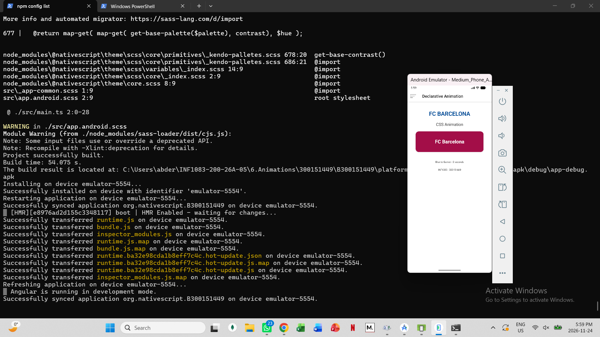
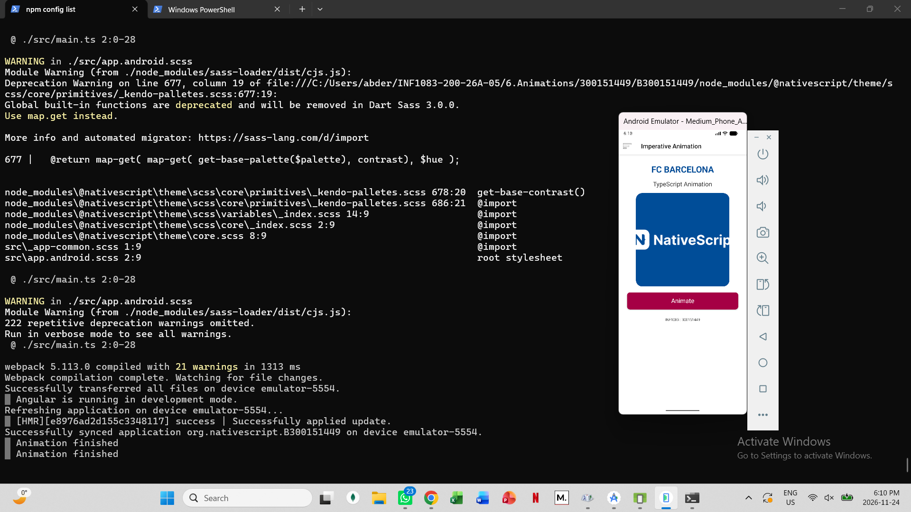

# 6. Animations — INF1083

- Étudiant : 300151449
- Projet : B300151449
- Technologies : NativeScript, Angular, TypeScript et SCSS

## Objectif

Réaliser deux types d’animations dans une application mobile avec navigation latérale.

## Animation déclarative (Home)

Une animation CSS utilisant `@keyframes` change la couleur du bouton FC Barcelona du bleu au grenat en deux secondes.



## Animation impérative (Browse)

Le bouton Animate déclenche une séquence d’animations TypeScript : opacité, déplacement, agrandissement et rotation, puis retour à l’état initial. La ressource `res://logo` remplace `res://icon`, absente du modèle installé.

La console affiche `Animation finished` à la fin de la séquence.



## Exécution

Depuis le dossier étudiant :

```powershell
cd B300151449
npm.cmd install
ns.cmd run android
```

## Résultat

L’application a été compilée et exécutée sur un émulateur Android. Les avertissements de dépréciation Sass n’ont pas empêché son exécution.
