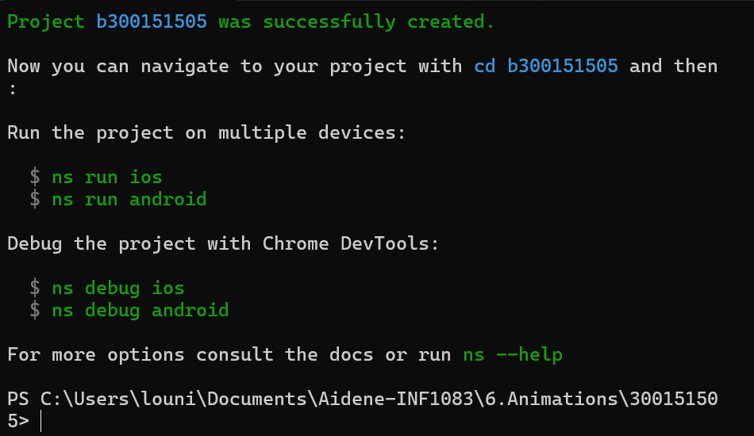
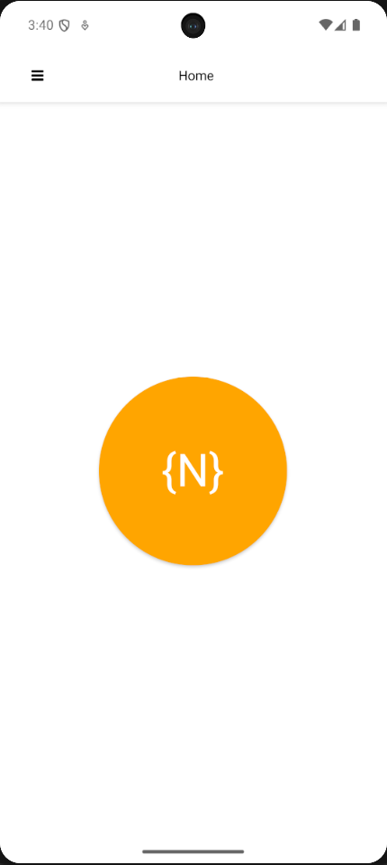
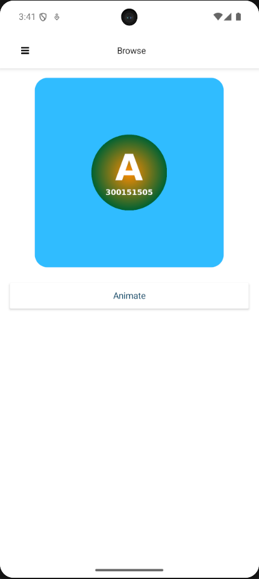
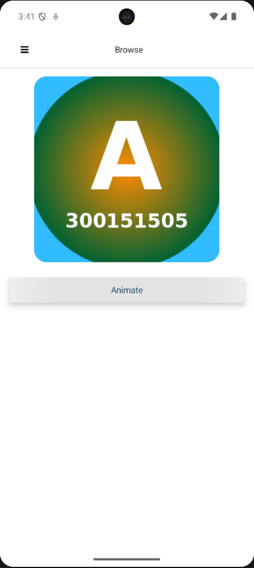
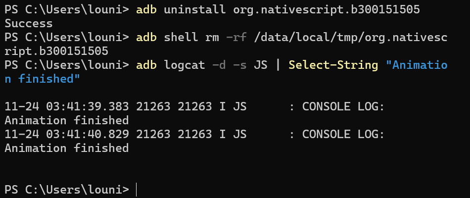

# 🎬 Animations — INF1083

**Étudiant :** Aidene Arezki  
**Matricule :** 300151505  
**GitHub :** [300151505](https://github.com/300151505)  
**Cours :** INF1083 — Développement d'applications  
**Session :** Automne 2026  

> ℹ️ Travail réalisé sur l'ordinateur d'un ami (session Windows `louni`), avec mon propre dépôt et mon compte GitHub.

---

## 🎯 Objectif

Réaliser deux types d'animations dans une application **NativeScript Angular** avec menu tiroir (*drawer*) :

| Type | Page | Principe |
|---|---|---|
| 🎨 **Déclarative** | **Home** | règles `@keyframes` dans un fichier `.scss` |
| ⚙️ **Impérative** | **Browse** | appels `view.animate()` enchaînés dans le code TypeScript |

Projet : **`b300151505`** (modèle *drawer-navigation-ng*, NativeScript 9 + Angular 22, Pixel 7 — Android 15)

## ▶️ Exécuter le projet

```powershell
cd 6.Animations\300151505\b300151505
npm install
ns run android
```

Puis ouvrir le menu **☰ → Browse** et toucher **Animate**.

---

## 🏗️ 1. Création du projet

```powershell
cd 6.Animations\300151505
ns create b300151505 --template @nativescript/template-drawer-navigation-ng
```



> Mon projet RxJS s'appelait aussi `b300151505` (même identifiant Android). Pour éviter un écran blanc, je l'ai d'abord désinstallé de l'émulateur :
> ```powershell
> adb uninstall org.nativescript.b300151505
> adb shell rm -rf /data/local/tmp/org.nativescript.b300151505
> ```

---

## 🎨 2. Animation déclarative (CSS) — page Home

### `home.component.html`

```html
<GridLayout class="page__content">
  <Button text="{N}" class="background"></Button>
</GridLayout>
```

### `home.component.scss`

J'ai choisi une animation du **bleu vers l'orange** :

```scss
@keyframes bgAnimation {
    from { background-color: blue; }
    to { background-color: orange; }
}

.background {
    animation-name: bgAnimation;
    animation-duration: 2s;
    animation-fill-mode: forwards;
    width: 200;
    height: 200;
    border-radius: 100;
    font-size: 48;
    color: white;
}
```

| Propriété | Rôle |
|---|---|
| `@keyframes bgAnimation` | décrit les étapes de l'animation (`from` → `to`) |
| `animation-duration: 2s` | durée de 2 secondes |
| `animation-fill-mode: forwards` | le bouton **garde la couleur finale** (orange) |
| `border-radius: 100` | rend le bouton rond (moitié de la largeur) |

Le fichier de style est relié au composant dans `home.component.ts` :

```typescript
styleUrls: ['./home.component.scss'],
```

### ✅ Résultat : le bouton `{N}` termine en orange



---

## ⚙️ 3. Animation impérative — page Browse

### `browse.component.html`

```html
<StackLayout>
  <AbsoluteLayout width="300" height="300" class="bg-primary m-15" borderRadius="20">
    <Image #cible src="~/assets/aidene.png" width="120" height="120" left="90" top="90"></Image>
  </AbsoluteLayout>
  <Button text="Animate" (tap)="animate(cible)" class="btn btn-primary btn-active"></Button>
</StackLayout>
```

- L'image `src/assets/aidene.png` est **mon image** (lettre « A » et mon matricule).
- `#cible` est une **référence de template** : le bouton envoie l'image à la méthode `animate()`.

### `browse.component.ts`

```typescript
animate(cible: unknown) {
  const view = cible as View
  let duration = 300
  view
    .animate({ opacity: 0, duration: duration })
    .then(() => view.animate({ opacity: 1, duration: duration }))
    .then(() => view.animate({ translate: { x: 200, y: 200 }, duration: duration }))
    .then(() => view.animate({ translate: { x: 0, y: 0 }, duration: duration }))
    .then(() => view.animate({ scale: { x: 5, y: 5 }, duration: duration }))
    .then(() => view.animate({ scale: { x: 1, y: 1 }, duration: duration }))
    .then(() => view.animate({ rotate: 180, duration: duration }))
    .then(() => view.animate({ rotate: 0, duration: duration }))
    .then(() => {
      console.log('Animation finished')
    })
    .catch((e) => {
      console.log(e.message)
    })
}
```

`view.animate()` retourne une **Promise** : chaque `.then()` attend la fin de l'étape précédente.

| Étapes | Propriété | Effet |
|---|---|---|
| 1-2 | `opacity` 0 → 1 | l'image disparaît puis réapparaît |
| 3-4 | `translate` (200, 200) → (0, 0) | elle glisse en bas à droite puis revient |
| 5-6 | `scale` ×5 → ×1 | elle grossit 5 fois puis revient |
| 7-8 | `rotate` 180° → 0° | demi-tour puis retour |

> Angular 22 vérifie les types du template : la référence `#cible` est vue comme un `HTMLElement`. Le paramètre est donc déclaré `unknown`, puis converti en `View` NativeScript (`cible as View`).

### ✅ Résultat

| Avant l'animation | Pendant l'animation (`scale ×5`) |
|---|---|
|  |  |

Console (lue avec `adb logcat`) : `Animation finished` à la fin de chaque animation.

```powershell
adb logcat -d -s JS | Select-String "Animation finished"
```



---

## 📝 Conclusion

J'ai comparé deux façons d'animer une interface. L'animation **déclarative** est simple : on décrit le début et la fin en CSS, et NativeScript s'occupe du reste. L'animation **impérative** donne plus de contrôle : on enchaîne plusieurs étapes avec des Promises et on peut exécuter du code à la fin (ici, un message dans la console).
