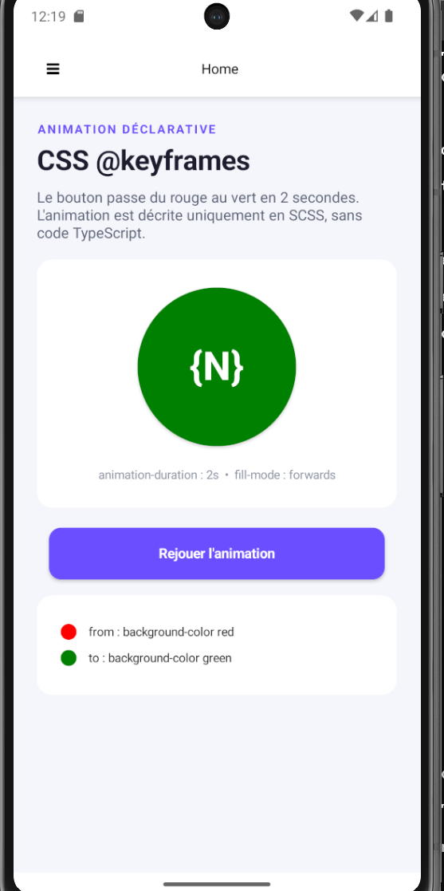
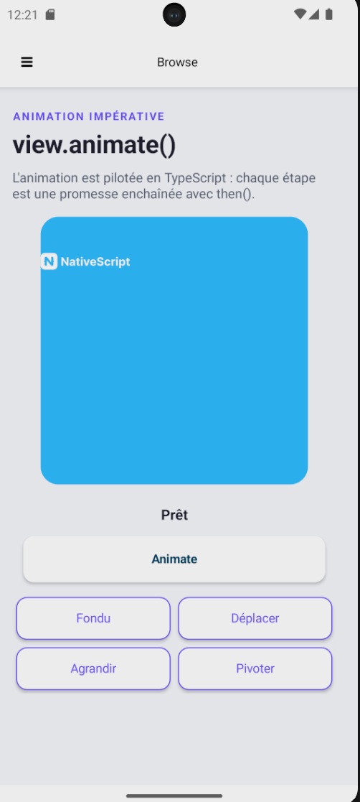
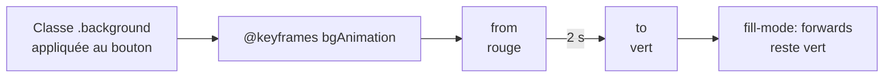
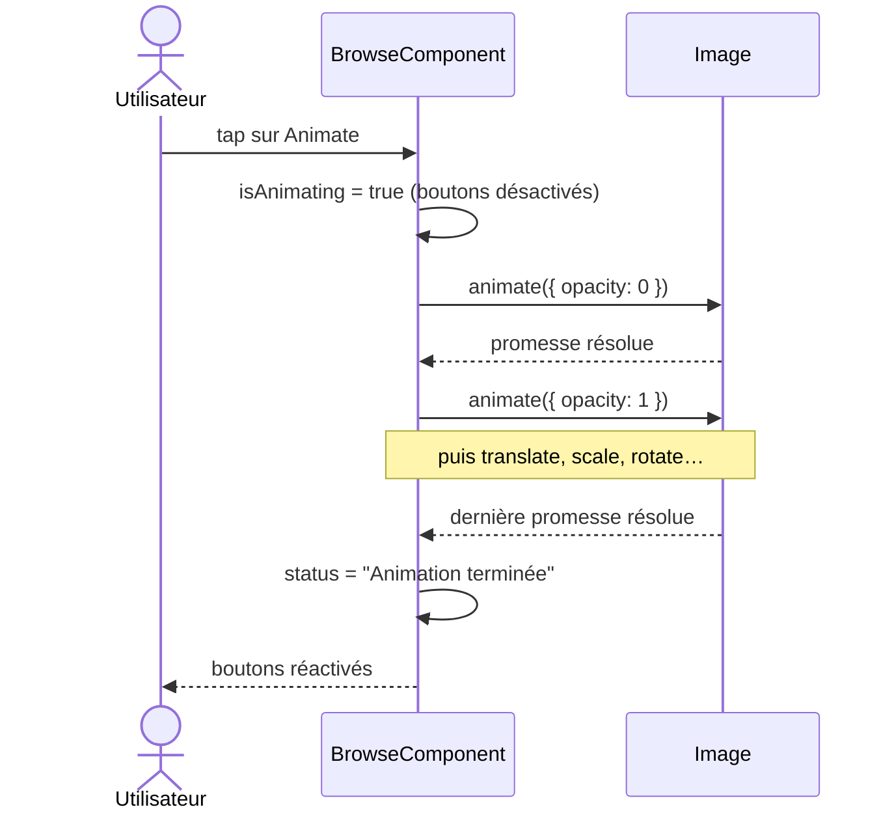

<div align="center">

# :clown_face: Animations NativeScript

### Animer une application mobile en **CSS** et en **TypeScript**


**Lounes Allouti** · :id: 300151781 · :octocat: [@lounesallouti](https://github.com/lounesallouti)
<br>
INF1083 — Labo 6 : Animations · Collège Boréal

[Aperçu](#camera-aperçu) ·
[Comparaison](#scales-css-ou-code-) ·
[CSS](#a-animation-déclarative-css) ·
[Code](#b-animation-impérative-code) ·
[Problèmes](#wrench-problèmes-rencontrés-et-solutions) ·
[Lancer](#rocket-lancer-le-projet)

</div>

---

## :zap: En bref

<table>
  <tr>
    <td align="center" width="25%"><h3>2</h3>types d'animation<br><sub>CSS et TypeScript</sub></td>
    <td align="center" width="25%"><h3>5</h3>animations<br><sub>1 séquence + 4 étapes</sub></td>
    <td align="center" width="25%"><h3>2,4 s</h3>séquence complète<br><sub>8 étapes × 300 ms</sub></td>
    <td align="center" width="25%"><h3>4</h3>problèmes résolus<br><sub>documentés plus bas</sub></td>
  </tr>
</table>

> [!NOTE]
> Le projet complet est dans le dossier [`b300151781`](b300151781) (template `drawer-navigation-ng`).
> Tout ce que demande l'énoncé est présent, avec des [améliorations](#sparkles-au-delà-de-lénoncé) en plus.

---

## :camera: Aperçu

<table>
  <tr>
    <th width="50%">:a: Home — animation CSS</th>
    <th width="50%">:b: Browse — animation en code</th>
  </tr>
  <tr>
    <td align="center"></td>
    <td align="center"></td>
  </tr>
  <tr>
    <td>Le bouton <code>{N}</code> passe du <b>rouge</b> au <b>vert</b> en 2 secondes, sans une seule ligne de TypeScript. <b>Rejouer l'animation</b> la relance.</td>
    <td><b>Animate</b> enchaîne fondu, déplacement, agrandissement et rotation. Les 4 boutons lancent chaque étape séparément, avec un <b>statut en direct</b>.</td>
  </tr>
</table>

---

## :scales: CSS ou code ?

| Critère | :a: Déclarative (CSS) | :b: Impérative (code) |
|---|---|---|
| **Fichier** | `home.component.scss` | `browse.component.ts` |
| **Syntaxe** | `@keyframes` + `animation-name` | `view.animate({ ... })` |
| **Déclenchement** | Automatique, à l'application de la classe | Au toucher d'un bouton (`tap`) |
| **Enchaînement** | `from` → `to` | Promesses enchaînées avec `then()` |
| **Contrôle** | Limité (durée, délai, répétition) | Total (logique, conditions, état) |
| **Idéal pour** | Effets visuels simples et répétitifs | Séquences complexes et interactives |

> [!TIP]
> **Règle simple :** si l'animation ne dépend d'aucune logique, on l'écrit en CSS. Dès qu'il faut réagir à
> l'utilisateur ou enchaîner des étapes, on passe au code.

---

## :file_folder: Architecture

```text
b300151781/
├── nativescript.config.ts            identifiant Android unique
└── src/app/
    ├── home/                         :a: animation CSS
    │   ├── home.component.html       bouton {N} + bouton Rejouer
    │   ├── home.component.scss       @keyframes bgAnimation       (nouveau)
    │   └── home.component.ts         styleUrls + replay()
    └── browse/                       :b: animation en code
        ├── browse.component.html     scène, statut, Animate + 4 étapes
        ├── browse.component.scss     design de la page            (nouveau)
        └── browse.component.ts       animate(), fade(), move(), zoom(), spin()
```

---

## :a: Animation déclarative (CSS)

### Le principe



### Le style — [`home.component.scss`](b300151781/src/app/home/home.component.scss)

```scss
@keyframes bgAnimation {
  from {
    background-color: red;
  }
  to {
    background-color: green;
  }
}

.background {
  animation-name: bgAnimation;
  animation-duration: 2s;
  animation-fill-mode: forwards;
}
```

| Propriété | Rôle |
|---|---|
| `@keyframes bgAnimation` | Décrit les étapes de l'animation |
| `animation-name` | Associe l'animation à la classe `.background` |
| `animation-duration: 2s` | Durée totale |
| `animation-fill-mode: forwards` | Conserve l'état final (vert) |

### Relier le style au composant — [`home.component.ts`](b300151781/src/app/home/home.component.ts)

```typescript
@Component({
  standalone: false,
  selector: 'Home',
  templateUrl: './home.component.html',
  styleUrls: ['./home.component.scss'],
})
```

> [!IMPORTANT]
> Sans `styleUrls`, le fichier SCSS n'est jamais chargé et le bouton reste gris.

<details>
<summary><b>Voir le bouton « Rejouer l'animation »</b></summary>

<br>

Une animation CSS ne joue qu'une fois, au moment où la classe est appliquée. Pour la relancer, on retire
la classe puis on la remet :

```html
<Button #nButton text="{N}" class="background"></Button>
<Button text="Rejouer l'animation" class="btn-replay" (tap)="replay(nButton)"></Button>
```

```typescript
replay(target: any): void {
  const button = target as View
  button.className = ''
  setTimeout(() => (button.className = 'background'), 50)
}
```

</details>

---

## :b: Animation impérative (code)

### Le principe

Chaque appel à `view.animate()` retourne une **promesse**. L'étape suivante ne démarre qu'à la fin de la
précédente, grâce à `then()`.



### La chronologie de la séquence

| # | Étape | Propriété | Valeur | Temps |
|:-:|---|---|---|---|
| 1 | Fondu | `opacity` | `0` | 0 → 300 ms |
| 2 | Fondu | `opacity` | `1` | 300 → 600 ms |
| 3 | Déplacement | `translate` | `{ x: 200, y: 200 }` | 600 → 900 ms |
| 4 | Déplacement | `translate` | `{ x: 0, y: 0 }` | 900 → 1 200 ms |
| 5 | Agrandissement | `scale` | `{ x: 5, y: 5 }` | 1 200 → 1 500 ms |
| 6 | Agrandissement | `scale` | `{ x: 1, y: 1 }` | 1 500 → 1 800 ms |
| 7 | Rotation | `rotate` | `180` | 1 800 → 2 100 ms |
| 8 | Rotation | `rotate` | `0` | 2 100 → 2 400 ms |

### Le code — [`browse.component.ts`](b300151781/src/app/browse/browse.component.ts)

```typescript
animate(target: any) {
  // #cible est typé HTMLElement par Angular : on le convertit en View NativeScript
  const view = target as View
  const duration = this.duration
  const curve = this.curve
  this.start('Fondu')
  view
    .animate({ opacity: 0, duration, curve })
    .then(() => view.animate({ opacity: 1, duration, curve }))
    .then(() => (this.status = 'Déplacement'))
    .then(() => view.animate({ translate: { x: 200, y: 200 }, duration, curve }))
    .then(() => view.animate({ translate: { x: 0, y: 0 }, duration, curve }))
    .then(() => (this.status = 'Agrandissement'))
    .then(() => view.animate({ scale: { x: 5, y: 5 }, duration, curve }))
    .then(() => view.animate({ scale: { x: 1, y: 1 }, duration, curve }))
    .then(() => (this.status = 'Rotation'))
    .then(() => view.animate({ rotate: 180, duration, curve }))
    .then(() => view.animate({ rotate: 0, duration, curve }))
    .then(() => this.finish())
    .catch((e) => this.fail(e))
}
```

<details>
<summary><b>Voir les 4 étapes individuelles (factorisées)</b></summary>

<br>

Plutôt que de répéter le même code 4 fois, une méthode privée `run()` joue une animation « aller » puis
« retour » :

```typescript
fade(target: any) {
  this.run(target, 'Fondu', { opacity: 0 }, { opacity: 1 })
}

move(target: any) {
  this.run(target, 'Déplacement', { translate: { x: 200, y: 200 } }, { translate: { x: 0, y: 0 } })
}

zoom(target: any) {
  this.run(target, 'Agrandissement', { scale: { x: 5, y: 5 } }, { scale: { x: 1, y: 1 } })
}

spin(target: any) {
  this.run(target, 'Rotation', { rotate: 180 }, { rotate: 0 })
}

private run(target: any, label: string, to: object, back: object) {
  const view = target as View
  this.start(label)
  view
    .animate({ ...to, duration: this.duration, curve: this.curve })
    .then(() => view.animate({ ...back, duration: this.duration, curve: this.curve }))
    .then(() => this.finish())
    .catch((e) => this.fail(e))
}
```

</details>

<details>
<summary><b>Voir le template de la page Browse</b></summary>

<br>

```html
<AbsoluteLayout width="300" height="300" class="bg-primary m-15 stage" borderRadius="20">
  <Image #cible src="res://logo" left="75" top="100" width="150" height="100" stretch="aspectFit"></Image>
</AbsoluteLayout>

<Label class="status" [text]="status"></Label>

<Button text="Animate" (tap)="animate(cible)" [isEnabled]="!isAnimating" class="btn-main"></Button>

<GridLayout columns="*, *" rows="auto, auto" class="actions">
  <Button row="0" col="0" text="Fondu" class="btn-step" [isEnabled]="!isAnimating" (tap)="fade(cible)"></Button>
  <Button row="0" col="1" text="Déplacer" class="btn-step" [isEnabled]="!isAnimating" (tap)="move(cible)"></Button>
  <Button row="1" col="0" text="Agrandir" class="btn-step" [isEnabled]="!isAnimating" (tap)="zoom(cible)"></Button>
  <Button row="1" col="1" text="Pivoter" class="btn-step" [isEnabled]="!isAnimating" (tap)="spin(cible)"></Button>
</GridLayout>
```

La **variable de template** `#cible` donne accès à l'image depuis le composant.

</details>

---

## :sparkles: Au-delà de l'énoncé

| | Amélioration | Pourquoi |
|:-:|---|---|
| :repeat: | Bouton **Rejouer l'animation** | Revoir l'animation CSS sans relancer l'application |
| :control_knobs: | **4 boutons d'étapes** | Observer chaque propriété animée séparément |
| :satellite: | **Statut en direct** | Savoir à tout moment quelle étape est en cours |
| :no_entry: | Boutons **désactivés pendant l'animation** | Empêcher deux animations simultanées |
| :chart_with_upwards_trend: | Courbe **`easeInOut`** | Mouvements naturels : accélération puis ralentissement |
| :recycle: | Méthode **`run()`** factorisée | Pas de code dupliqué entre les 4 étapes |
| :art: | **Design** en cartes, palette violette cohérente | Interface lisible et professionnelle |

---

## :wrench: Problèmes rencontrés et solutions

| Problème | Cause | Solution |
|---|---|---|
| L'image `res://icon` ne s'affiche pas | Le template récent ne contient plus cette ressource | Utilisation de `res://logo` |
| `HTMLElement is not assignable to View` à la compilation | Angular type `#cible` comme un élément HTML | Paramètre `target: any`, converti avec `as View` |
| `Application ... is not running`, l'ancienne application RxJS s'ouvre | Les deux projets `b300151781` partageaient le **même identifiant Android** | Identifiant unique `org.nativescript.b300151781.animations`, puis `ns clean` |
| L'émulateur refuse de démarrer | Disque presque plein (0,2 Go libre) | Espace libéré jusqu'à plus de 50 Go |

> [!WARNING]
> Deux applications avec le même identifiant (`id` dans `nativescript.config.ts`) se **remplacent** sur
> l'appareil. Chaque projet doit avoir le sien.

---

## :rocket: Lancer le projet

```bash
cd b300151781
npm install
ns run android
```

| Prérequis | Version utilisée |
|---|---|
| NativeScript CLI | 9.1.2 |
| `@nativescript/core` | 9.1 |
| Angular | 22 |
| Émulateur | Android Pixel 7 |

> [!NOTE]
> Le dossier `node_modules` n'est pas versionné : `npm install` le recrée.

---

## :bulb: Ce que j'ai appris

- [x] Une animation **CSS** se déclare avec `@keyframes` et s'active en appliquant une classe.
- [x] Une animation **en code** s'écrit avec `view.animate()` et s'enchaîne avec des **promesses**.
- [x] Une **variable de template** (`#cible`) permet de manipuler une vue depuis le composant.
- [x] Désactiver l'interface pendant une animation évite les états incohérents.
- [x] Chaque application Android doit avoir un **identifiant unique**.

---

## :books: Références

- [NativeScript — Animations](https://docs.nativescript.org/guide/animations)
- [NativeScript — CSS Animations (v7)](https://v7.docs.nativescript.org/ui/animation-css)
- [NativeScript — Animations en code (v7)](https://v7.docs.nativescript.org/ui/animation-code)
- [MDN — @keyframes](https://developer.mozilla.org/fr/docs/Web/CSS/@keyframes)

<div align="center">

<sub>Réalisé par <b>Lounes Allouti</b> · INF1083 · Collège Boréal · 2026</sub>

</div>
