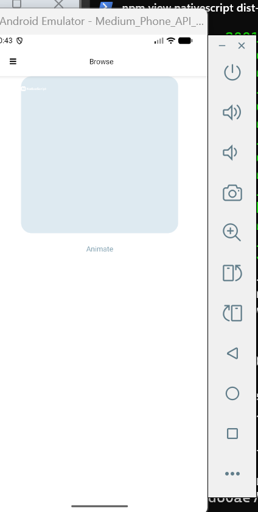
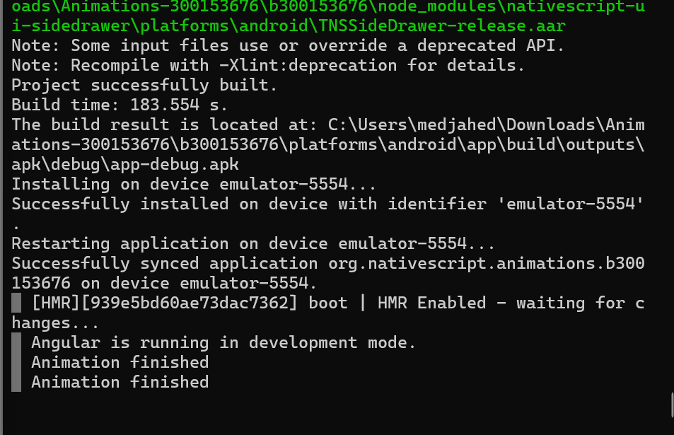

# Animations avec NativeScript

Lyes Medjahed · INF1083 · 300153676

[Projet b300153676](./Animations-300153676.zip), basé sur le patron Angular à tiroir `@nativescript/template-drawer-navigation-ng`.

- **Home** — À l’ouverture, le bouton **{N}** passe du rouge au vert en deux secondes. Les images clés sont définies dans `home.component.scss`.
- **Browse** — Ouvrir le menu, choisir **Browse**, puis toucher **Animate**. L’image disparaît et réapparaît, se déplace et revient, grandit et reprend sa taille, puis pivote et revient à son orientation initiale. Chaque étape dure 300 ms. À la fin, la console affiche `Animation finished`.

Pour exécuter le projet, extraire l’archive, ouvrir un terminal dans `b300153676`, puis lancer `npm ci` et `ns run android`.

## Test sur Android

Sur la page Home, le bouton {N} est vert à la fin de l’animation. Sur la page Browse, deux appuis sur Animate ont produit deux messages `Animation finished` dans PowerShell.

