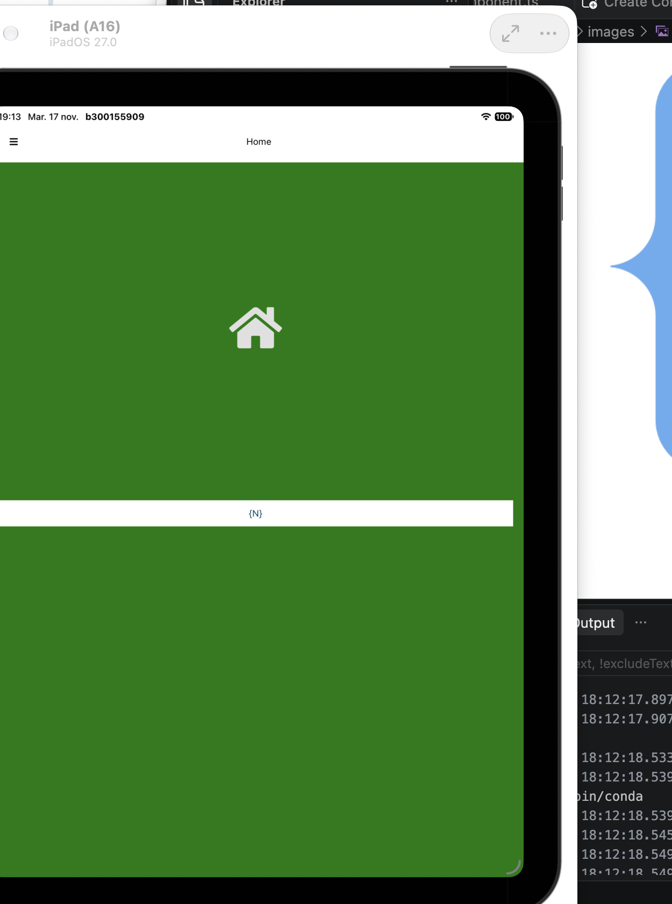
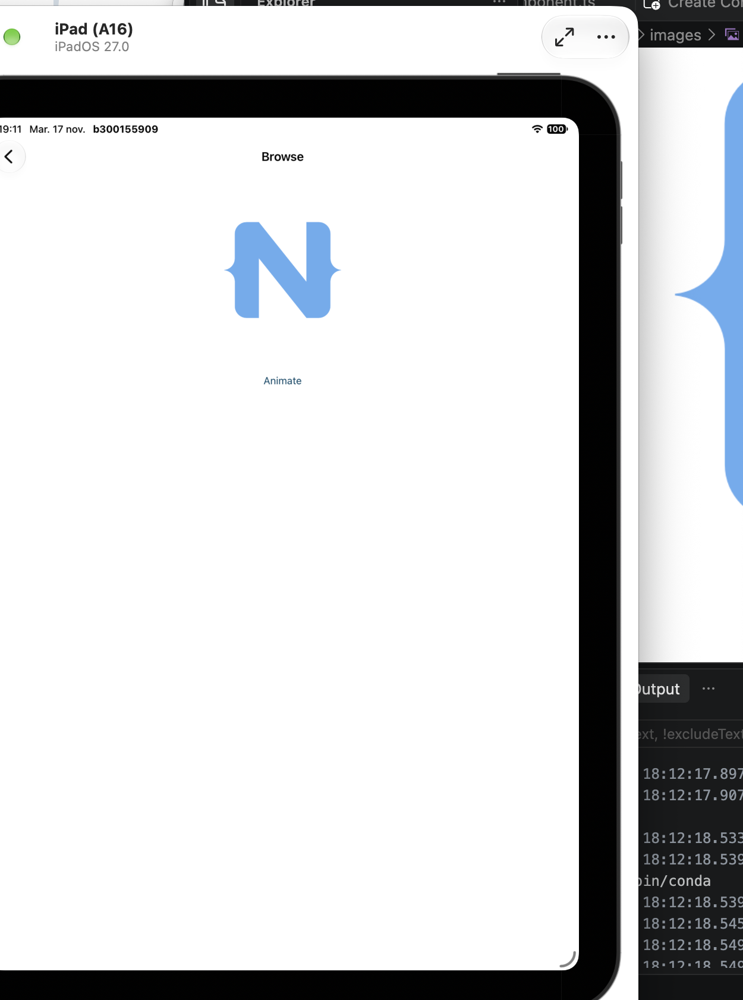
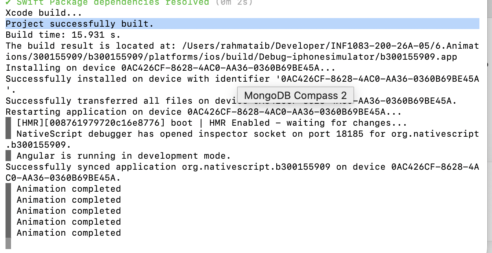

# INF1083 – Animation Assignment

**Student Number:** 300155909  
**Course:** INF1083

## Project Description

This project demonstrates animations using NativeScript and Angular.

## Animation Features

- **Home Page:** Background color animation from red to green.
- **Browse Page:** Image animation using rotation and scaling.
- **Animate Button:** Starts the animation when tapped.

## Animation Details

- Rotation: 360 degrees
- Scale: 1.5
- Duration: 1500 milliseconds

## Screenshots

### Home Page


### Browse Page – Animation


### Terminal – Successful Execution


## Technologies Used

- NativeScript
- Angular
- TypeScript
- HTML
- SCSS

## Run the Project

```bash
ns run ios
```

**Student:** 300155909
