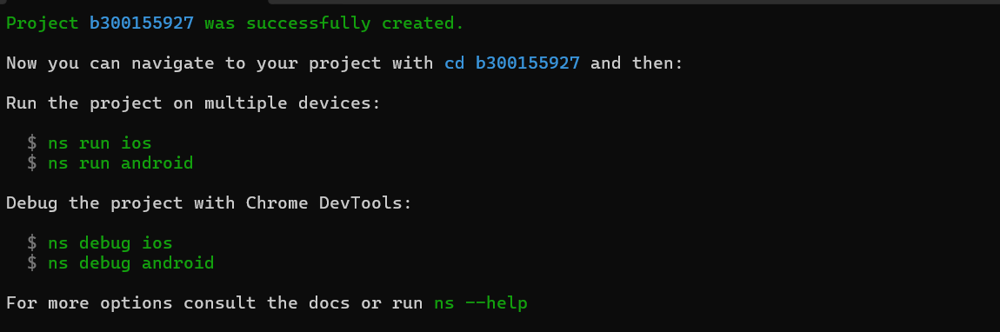
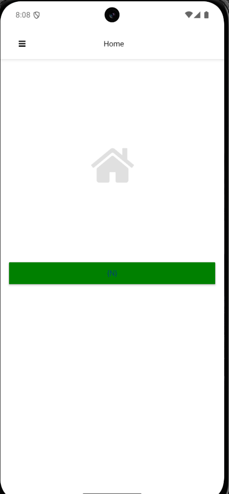
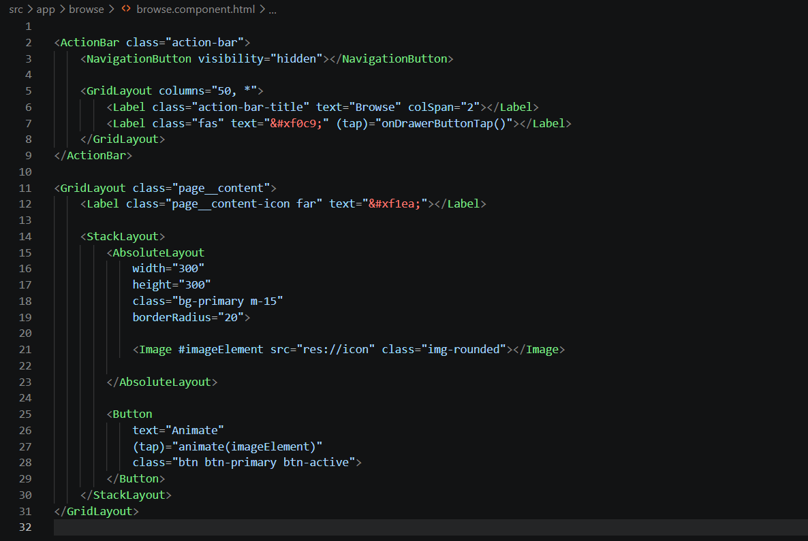
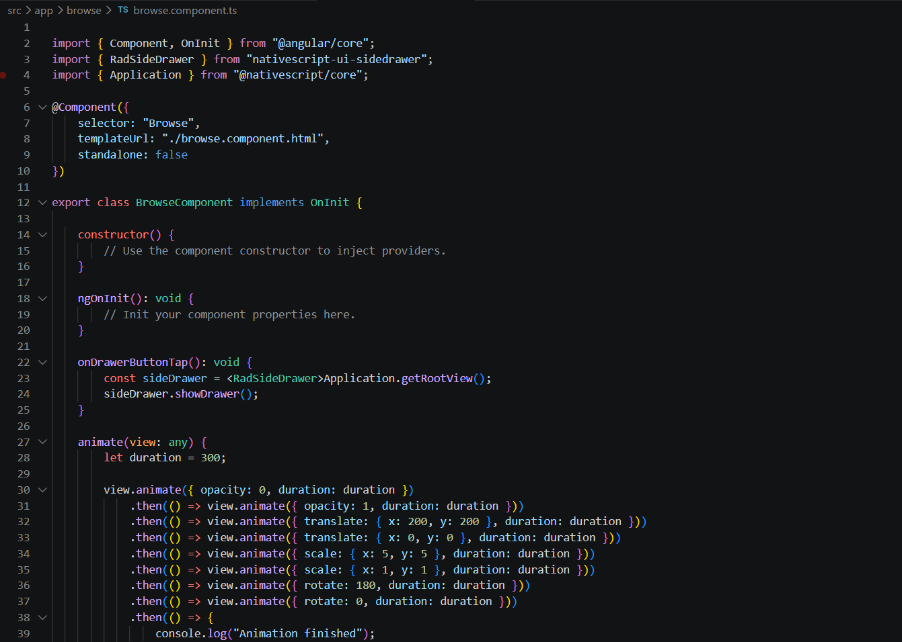
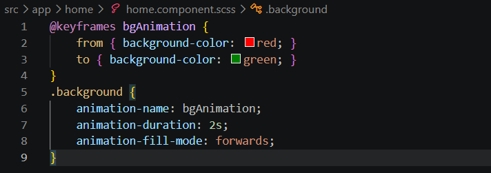

# 300155927

# 📱 Projet NativeScript — Animations ✨ — b300155927

Documentation des étapes de création d'une application mobile avec **NativeScript** et Angular : des animations sur les écrans **Home** et **Browse** (tiroir latéral, image animée, fond qui change de couleur), testées sur un émulateur Android. 🎬

## 🛠️ Environnement

| Élément | Détail |
|---|---|
| Framework | NativeScript (avec Angular) |
| Nom du projet | `b300155927` |
| Éditeur | Visual Studio Code |
| Fonction | Animations : tiroir latéral, image animée, fond rouge → vert |
| Test | Émulateur Android |

## 📋 Étapes

### 1️⃣ 🚀 Création du projet

Le projet est créé avec la ligne de commande NativeScript (`ns`). PowerShell affiche le message **« Project b300155927 was successfully created »** 🎉 et propose les commandes suivantes : entrer dans le dossier (`cd b300155927`), lancer l'application (`ns run android` ou `ns run ios`) et déboguer (`ns debug android`).



### 2️⃣ 🏠 L'écran d'accueil — Home

Sur l'émulateur, l'écran **Home** montre :

- en haut, un bouton menu (trois lignes) et le titre **Home** ;
- au centre, une grande icône de maison ;
- un bouton vert au milieu de l'écran.



### 3️⃣ 🖼️ La vue Browse — `browse.component.html`

Le fichier `browse.component.html` décrit l'écran **Browse** avec des balises NativeScript :

- une barre en haut (`ActionBar`) avec le titre **Browse** et une icône de menu qui appelle `onDrawerButtonTap()` quand on appuie dessus (elle ouvre le tiroir latéral) ;
- une icône de page au centre ;
- une image (`Image`, `src="res://icon"`) dans un cadre arrondi (`borderRadius="20"`) ;
- un bouton **« Animate »** qui appelle la fonction `animate(imageElement)` quand on appuie dessus.



### 4️⃣ 💻 Le code Browse — `browse.component.ts`

Le fichier `browse.component.ts` contient le code du composant `BrowseComponent` :

- il importe `RadSideDrawer` (le tiroir latéral) et `Application` ;
- la fonction `onDrawerButtonTap()` ouvre le tiroir latéral avec `sideDrawer.showDrawer()` ;
- la fonction `animate(view)` enchaîne plusieurs animations, chacune en 300 millisecondes :
  - 👻 l'image disparaît puis réapparaît (`opacity: 0` puis `1`) ;
  - ➡️ elle se déplace (`translate: x: 200, y: 200`) puis revient à sa place ;
  - 🔍 elle grandit (`scale: 5`) puis revient à sa taille normale ;
  - 🔄 elle tourne de 180 degrés (`rotate: 180`) puis revient à 0 ;
  - ✅ à la fin, la console affiche **« Animation finished »**.



### 5️⃣ 🎨 L'animation du fond — `home.component.scss`

Le fichier `home.component.scss` contient le style de l'écran d'accueil :

- `@keyframes bgAnimation` définit l'animation : le fond passe du **rouge** 🔴 (`from`) au **vert** 🟢 (`to`) ;
- la classe `.background` utilise cette animation : elle dure **2 secondes** (`animation-duration: 2s`) ;
- `animation-fill-mode: forwards` veut dire que le fond **reste vert** à la fin de l'animation.



## 💻 Commandes utilisées

```powershell
ns create b300155927   # créer le projet
cd b300155927          # entrer dans le dossier
ns run android         # lancer sur l'émulateur Android
ns debug android       # déboguer avec Chrome DevTools
```
