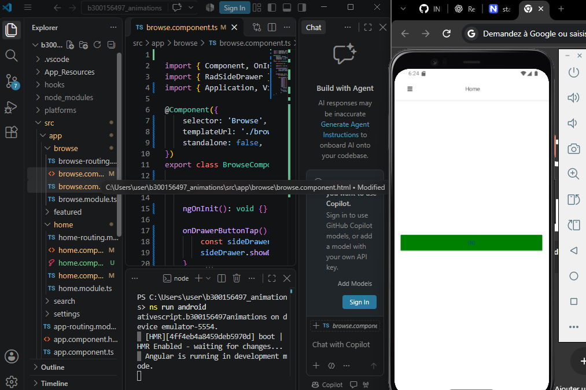
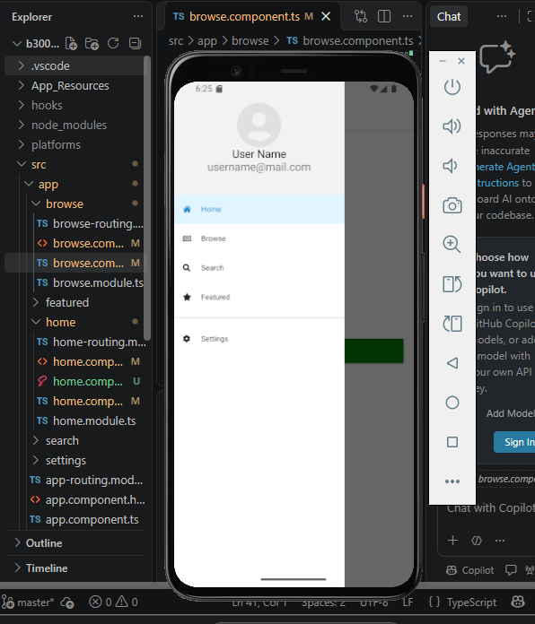
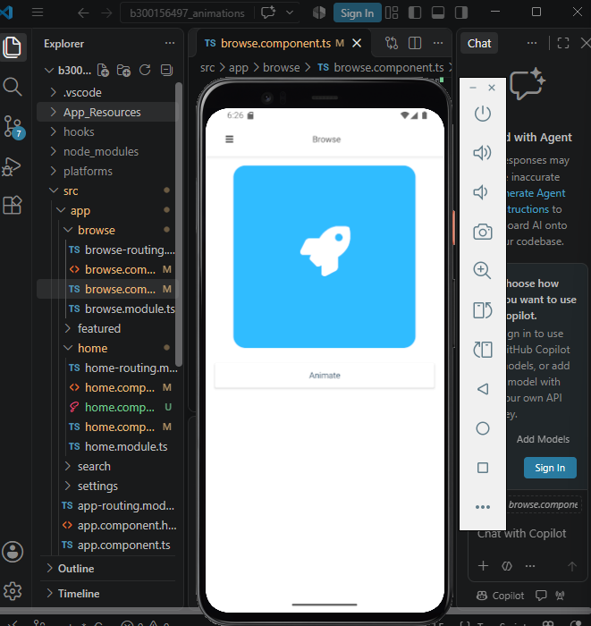

# 🎬 Laboratoire 6 – Animations NativeScript

**Étudiant :** 300156497  
**Cours :** INF1083 – Développement d'applications mobiles  
**Projet :** Animations NativeScript + Angular

---

## 📌 1. Présentation du projet

Dans ce laboratoire, j'ai réalisé une application mobile avec **NativeScript et Angular** afin de découvrir et de mettre en pratique les animations dans une application mobile.

L'objectif était d'apprendre à créer deux types d'animations :

- 🎨 **Animation déclarative (CSS)** : permet d'animer les éléments de l'interface à l'aide de feuilles de style.
- ⚙️ **Animation impérative (TypeScript)** : permet de contrôler les animations directement dans le code.

Le projet utilise le modèle de navigation Drawer de NativeScript.

## 🛠️ 2. Environnement de développement

Les outils et technologies utilisés :

| Outil | Version / Technologie |
|---|---|
| Node.js | v24.21.0 |
| npm | 11.19.0 |
| NativeScript | CLI |
| NativeScript Core | 9.1.4 |
| NativeScript Angular | 22.0.2 |
| Angular | TypeScript |
| Visual Studio Code | Éditeur de code |
| Android Emulator | Émulateur Android |
| Git et GitHub | Gestion et publication du projet |

## 📂 3. Structure du projet

Le projet est organisé de la manière suivante :

```text
300156497/
│
├── App_Resources/
├── hooks/
├── src/
│   └── app/
│       ├── home/
│       │   ├── home.component.html
│       │   ├── home.component.scss
│       │   └── home.component.ts
│       │
│       └── browse/
│           ├── browse.component.html
│           └── browse.component.ts
│
├── images/
├── .vscode/
├── .gitignore
├── nativescript.config.ts
├── package.json
├── package-lock.json
├── references.d.ts
├── tsconfig.json
└── webpack.config.js
```

## 🚀 4. Création et préparation du projet

Le projet NativeScript a été préparé avec le modèle Angular Drawer Navigation.

Le dossier du projet utilisé :

```powershell
C:\Users\user\b300156497_animations
```

### Vérification des outils

Pour vérifier les versions de Node.js et npm :

```powershell
node -v
npm -v
```

Résultats obtenus :

```text
Node.js : v24.21.0
npm : 11.19.0
```

Pour vérifier les dépendances NativeScript :

```powershell
npm list @nativescript/core @nativescript/angular
```

Versions installées :

```text
@nativescript/angular : 22.0.2
@nativescript/core : 9.1.4
```

Pour vérifier l'environnement NativeScript :

```powershell
ns doctor
```

Cette commande permet de vérifier la configuration de l'environnement de développement.

## 💻 5. Réalisation dans Visual Studio Code

Le projet a été ouvert dans Visual Studio Code afin de modifier les fichiers HTML, SCSS et TypeScript.

### 🎨 Partie 1 – Animation déclarative (CSS)

Dans la page Home, une animation CSS a été ajoutée à un bouton.

**Fichier :** `home.component.html`

L'élément HTML utilise une classe CSS pour appliquer l'animation.

**Fichier :** `home.component.scss`

```scss
@keyframes bgAnimation {
    from {
        background-color: red;
    }

    to {
        background-color: green;
    }
}

.background {
    animation-name: bgAnimation;
    animation-duration: 2s;
    animation-fill-mode: forwards;
}
```


**Fichier :** `home.component.ts`

La feuille de style a été associée au composant avec :

```typescript
styleUrls: ["./home.component.scss"]
```

**Résultat attendu :**

Le bouton change progressivement de couleur, du rouge au vert, pendant deux secondes.

### ⚙️ Partie 2 – Animation impérative (TypeScript)

Dans la page Browse, une animation a été ajoutée à un élément affichant le numéro étudiant.

**Fichier :** `browse.component.html`

L'interface contient :

- Un élément affichant le numéro étudiant `300156497`.
- Un bouton nommé `Animate`.

Exemple de structure :

```html
<StackLayout>
    <Label #cible text="300156497" fontSize="40"></Label>

    <Button
        text="Animate"
        (tap)="animate($any(cible))">
    </Button>
</StackLayout>
```

**Fichier :** `browse.component.ts`

La classe `View` est importée depuis NativeScript :

```typescript
import { View } from "@nativescript/core";
```

Une méthode `animate()` permet de déclencher les animations lorsque l'utilisateur appuie sur le bouton.

Les animations réalisées utilisent différentes propriétés :

- **Opacity** : modifier la transparence.
- **Translate** : déplacer l'élément.
- **Scale** : modifier sa taille.
- **Rotate** : effectuer une rotation.

Les animations sont exécutées successivement afin de voir les différents effets sur l'élément.


## 📱 6. Compilation et exécution sur Android

Pour rechercher les appareils disponibles :

```powershell
ns device
```

Pour vérifier les appareils Android connectés :

```powershell
adb devices
```

Pour compiler l'application Android :

```powershell
ns build android
```

Cette commande prépare et compile le projet pour Android.

Pour lancer l'application sur l'émulateur :

```powershell
ns run android
```

La compilation a permis de préparer l'application et de l'installer sur l'émulateur Android.

## 🔧 7. Commandes utilisées pendant le dépannage

Pendant la réalisation du laboratoire, plusieurs commandes ont été utilisées pour vérifier le projet et résoudre les problèmes rencontrés.

| Commande | Utilité |
|---|---|
| `Get-ChildItem` | Afficher les fichiers et dossiers. |
| `Get-ChildItem -Force` | Afficher également les fichiers cachés. |
| `Test-Path` | Vérifier si un fichier ou dossier existe. |
| `npm list` | Vérifier les dépendances installées. |
| `node -v` | Vérifier la version de Node.js. |
| `npm -v` | Vérifier la version de npm. |
| `ns doctor` | Vérifier l'environnement NativeScript. |
| `ns device` | Rechercher les appareils disponibles. |
| `adb devices` | Vérifier les appareils Android. |
| `ns build android` | Compiler l'application Android. |
| `ns run android` | Exécuter l'application sur Android. |

## 📸 8. Captures d'écran

Les captures d'écran du projet peuvent être ajoutées dans le dossier `images/`.

Exemples de captures à présenter :

- L'application ouverte sur la page Home.
- L'animation CSS du bouton.
- La page Browse.
- Le bouton Animate.
- Le résultat de l'animation sur l'émulateur Android.

## 🌐 9. Publication du projet sur GitHub

Le projet a été copié dans le dépôt du cours :

```text
INF1083-200-26A-05/
└── 6.Animations/
    └── 300156497/
```

### Étape 1 – Création du dossier du laboratoire

```powershell
New-Item -ItemType Directory -Name "6.Animations"
```

### Étape 2 – Copie du projet

La commande suivante a permis de copier le projet dans le dépôt du cours :

```powershell
robocopy C:\Users\user\b300156497_animations C:\Users\user\INF1083-200-26A-05\6.Animations\300156497 /E /XD .git node_modules platforms
```

Les dossiers `.git`, `node_modules` et `platforms` ont été exclus de la copie.

### Étape 3 – Création du dossier images

```powershell
New-Item -ItemType Directory -Force -Path .\300156497\images
```

### Étape 4 – Création du README

```powershell
New-Item -ItemType File -Path .\300156497\README.md
```

### Étape 5 – Vérification du dépôt

```powershell
git status
```

Cette commande permet de vérifier les fichiers modifiés et les fichiers à envoyer.

### Étape 6 – Ajout du projet

```powershell
git add 6.Animations/300156497
```

### Étape 7 – Création du commit

```powershell
git commit -m "Add NativeScript animations project"
```

Le commit a été créé avec succès.

### Étape 8 – Récupération des modifications GitHub

Lors du premier envoi, GitHub a refusé le push parce que le dépôt distant contenait des modifications qui n'étaient pas présentes dans le dépôt local.

Le message obtenu était :

```text
! [rejected] main -> main (fetch first)
```

Pour résoudre ce problème, nous avons utilisé :

```powershell
git pull --rebase origin main
```

La récupération et l'intégration des modifications se sont terminées avec succès.

### Étape 9 – Envoi final sur GitHub

```powershell
git push origin main
```

Résultat obtenu :

```text
f4cb281..746ac32  main -> main
```

<text>Le projet a donc été envoyé avec succès sur la branche `main` du dépôt GitHub du cours.</text>

## ✅ 10. Conclusion

Ce laboratoire m'a permis de découvrir les animations dans NativeScript et de comprendre la différence entre les animations déclaratives et impératives.

J'ai appris à utiliser CSS pour animer les éléments de l'interface et TypeScript pour contrôler des animations directement dans le code.

J'ai également pratiqué la compilation et l'exécution d'une application Android, ainsi que l'utilisation de Git et GitHub pour publier mon travail.

**🎉 Laboratoire 6 – Animations terminé !**
