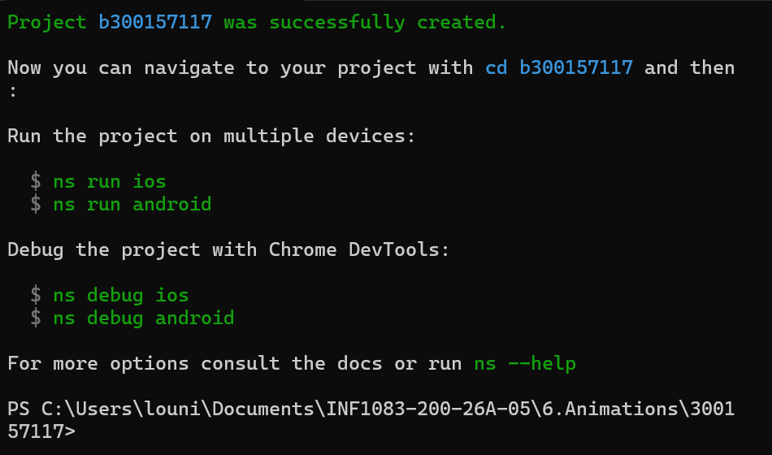
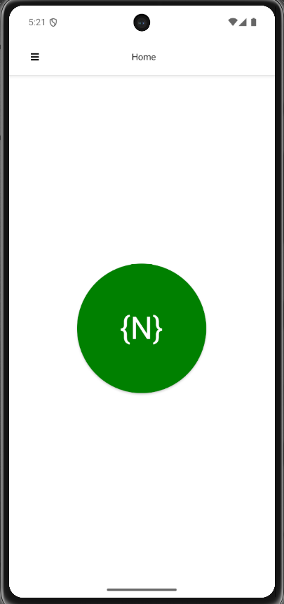
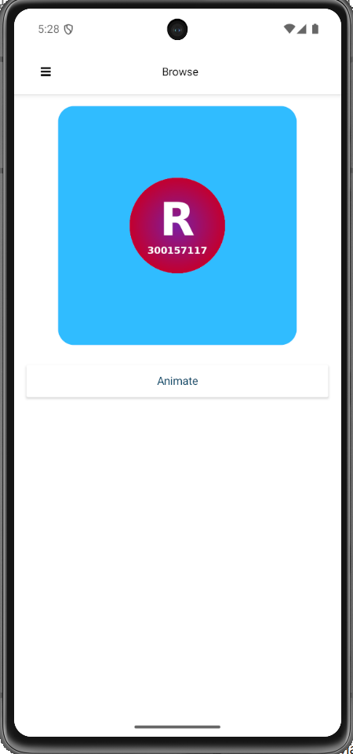
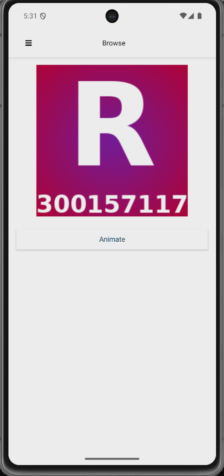
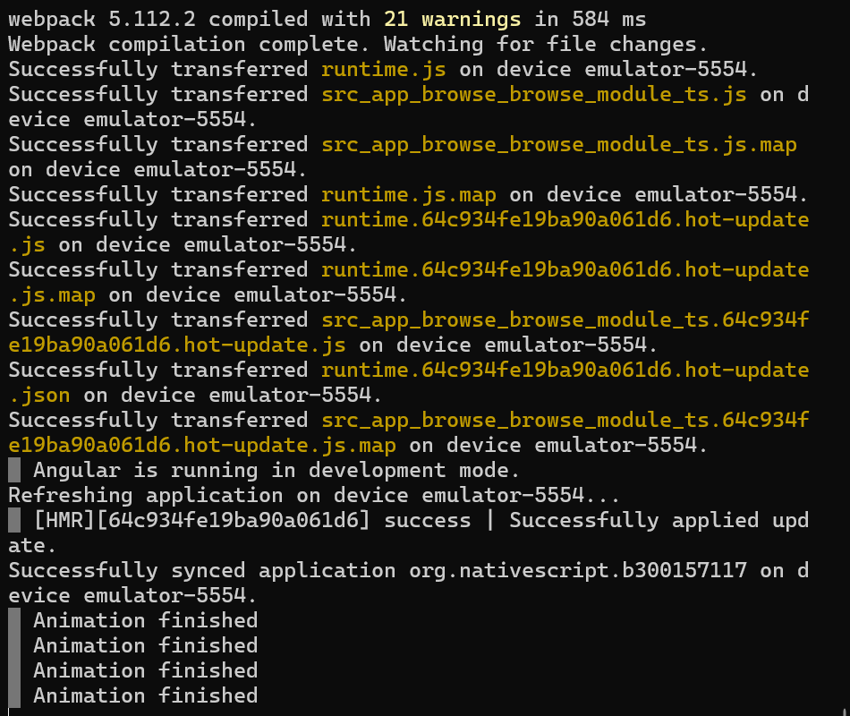

# 🤡 Animations — INF1083

**Étudiant :** Rayan Lounis  
**Matricule :** 300157117  
**GitHub :** [lounisrayan](https://github.com/lounisrayan)  
**Cours :** INF1083 — Développement d'applications  
**Session :** Automne 2026  

---

## 🎯 Objectif

Réaliser deux types d'animations dans une application **NativeScript Angular** :

| Type | Où ? | Principe |
|---|---|---|
| 🎨 **Déclarative** (CSS Animation) | page **Home** | `@keyframes` dans un fichier `.scss` |
| ⚙️ **Impérative** | page **Browse** | `view.animate()` dans le code TypeScript |

Projet réalisé : **`b300157117`** (modèle *drawer-navigation-ng*, NativeScript 9 + Angular 22, émulateur Pixel 7 — Android 15)

```text
6.Animations/300157117/
├── README.md
├── images/
└── b300157117/
    └── src/
        ├── assets/rayan.png                  ← image animée (page Browse)
        └── app/
            ├── home/
            │   ├── home.component.html       ← Button {N}
            │   ├── home.component.scss       ← @keyframes bgAnimation
            │   └── home.component.ts         ← styleUrls
            └── browse/
                ├── browse.component.html     ← AbsoluteLayout + Image #cible + Button Animate
                └── browse.component.ts       ← animate()
```

---

## ▶️ Exécuter le projet

```powershell
cd 6.Animations\300157117\b300157117
ns run android
```

- Page **Home** : l'animation CSS démarre automatiquement.
- Menu **☰ → Browse**, puis bouton **Animate**.

---

## 🅰️ 1. Création du projet

```powershell
cd 6.Animations\300157117
ns create b300157117 --template @nativescript/template-drawer-navigation-ng
```



---

## 🅱️ 2. Animation déclarative (CSS) — page Home

### `home.component.html`

```html
<GridLayout class="page__content">
  <Button text="{N}" class="background" ></Button>
</GridLayout>
```

### `home.component.scss`

```scss
@keyframes bgAnimation {
    from { background-color: red; }
    to { background-color: green; }
}

.background {
    animation-name: bgAnimation;
    animation-duration: 2s;
    animation-fill-mode: forwards;
    width: 200;
    height: 200;
    border-radius: 100;
    font-size: 48;
    color: white;
}
```

- `@keyframes` décrit l'animation : de **rouge** (`from`) à **vert** (`to`).
- `animation-duration: 2s` : l'animation dure 2 secondes.
- `animation-fill-mode: forwards` : le bouton **reste vert** à la fin.
- J'ai ajouté une taille, un `border-radius` et une police pour obtenir un bouton rond bien visible.

### `home.component.ts`

```typescript
@Component({
  standalone: false,
  selector: 'Home',
  templateUrl: './home.component.html',
  styleUrls: ['./home.component.scss'],
})
```

### ✅ Résultat : le bouton `{N}` passe du rouge au vert



---

## 🅱️ 3. Animation impérative — page Browse

### `browse.component.html`

```html
<StackLayout>
  <AbsoluteLayout width="300" height="300" class="bg-primary m-15" borderRadius="20">
    <Image #cible src="~/assets/rayan.png" width="120" height="120" left="90" top="90"></Image>
  </AbsoluteLayout>
  <Button text="Animate" (tap)="animate(cible)" class="btn btn-primary btn-active"></Button>
</StackLayout>
```

- `#cible` est une **référence de template** vers l'image, transmise à `animate()` quand on touche le bouton.

### `browse.component.ts`

```typescript
import { Application, View } from '@nativescript/core'

export class BrowseComponent implements OnInit {
  // ...

  animate(cible: unknown) {
    const view = cible as View
    let duration = 300
    view
      .animate({ opacity: 0, duration: duration })
      .then(() => view.animate({ opacity: 1, duration: duration }))
      .then(() => view.animate({ translate: { x: 200, y: 200 }, duration: duration }))
      .then(() => view.animate({ translate: { x: 0, y: 0 }, duration: duration }))
      .then(() => view.animate({ scale: { x: 5, y: 5 }, duration: duration }))
      .then(() => view.animate({ scale: { x: 1, y: 1 }, duration: duration }))
      .then(() => view.animate({ rotate: 180, duration: duration }))
      .then(() => view.animate({ rotate: 0, duration: duration }))
      .then(() => {
        console.log('Animation finished')
      })
      .catch((e) => {
        console.log(e.message)
      })
  }
}
```

Chaque `view.animate()` retourne une **Promise** : les `.then()` enchaînent les étapes l'une après l'autre (300 ms chacune).

| Étape | Propriété | Effet |
|---|---|---|
| 1-2 | `opacity: 0 → 1` | l'image disparaît puis réapparaît |
| 3-4 | `translate: (200, 200) → (0, 0)` | elle glisse en bas à droite puis revient |
| 5-6 | `scale: ×5 → ×1` | elle grossit 5 fois puis reprend sa taille |
| 7-8 | `rotate: 180° → 0°` | elle fait un demi-tour puis revient |

### ✅ Résultat

| Avant | Pendant l'animation (`scale ×5`) |
|---|---|
|  |  |

Console : `Animation finished` à la fin de chaque animation.



---

## ⚠️ Problèmes rencontrés et solutions

| Problème | Cause | Solution |
|---|---|---|
| `Missing Image with resourceID: res://icon` — l'image n'apparaît pas | Le modèle *drawer-navigation* n'a pas de ressource `icon` | Ajout de ma propre image `src/assets/rayan.png`, utilisée avec `src="~/assets/rayan.png"` |
| `TS2345: Argument of type 'HTMLElement' is not assignable to parameter of type 'View'` | Angular 22 vérifie strictement les types du template : la référence `#cible` est vue comme un `HTMLElement` | Paramètre `cible: unknown` converti en `View` avec `cible as View` |
| `Application ... is not running` au 1er lancement | L'émulateur n'était pas prêt | Relancer `ns run android` |

---

## 📝 Conclusion

J'ai réalisé une **animation déclarative** en CSS (`@keyframes`, rouge → vert) et une **animation impérative** en TypeScript, où une chaîne de Promises (`view.animate().then(...)`) fait varier l'opacité, la position, l'échelle et la rotation d'une image. J'ai aussi appris à lire les messages de la console pour corriger une ressource d'image manquante et une erreur de type dans le template.

---

<p align="center"><b>🤡 INF1083 — Animations | 300157117</b></p>
