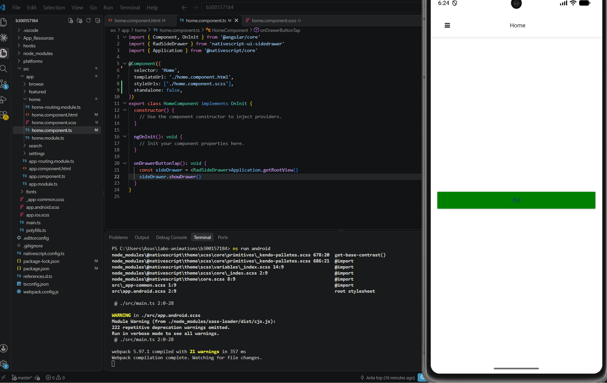
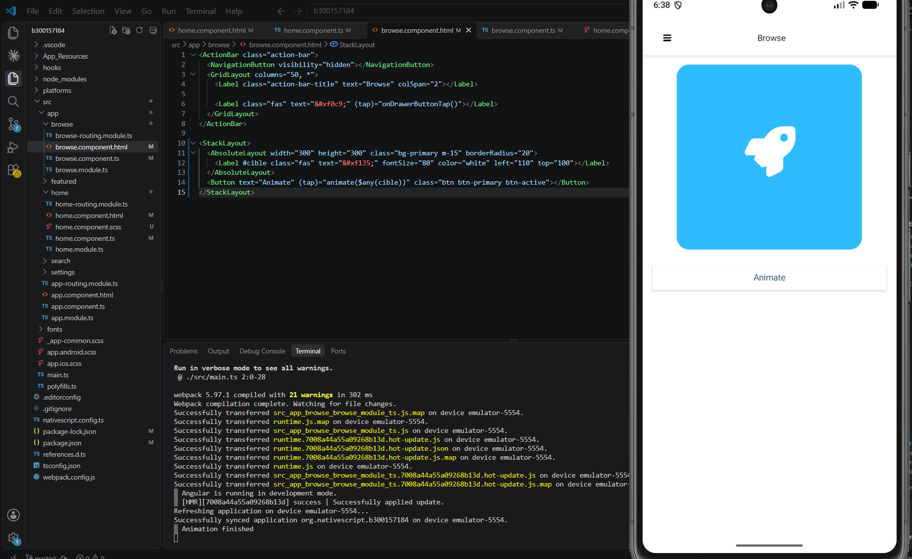

# Labo 6 – Animations NativeScript

**Étudiant :** 300157184
**Cours :** INF1083 – Développement d'applications mobiles
**Projet :** [`b300157184`](b300157184)

Application mobile **NativeScript + Angular** (modèle *drawer navigation*) qui présente les deux façons d'animer une interface :

| Type | Où | Principe |
|---|---|---|
| **Déclarative** (CSS Animation) | Page **Home** | On décrit l'état de départ et d'arrivée dans un fichier `.scss` ; NativeScript calcule le reste. |
| **Impérative** | Page **Browse** | Le code TypeScript commande chaque mouvement, étape par étape, au toucher d'un bouton. |

---

##  Résultats

| Animation CSS (Home) | Animation impérative (Browse) |
|:---:|:---:|
|  |  |
| Le bouton `{N}` passe du rouge au vert en 2 s et reste vert. | La fusée disparaît, se déplace, grossit puis tourne. La console affiche `Animation finished`. |

---

##  Environnement

| Outil | Version |
|---|---|
| Système | Windows 11 |
| Node.js | 24.21.0 |
| NativeScript CLI | 9.1.1 |
| @nativescript/core | 9.1.3 |
| Angular | 22.0.8 |
| webpack | **5.97.1** (version fixée, voir problème n°1) |
| Émulateur | Android – Pixel 7 |

---

##  Sommaire

1. [Créer le projet](#étape-1--créer-le-projet)
2. [Fixer la version de webpack](#étape-2--fixer-la-version-de-webpack)
3. [Animation déclarative (Home)](#️-partie-a--animation-déclarative-css)
4. [Animation impérative (Browse)](#️-partie-b--animation-impérative)
5. [Déposer sur GitHub](#étape-9--déposer-le-travail-sur-github)
6. [Problèmes rencontrés](#-problèmes-rencontrés-et-solutions)
7. [Conseils pour les autres étudiants](#️-conseils-pour-les-autres-étudiants)

---

## Étape 1 – Créer le projet

Mon projet du labo RxJS s'appelait déjà `b300157184` dans `C:\Users\Asus`. Pour éviter un conflit de nom, le projet a été créé dans un nouveau dossier :

```
cd C:\Users\Asus
mkdir labo-animations
cd labo-animations
ns create b300157184 --template @nativescript/template-drawer-navigation-ng
cd b300157184
code .
```

Le modèle **drawer** affiche un menu latéral (☰) avec les pages Home, Browse, Search, Featured et Settings.


---

## Étape 2 – Fixer la version de webpack

Lors du labo RxJS, la compilation échouait avec `Cannot find module 'webpack/lib/ExternalModuleFactoryPlugin'`. La correction a été appliquée **dès le départ** :

```powershell
npm install webpack@5.97.1 --save-dev
```

Les messages `npm warn install-scripts` ne sont que des avertissements.


> Sur cette capture, on voit aussi une erreur rouge : j'avais collé du **HTML dans le terminal**. Le terminal n'accepte que des commandes ; le code se colle dans le **fichier ouvert dans l'éditeur**.

---

##  Partie A – Animation déclarative (CSS)

### Étape 3 – Le template `home.component.html`

Fichier d'origine :


L'icône et le texte d'exemple sont remplacés par un bouton portant la classe `background` :

```html
<ActionBar class="action-bar">
  <NavigationButton visibility="hidden"></NavigationButton>
  <GridLayout columns="50, *">
    <Label class="action-bar-title" text="Home" colSpan="2"></Label>

    <Label class="fas" text="&#xf0c9;" (tap)="onDrawerButtonTap()"></Label>
  </GridLayout>
</ActionBar>

<GridLayout class="page__content">
  <Button text="{N}" class="background"></Button>
</GridLayout>
```

>  L'icône d'origine a aussi été retirée : un `GridLayout` sans lignes ni colonnes superpose ses éléments au même endroit.

### Étape 4 – Le fichier `home.component.scss`

Nouveau fichier créé dans le dossier `home` :

```scss
@keyframes bgAnimation {
    from { background-color: red; }
    to { background-color: green; }
}

.background {
    animation-name: bgAnimation;
    animation-duration: 2s;
    animation-fill-mode: forwards;
}
```

| Propriété | Rôle |
|---|---|
| `@keyframes bgAnimation` | Définit l'animation : de `red` (`from`) à `green` (`to`) |
| `animation-name` | Animation à jouer |
| `animation-duration: 2s` | Durée de 2 secondes |
| `animation-fill-mode: forwards` | Le bouton **garde** l'état final (vert) |


### Étape 5 – Relier le style au composant

Dans `home.component.ts`, on ajoute `styleUrls` (une **liste** : plusieurs fichiers possibles) et `standalone: false` :

```typescript
@Component({
  selector: 'Home',
  templateUrl: './home.component.html',
  styleUrls: ['./home.component.scss'],
  standalone: false,
})
```


### Étape 6 – Lancer et tester

```powershell
ns run android
```

Au démarrage, l'émulateur affiche encore l'**ancienne appli** (RxJS) pendant la compilation. Les deux projets ayant le même identifiant, la nouvelle appli la remplace.


 **Résultat :** le bouton `{N}` passe du rouge au vert et reste vert.


> 💡 Pour revoir l'animation : menu ☰ → Browse, puis revenir sur Home.

---

##  Partie B – Animation impérative

### Étape 7 – Le template `browse.component.html`

```html
<ActionBar class="action-bar">
  <NavigationButton visibility="hidden"></NavigationButton>
  <GridLayout columns="50, *">
    <Label class="action-bar-title" text="Browse" colSpan="2"></Label>

    <Label class="fas" text="&#xf0c9;" (tap)="onDrawerButtonTap()"></Label>
  </GridLayout>
</ActionBar>

<StackLayout>
  <AbsoluteLayout width="300" height="300" class="bg-primary m-15" borderRadius="20">
    <Label #cible class="fas" text="&#xf135;" fontSize="80" color="white" left="110" top="100"></Label>
  </AbsoluteLayout>
  <Button text="Animate" (tap)="animate($any(cible))" class="btn btn-primary btn-active"></Button>
</StackLayout>
```

| Élément | Rôle |
|---|---|
| `AbsoluteLayout` | « Scène » de 300 × 300, fond coloré, coins arrondis |
| `#cible` | Variable de référence Angular qui nomme l'élément à animer |
| `(tap)="animate($any(cible))"` | Au toucher, passe l'élément à la méthode `animate()` |
| `&#xf135;` | Icône **fusée** de Font Awesome |

>  Ce template diffère de l'énoncé sur deux points : `$any(cible)` (problème n°3) et une fusée Font Awesome au lieu de `res://icon` (problème n°4).


### Étape 8 – La méthode `animate()` dans `browse.component.ts`

```typescript
import { Component, OnInit } from '@angular/core'
import { RadSideDrawer } from 'nativescript-ui-sidedrawer'
import { Application, View } from '@nativescript/core'

@Component({
  selector: 'Browse',
  templateUrl: './browse.component.html',
  standalone: false,
})
export class BrowseComponent implements OnInit {
  constructor() {}

  ngOnInit(): void {}

  onDrawerButtonTap(): void {
    const sideDrawer = <RadSideDrawer>Application.getRootView()
    sideDrawer.showDrawer()
  }

  animate(view: View) {
    let duration = 300
    view.animate({ opacity: 0, duration: duration })
      .then(() => view.animate({ opacity: 1, duration: duration }))
      .then(() => view.animate({ translate: { x: 200, y: 200 }, duration: duration }))
      .then(() => view.animate({ translate: { x: 0, y: 0 }, duration: duration }))
      .then(() => view.animate({ scale: { x: 5, y: 5 }, duration: duration }))
      .then(() => view.animate({ scale: { x: 1, y: 1 }, duration: duration }))
      .then(() => view.animate({ rotate: 180, duration: duration }))
      .then(() => view.animate({ rotate: 0, duration: duration }))
      .then(() => {
        console.log('Animation finished')
      })
      .catch((e) => {
        console.log(e.message)
      })
  }
}
```

**Fonctionnement :** `view.animate()` renvoie une **Promise**. Chaque `.then()` attend la fin de l'animation précédente avant de lancer la suivante :

| Ordre | Animation | Effet |
|:-:|---|---|
| 1 – 2 | `opacity: 0` → `1` | Disparaît puis réapparaît |
| 3 – 4 | `translate` (200, 200) → (0, 0) | Se déplace puis revient |
| 5 – 6 | `scale` 5 → 1 | Grossit 5 fois puis reprend sa taille |
| 7 – 8 | `rotate` 180 → 0 | Demi-tour puis retour |

Chaque étape dure 300 ms (≈ 2,4 s au total). `.catch()` affiche une éventuelle erreur dans la console.

 **Résultat :**


---

## Étape 9 – Déposer le travail sur GitHub

Le dépôt du cours est partagé : seul **mon** dossier est modifié.

```powershell
cd C:\Users\Asus\INF1083-200-26A-05
git pull
git status
```


Copie du projet **sans** `node_modules`, `platforms`, `hooks` et `.git` :

```powershell
robocopy C:\Users\Asus\labo-animations\b300157184 6.Animations\300157184\b300157184 /E /XD node_modules platforms hooks .git
git add 6.Animations/300157184/b300157184
git status
git commit -m "Labo 6 Animations - 300157184"
git push
```

Les avertissements `LF will be replaced by CRLF` concernent seulement les fins de ligne (Windows/Linux) et ne sont pas des erreurs.


---

##  Problèmes rencontrés et solutions

| # | Problème | Cause | Solution |
|:-:|---|---|---|
| 1 | `Cannot find module 'webpack/lib/ExternalModuleFactoryPlugin'` (labo précédent) | webpack trop récent | `npm install webpack@5.97.1 --save-dev` dès la création |
| 2 | `NG6008: Component is standalone` (labo précédent) | Angular 19+ : standalone par défaut | `standalone: false` dans chaque `@Component` |
| 3 | `Error occurs in the template of component BrowseComponent` | *Strict templates* : `#cible` est vu comme un `HTMLElement`, pas un `View` | `animate($any(cible))` |
| 4 | `Missing Image with resourceID: res://icon` | L'icône n'existe plus sous ce nom dans les modèles récents | Animer une icône Font Awesome (`<Label class="fas">`) |
| 5 | HTML collé dans le terminal | Confusion terminal / éditeur | Coller le code dans le fichier ouvert |
| 6 | `git push` : `Everything up-to-date`, rien sur GitHub | `git commit` oublié | `git status`, puis `git commit` et `git push` |

### Problème 3 – Erreur de type dans le template Browse

Après avoir écrit le template, l'erreur est d'abord attendue (la méthode `animate` n'existe pas encore) :


Mais elle persiste après l'ajout de `animate(view: View)`, pointant sur `templateUrl` (ligne 7) :


**Cause :** avec Angular 22, les templates sont vérifiés strictement. Angular ne connaît pas les balises NativeScript : `#cible` est typé `HTMLElement`, alors que `animate()` attend un `View`. À l'exécution, c'est pourtant bien un `View`.

 **Solution :** `$any(...)` désactive la vérification de type pour cette valeur.

```html
<Button text="Animate" (tap)="animate($any(cible))" ...></Button>
```


### Problème 4 – Image invisible : `Missing Image with resourceID`

L'animation fonctionnait (`Animation finished` dans la console), mais le carré restait **vide** :

```
Missing Image with resourceID: res://icon
```


Le nom `res://ic_launcher` n'a pas fonctionné non plus :


**Cause :** l'énoncé a été écrit pour une ancienne version de NativeScript ; l'icône de l'application n'est plus accessible sous ce nom.

 **Solution :** animer une icône de la police **Font Awesome**, déjà incluse dans le projet (c'est elle qui affiche le ☰). Un `Label` étant un `View`, la méthode `animate()` reste identique.

```html
<Label #cible class="fas" text="&#xf135;" fontSize="80" color="white" left="110" top="100"></Label>
```

### Problème 6 – Le projet n'apparaît pas sur GitHub

`git push` répondait `Everything up-to-date` et `git pull` un simple `Fast-forward` : le **commit n'avait pas été fait**, donc il n'y avait rien à envoyer.


 **Solution :** vérifier avec `git status`, puis :

```powershell
git commit -m "Labo 6 Animations - 300157184"
git push
```

>  Un commit réussi affiche `[main xxxxxxx] ...` et `XX files changed` ; un push réussi affiche `xxxxxxx..yyyyyyy  main -> main`.

---

##  Conseils pour les autres étudiants

**Avant de commencer**
- Si un projet `b<ID>` existe déjà (labo précédent), créez le nouveau dans un **autre dossier**.
- Installez tout de suite `webpack@5.97.1` pour éviter l'erreur `ExternalModuleFactoryPlugin`.

**Code**
- Ajoutez **`standalone: false`** dans chaque `@Component` que vous modifiez.
- Pour passer une référence `#nom` à une méthode typée `View`, utilisez **`$any(nom)`**.
- `res://icon` ne fonctionne plus : animez une icône Font Awesome ou une autre vue.
- Collez le code dans **l'éditeur**, jamais dans le terminal.
- Vérifiez qu'aucun onglet n'affiche le point **●** (fichier non enregistré) : activez *File → Auto Save*.

**Tester**
- L'animation CSS ne dure que 2 s : changez de page puis revenez sur Home pour la revoir.
- `console.log('Animation finished')` dans le terminal confirme que la chaîne de `.then()` s'est bien exécutée.

**Git (dépôt partagé)**
- `git pull` avant de commencer et avant `git push`.
- N'ajoutez que **votre** dossier : `git add 6.Animations/VOTRE_ID/...` — jamais `git add .`
- N'oubliez pas **`git commit`** entre `git add` et `git push`.
- **Jamais** `git push --force`.

---

##  Lancer le projet

```powershell
cd b300157184
npm install
ns run android
```

- **Home** : le bouton `{N}` s'anime automatiquement.
- **Browse** (menu ☰) : touchez **Animate**.
