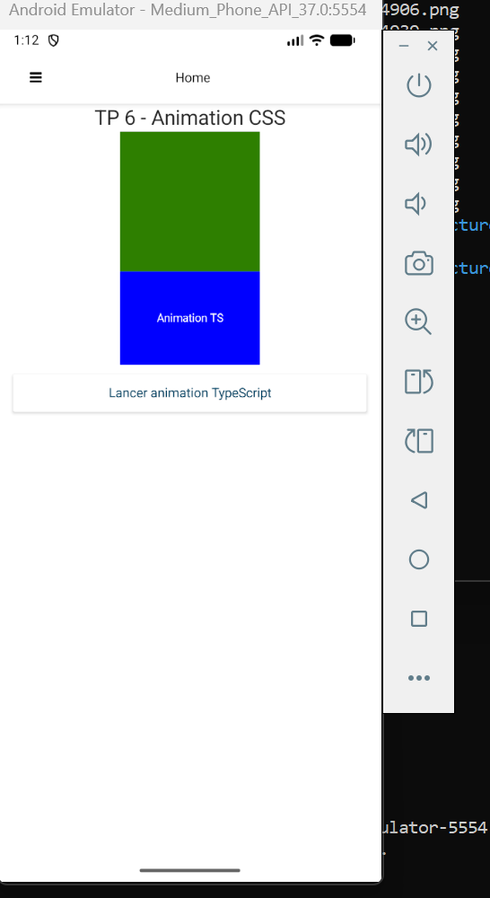

# TP 6 — Animations

**Étudiant :** Yahia Benkara  
**Matricule :** 300157275  
**Cours :** INF1083 — Développement d'applications

## Objectif

Créer une application mobile NativeScript avec Angular afin de réaliser deux animations : une animation déclarative en CSS et une animation impérative en TypeScript.

## 1. Animation CSS

Un carré change automatiquement de couleur, du rouge au vert, grâce à une animation définie avec `@keyframes`.

L'animation dure trois secondes et se répète en continu.



## 2. Animation TypeScript

Un deuxième carré bleu est animé lorsqu'on appuie sur le bouton « Lancer animation TypeScript ».

L'animation utilise la méthode `animate()` de NativeScript pour :
- déplacer le carré vers la droite ;
- effectuer une rotation de 360 degrés ;
- ramener le carré à sa position initiale.


## 3. Technologies utilisées

- NativeScript
- Angular
- TypeScript
- CSS
- Android Emulator
- Visual Studio Code
- Git et GitHub

## 4. Résultat

Les deux animations ont été testées sur l'émulateur Android.

L'animation CSS fonctionne automatiquement et l'animation TypeScript se déclenche à l'aide d'un bouton.

## 5. Projet

Le code source de l'application se trouve dans le dossier `B300157275`.

Les fichiers principaux sont :

- `src/app/home/home.component.html`
- `src/app/home/home.component.ts`
- `src/app/home/home.component.css`


## 6. Codes sources des animations

### HTML - Interface NativeScript

```html
<ActionBar class="action-bar">
  <NavigationButton visibility="hidden"></NavigationButton>
  <GridLayout columns="50, *">
    <Label class="action-bar-title" text="Home" colSpan="2"></Label>

    <Label class="fas" text="&#xf0c9;" (tap)="onDrawerButtonTap()"></Label>
  </GridLayout>
</ActionBar>

<StackLayout class="page__content"><Label text="TP 6 - Animation CSS" fontSize="22" textAlignment="center"></Label><Label class="carre-anime" text=" "></Label><Label #carreTS text="Animation TS" backgroundColor="blue" color="white" width="150" height="100" textAlignment="center"></Label><Button text="Lancer animation TypeScript" (tap)="lancerAnimation()"></Button></StackLayout>
```

### CSS - Animation declarative

```css
@keyframes changerCouleur { from { background-color: red; } to { background-color: green; } } .carre-anime { width: 150; height: 150; background-color: red; animation-name: changerCouleur; animation-duration: 3s; animation-iteration-count: infinite; }
```

### TypeScript - Animation imperative

```typescript
import { Component, OnInit, ViewChild, ElementRef } from '@angular/core'
import { RadSideDrawer } from 'nativescript-ui-sidedrawer'
import { Application } from '@nativescript/core'

@Component({
  standalone: false,
  selector: 'Home',
  templateUrl: './home.component.html',
  styleUrls: ['./home.component.css'],
})
export class HomeComponent implements OnInit {
  @ViewChild('carreTS') carreTS!: ElementRef;

  lancerAnimation(): void {
    this.carreTS.nativeElement.animate({ translate: { x: 80, y: 0 }, rotate: 360, duration: 1500 }).then(() => {
      this.carreTS.nativeElement.animate({ translate: { x: 0, y: 0 }, rotate: 0, duration: 800 });
    });
  }
  constructor() {
    // Use the component constructor to inject providers.
  }

  ngOnInit(): void {
    // Init your component properties here.
  }

  onDrawerButtonTap(): void {
    const sideDrawer = <RadSideDrawer>Application.getRootView()
    sideDrawer.showDrawer()
  }
}
```

