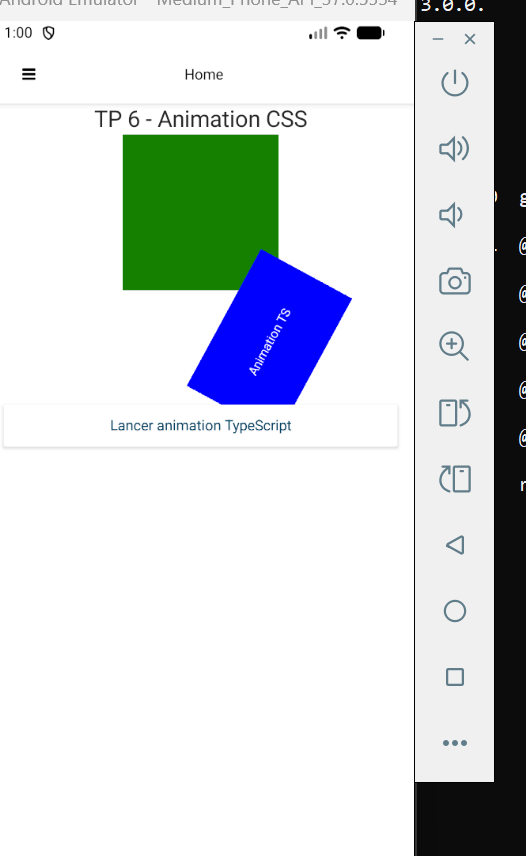

# TP 6 — Animations

**Étudiant :** Yahia Benkara  
**Matricule :** 300157275  
**Cours :** INF1083 — Développement d'applications

## Objectif

Créer une application mobile NativeScript avec Angular afin de réaliser deux animations : une animation déclarative en CSS et une animation impérative en TypeScript.

## 1. Animation CSS

Un carré change automatiquement de couleur, du rouge au vert, grâce à une animation définie avec `@keyframes`.

L'animation dure trois secondes et se répète en continu.

## 2. Animation TypeScript

Un deuxième carré bleu est animé lorsqu'on appuie sur le bouton « Lancer animation TypeScript ».

L'animation utilise la méthode `animate()` de NativeScript pour :
- déplacer le carré vers la droite ;
- effectuer une rotation de 360 degrés ;
- ramener le carré à sa position initiale.

## 3. Technologies utilisées

- NativeScript
- Angular
- TypeScript
- CSS
- Android Emulator
- Visual Studio Code
- Git et GitHub

## 4. Résultat

Les deux animations ont été testées sur l'émulateur Android.

L'animation CSS fonctionne automatiquement et l'animation TypeScript se déclenche à l'aide d'un bouton.

## 5. Projet

Le code source de l'application se trouve dans le dossier `B300157275`.

Les fichiers principaux sont :

- `src/app/home/home.component.html`
- `src/app/home/home.component.ts`
- `src/app/home/home.component.css`
