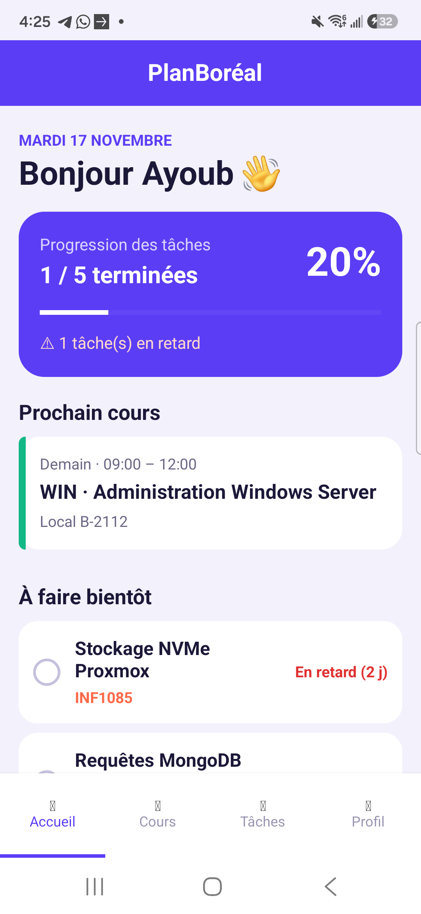

# 300151315 - Projet mobile : PlanBoréal

Application créée par **Toumi Ayoub**.

## 📱 Résumé
**PlanBoréal** est un agenda d'étudiant pour le Collège Boréal. L'étudiant y retrouve son horaire de cours de la semaine, ses tâches à remettre (laboratoires, projets) et reçoit un rappel le jour de la remise. Les données restent sur le téléphone, même après avoir fermé l'application.

## 🗂️ Pages (onglets)

| Onglet | Rôle |
|--------|------|
| **Accueil** | Date du jour, progression des tâches (barre et %), tâches en retard, prochain cours, tâches à faire bientôt |
| **Cours** | Horaire de la semaine groupé par jour (couleur par cours), ajout d'un cours (code, nom, local, jour, heures), suppression |
| **Tâches** | Ajout d'une tâche (titre, cours, date de remise), filtres *À faire / Faites / Toutes*, cocher une tâche, badge **RETARD**, suppression |
| **Profil** | Nom, numéro étudiant, programme, statistiques, activation des rappels, notification de test, réinitialisation |

## 🧩 Technique

### Patron (template)
```
ns create b300151315 --template @nativescript/template-tab-navigation-ng
```
`@nativescript/template-tab-navigation-ng` : Angular + `TabView` avec les onglets en bas. Les 3 onglets du modèle (Home, Browse, Search) ont été remplacés par mes 4 onglets.

### Plugins

| Plugin | Utilisation |
|--------|-------------|
| [`@nativescript/local-notifications`](https://market.nativescript.org/plugins/@nativescript/local-notifications) | Rappel à 8 h le jour de la remise d'une tâche, notification de test dans le Profil |
| `@nativescript/theme` | Thème de base du modèle (styles des formulaires) |

```
npm i @nativescript/local-notifications
```

### Fonctionnalités de NativeScript / Angular utilisées
- `ApplicationSettings` (de `@nativescript/core`) : sauvegarde des cours, des tâches et du profil en JSON sur le téléphone
- **Signals** Angular (`signal`, `computed`) dans `PlannerService` : tous les onglets se mettent à jour en même temps
- `NativeScriptFormsModule` et `[(ngModel)]` pour les formulaires
- `Dialogs.confirm` avant une suppression
- `Progress`, `Switch`, `TextField`, `ScrollView` horizontal pour les choix (puces)
- Icônes **Font Awesome** (fournies avec le modèle)

### Structure
```
src/app/
├── app.component.html      # TabView : Accueil, Cours, Tâches, Profil
├── app-routing.module.ts   # une route (outlet) par onglet
├── shared/
│   ├── planner.service.ts  # données + sauvegarde (ApplicationSettings)
│   └── reminder.service.ts # rappels (plugin local-notifications)
├── home/                   # Accueil
├── courses/                # Cours
├── tasks/                  # Tâches
└── profile/                # Profil
```

## 🎨 Design
Couleur principale violette `#5b3df5`, fond clair `#f3f1fb`, cartes blanches arrondies, une couleur par cours (bande à gauche des cartes). L'application garde son thème clair même si le téléphone est en mode sombre.

## ▶️ Exécution
```
cd b300151315
npm install
ns run android
```

## 📸 Résultat

### Accueil


## Problèmes rencontrés et solutions

| Problème | Solution |
|----------|----------|
| Téléphone en mode sombre : barre de titre sombre et texte illisible | Mode clair forcé dans `main.ts` (`AppCompatDelegate.MODE_NIGHT_NO`) et couleurs de la barre dans le HTML |
| Les onglets passaient sous les boutons d'Android | NativeScript 9 affiche l'application « edge to edge » : `androidOverflowEdge="top"` sur le `TabView` |
| Les textes étaient mis en majuscules (« Progression Des Tâches ») | `text-transform: none` sur `Label`, `Button`, `TextField` |
| Icônes des onglets affichées comme des carrés | Les onglets sont créés par code avant le CSS : la police `fa-solid-900` est donnée à chaque onglet au chargement du `TabView` |
| `TS2339: Property 'value' does not exist on type 'Event'` (Switch) | `$any($event).value` dans le template |
| Mes autres labos NativeScript sont sur le même téléphone | Identifiant propre : `org.nativescript.projet.b300151315` |

## ❓ Question au professeur — 2e projet (contenu généré)

Pour le 2e projet (*Application hybride et web avec contenu généré*), est-ce qu'on doit utiliser une API précise ?

Je propose **MétéoBoréal**, une application météo NativeScript (Angular) avec l'API gratuite **Open-Meteo** (https://open-meteo.com, sans clé) :
- **Aujourd'hui** : météo à ma position (plugin `@nativescript/geolocation`)
- **Prévisions** : les 7 prochains jours
- **Villes** : recherche d'une ville et favoris

Est-ce que cette API est acceptée, ou est-ce que vous avez une API à nous fournir ?
