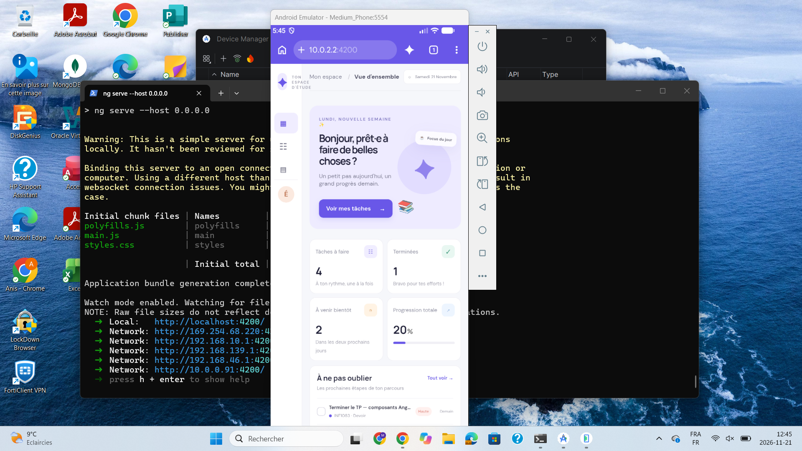
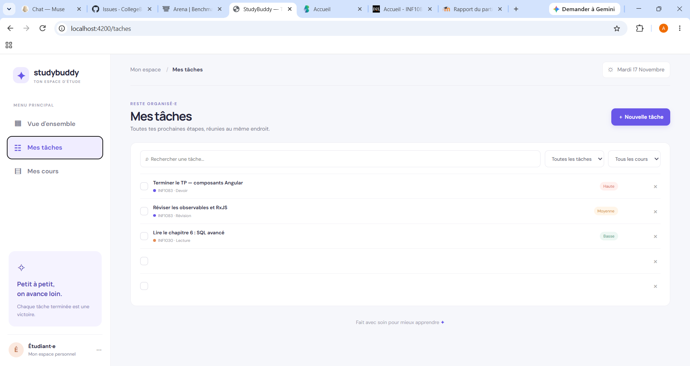
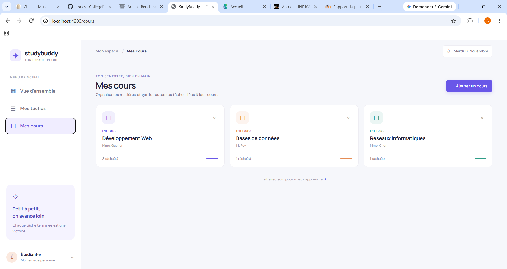

# StudyBuddy 📚

**StudyBuddy** est un organisateur d’études en français : rassemble tes cours, planifie tes devoirs et révisions, puis suis ta progression dans un tableau de bord simple.

**Étudiant :** Anis Ouhocine (300151496)
**Cours :** INF1083 — Développement d'applications mobiles
**Dossier de remise :** `7.Projects/300151496/`

## Langage et template utilisés

- **Langage :** TypeScript (TypeScript 5.5.4), avec Angular 18.2.0, RxJS 7.8.1 et Zone.js. Tout le code de l'application (composants, services, modèles) est écrit en TypeScript.
- **Template :** Angular CLI — projet créé avec `ng new studybuddy` (modèle par défaut d'Angular CLI). Architecture NgModule : `AppModule` déclare les composants (tableau de bord, tâches, cours), `main.ts` démarre l'application avec `platformBrowserDynamic().bootstrapModule(AppModule)`, et le routing est défini dans `AppModule` (routes `/`, `/taches`, `/cours`).


## Fonctionnalités

- Tableau de bord avec résumé des tâches, échéances proches et progression.
- Gestion des cours : code, nom, enseignant et couleur.
- Création de tâches validée : cours associé, échéance, type et priorité.
- Recherche et filtres par cours et statut avec formulaire Template Driven (`ngModel`).
- Formulaires Reactive Forms avec règles de validation.
- Cocher et supprimer des tâches; supprimer un cours et ses tâches liées.
- **Base de données en ligne (Firebase Firestore)** : les cours et les tâches sont sauvegardés dans le cloud, pas seulement dans le navigateur — ils suivent l'utilisateur d'un appareil à l'autre (voir la section ci-dessous).
- **Météo en direct (API externe)** : la météo actuelle de Toronto s'affiche sur le tableau de bord, récupérée en direct depuis l'API Open-Meteo (voir la section ci-dessous).
- **Citation motivante en direct (API externe)** : une citation différente à chaque visite, récupérée depuis l'API DummyJSON.
- **Jours fériés du Canada en direct (API externe)** : les 3 prochains jours fériés nationaux, récupérés depuis l'API Nager.Date, pour planifier les révisions.
- Mise en page responsive, adaptée aux écrans mobiles.
- **Application installable sur téléphone (PWA)** : manifest, icônes et service worker — on peut l'ajouter à l'écran d'accueil et l'utiliser hors ligne.

## 📱 Mobile (PWA)

StudyBuddy est une **Progressive Web App** : elle s'installe sur téléphone comme une application, avec son icône sur l'écran d'accueil, et fonctionne hors ligne grâce au service worker (`ngsw-config.json`, `@angular/service-worker`).

Pour l'installer sur ton téléphone : ouvre l'adresse de l'application déployée dans le navigateur du téléphone, puis « Ajouter à l'écran d'accueil » (Android / Chrome) ou « Sur l'écran d'accueil » (iPhone / Safari). L'application s'ouvre ensuite en plein écran, sans barre de navigateur.

## 🗄️ Base de données en ligne — Firebase Firestore

Les cours et les tâches ne sont plus stockés seulement dans le navigateur (`localStorage`) : ils sont sauvegardés dans une **base de données en ligne Firebase Firestore**, donc ils suivent l'utilisateur d'un appareil à l'autre et ne disparaissent pas si on vide le navigateur.

- **Base de données :** Cloud Firestore (Firebase, offre gratuite Spark).
- **Collections :** `courses` (cours) et `tasks` (tâches). Chaque document utilise l'identifiant du cours ou de la tâche comme identifiant de document.
- **Comment ça marche :** le service `StudyService` (`src/app/services/study.service.ts`) s'abonne aux deux collections avec `collectionData` (flux en direct RxJS) : chaque changement dans la base met à jour l'application automatiquement. Les ajouts, modifications et suppressions écrivent dans Firestore (`setDoc`, `updateDoc`, `deleteDoc`) et mettent à jour l'affichage tout de suite. Au premier lancement, l'application complète les cours et tâches par défaut manquants en un seul lot atomique (`writeBatch`, vérifié par `getDocs`) — sans jamais écraser les données existantes. Les mises à jour Firestore sont remises dans la zone Angular (`NgZone.run`) pour que l'affichage se rafraîchisse immédiatement.
- **Code :** AngularFire (`@angular/fire`) — `provideFirebaseApp` et `provideFirestore` dans `AppModule`, configuration dans `src/environments/environment.ts` (projet `studybuddy-53739`, déjà branchée).
- **Configuration requise :** la base Firestore doit être créée en mode test pour ce labo. Sans ces valeurs, l'application ne peut pas se connecter à la base de données.

## 🌤️ Données en direct — APIs externes (gratuites, sans clé)

Le tableau de bord récupère des **vraies données en direct depuis des APIs externes** — ce ne sont pas des données écrites en dur. Chaque appel utilise `HttpClient` et retourne un `Observable` RxJS ; en cas d'erreur réseau ou hors ligne, l'application affiche un message de repli au lieu de planter.

### 1. Météo de Toronto — Open-Meteo

La météo actuelle de Toronto s'affiche dans une carte du tableau de bord. Les données viennent de vraies stations météo (capteurs), via l'API **Open-Meteo** (gratuite, sans clé).

- **API :** `https://api.open-meteo.com/v1/forecast?latitude=43.65&longitude=-79.38&current=temperature_2m,relative_humidity_2m,weather_code,wind_speed_10m&timezone=America%2FToronto`
- **Données récupérées :** température (°C), humidité (%), vitesse du vent (km/h) et code météo WMO, traduit en libellé français (« Ciel dégagé », « Pluie », « Neige »…) avec une icône.
- **Code :** service `WeatherService` (`src/app/services/weather.service.ts`).

### 2. Citation motivante — DummyJSON

Une citation différente à chaque visite s'affiche dans l'en-tête du tableau de bord, avec son auteur.

- **API :** `https://dummyjson.com/quotes/random`
- **Données récupérées :** le texte de la citation et le nom de l'auteur.
- **Code :** service `QuoteService` (`src/app/services/quote.service.ts`). Si l'API est indisponible, le message par défaut (« Un petit pas aujourd'hui, un grand progrès demain. ») reste affiché.

### 3. Jours fériés du Canada — Nager.Date

Les 3 prochains jours fériés nationaux du Canada s'affichent dans un panneau du tableau de bord, pour planifier les révisions autour des jours de congé.

- **API :** `https://date.nager.at/api/v3/PublicHolidays/{année}/CA` (année en cours et suivante, pour être sûr d'avoir des jours à venir)
- **Données récupérées :** la date et le nom de chaque jour férié national (seuls les jours « global » sont gardés, triés par date).
- **Code :** service `HolidayService` (`src/app/services/holiday.service.ts`).

## Test sur émulateur Android

L'application a été testée sur un téléphone virtuel Android (**Medium Phone, Android 17**) lancé depuis Android Studio (Device Manager). StudyBuddy étant une application web, il n'y a pas besoin de la compiler pour Android : elle s'ouvre directement dans le navigateur Chrome de l'émulateur.

Étapes suivies :

1. Démarrer l'émulateur dans Android Studio (Device Manager → ▶ Play sur « Medium Phone »).
2. Lancer l'application sur le PC : `npm start` (le serveur écoute sur `http://localhost:4200`, avec `--host 0.0.0.0` pour être accessible depuis l'émulateur).
3. Dans Chrome sur l'émulateur, ouvrir `http://10.0.2.2:4200`. L'adresse `10.0.2.2` est l'adresse spéciale de l'émulateur qui pointe vers le `localhost` du PC — `localhost` dans l'émulateur désignerait l'émulateur lui-même, pas le PC.

Résultat : le tableau de bord s'affiche correctement sur le téléphone virtuel, avec les statistiques (4 tâches à faire, 1 terminée, 2 à venir, progression de 20 %) et la liste des cours. L'application peut ensuite être ajoutée à l'écran d'accueil de l'émulateur (Chrome → ⋮ → « Ajouter à l'écran d'accueil »).



## Test avec Firebase et les APIs en direct

L'application a été testée en ligne (déploiement temporaire) avec la base Firestore et les 3 APIs en direct — vérifié le 2026-11-24 :

- **Base de données :** les 3 cours (INF1083, INF1030, INF1050) et les 6 tâches s'affichent depuis Firestore. Une tâche ajoutée dans l'application (« TEST FIREBASE ») s'est bien enregistrée dans la base et reste présente après rechargement de la page — l'écriture dans Firestore est confirmée.
- **Météo :** −3 °C, ciel dégagé, vent 8–9 km/h, humidité ~70 % (Toronto, Open-Meteo).
- **Citation :** une citation différente à chaque chargement (DummyJSON).
- **Jours fériés :** Noël 25 déc. 2026, Jour de l'An 1 janv. 2027, Vendredi saint 26 mars 2027 (Nager.Date).
- **Compteurs :** 5 tâches à faire, 1 terminée, progression 17 %.

Remarque : le tableau de bord « À ne pas oublier » affiche volontairement les 4 prochaines tâches seulement (`.slice(0, 4)`) — le lien « Tout voir → » mène à la page complète des tâches.

## Aperçu des écrans

Captures de l'application en cours d'exécution sur `http://localhost:4200` :

### Tableau de bord (Vue d'ensemble)


### Mes tâches


### Mes cours


## Technologies

- Angular 18, TypeScript, Angular Router
- Progressive Web App (PWA) : manifest, service worker (`@angular/service-worker`), icônes installables
- Reactive Forms et Template Driven Forms
- RxJS (`BehaviorSubject`, `Observable`, `map`)
- CSS responsive; base de données en ligne Firebase Firestore (collections `courses` et `tasks`)

## Installation et démarrage

Prérequis : Node.js 18.19+ ou 20.11+ et npm.

```bash
cd 7.Projects/300151496
npm install
npm start
```

Ouvre ensuite l’adresse indiquée par Angular CLI (par défaut `http://localhost:4200`). Pour générer le build de production :

```bash
npm run build
```

## Structure du projet

```text
src/app/
├── models/study.models.ts       # Interfaces Course et StudyTask
├── services/study.service.ts    # État, opérations et base de données Firestore
├── services/weather.service.ts  # Météo en direct (API Open-Meteo, HttpClient + RxJS)
├── services/quote.service.ts    # Citation motivante (API DummyJSON, HttpClient + RxJS)
├── services/holiday.service.ts  # Jours fériés Canada (API Nager.Date, HttpClient + RxJS)
├── pages/
│   ├── dashboard.component.ts  # Vue d’ensemble
│   ├── tasks.component.ts      # Recherche, filtres et formulaire validé
│   └── courses.component.ts    # Gestion des cours
├── app.component.ts             # Navigation principale
└── app.module.ts                # Déclarations et routes Angular
src/environments/
└── environment.ts               # Configuration Firebase (à remplacer par celle du projet)
```

## Concepts du module mis en pratique

| Notion | Exemple dans l’application |
|---|---|
| Composants et modules Angular | Tableau de bord, tâches, cours et `AppModule` |
| Routing | Routes `/`, `/taches` et `/cours` |
| Template Driven Forms | Recherche et filtres des tâches avec `ngModel` |
| Reactive Forms | Ajout de tâches et de cours avec validations |
| Service | `StudyService` centralise les opérations et l’état |
| HttpClient / API externe | `WeatherService`, `QuoteService` et `HolidayService` récupèrent des données en direct (météo Open-Meteo, citation DummyJSON, jours fériés Nager.Date) via `HttpClient` ; `catchError` gère l’erreur réseau |
| RxJS | Flux `BehaviorSubject`, `Observable` et `map` pour le résumé |
| Modèles TypeScript | Interfaces `Course` et `StudyTask` |
| Persistance | Cours et tâches sauvegardés en ligne dans Firebase Firestore (collections `courses` et `tasks`, flux en direct) |
| Base de données | Firebase Firestore via AngularFire (`collectionData`, `setDoc`, `updateDoc`, `deleteDoc`) |
| PWA / mobile | Manifest, service worker et icônes — installable sur téléphone, hors ligne |

## Idées d’amélioration

- Calendrier hebdomadaire et tri personnalisable.
- Modification des cours et tâches existants.
- Synchronisation via une API REST et gestion d’erreurs avec `catchError`.
- Rappels et notifications push.

## Images du README

Les visuels de ce dépôt sont des illustrations SVG locales créées pour le projet; aucune ressource distante n’est nécessaire pour les voir sur GitHub.
