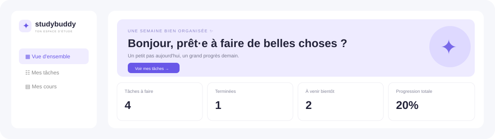
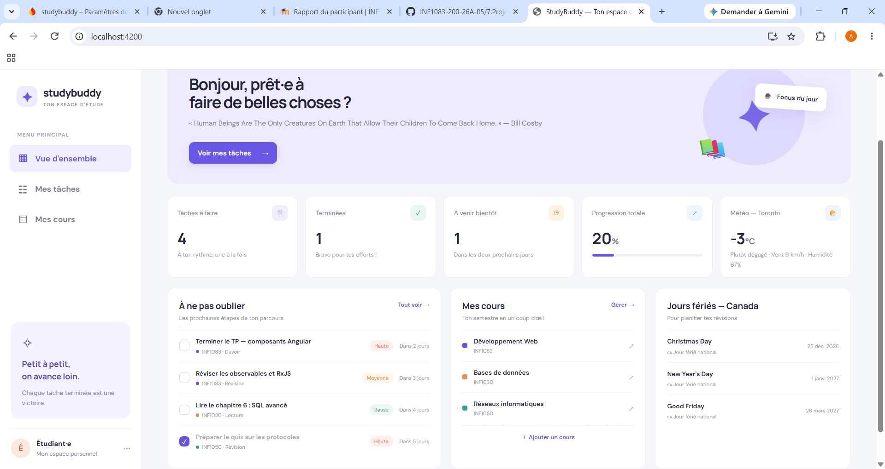

# StudyBuddy 📚

**StudyBuddy** est un organisateur d’études en français : rassemble tes cours, planifie tes devoirs et révisions, puis suis ta progression dans un tableau de bord simple.

**Étudiant :** Anis Ouhocine (300151496)
**Cours :** INF1083 — Développement d'applications mobiles
**Dossier de remise :** `7.Projects/300151496/`

## Langage et template utilisés

- **Langage :** TypeScript (TypeScript 5.5.4), avec Angular 18.2.0, RxJS 7.8.1 et Zone.js. Tout le code de l'application (composants, services, modèles) est écrit en TypeScript.
- **Template :** Angular CLI — projet créé avec `ng new studybuddy` (modèle par défaut d'Angular CLI). Architecture NgModule : `AppModule` déclare les composants (tableau de bord, tâches, cours), `main.ts` démarre l'application avec `platformBrowserDynamic().bootstrapModule(AppModule)`, et le routing est défini dans `AppModule` (routes `/`, `/taches`, `/cours`).



## Fonctionnalités

- Tableau de bord avec résumé des tâches, échéances proches et progression.
- Gestion des cours : code, nom, enseignant et couleur.
- Création de tâches validée : cours associé, échéance, type et priorité.
- Recherche et filtres par cours et statut avec formulaire Template Driven (`ngModel`).
- Formulaires Reactive Forms avec règles de validation.
- Cocher et supprimer des tâches; supprimer un cours et ses tâches liées.
- Conservation locale des données dans le navigateur (`localStorage`), sans compte ni serveur.
- Mise en page responsive, adaptée aux écrans mobiles.
- **Application installable sur téléphone (PWA)** : manifest, icônes et service worker — on peut l'ajouter à l'écran d'accueil et l'utiliser hors ligne.

## 📱 Mobile (PWA)

StudyBuddy est une **Progressive Web App** : elle s'installe sur téléphone comme une application, avec son icône sur l'écran d'accueil, et fonctionne hors ligne grâce au service worker (`ngsw-config.json`, `@angular/service-worker`).

Pour l'installer sur ton téléphone : ouvre l'adresse de l'application déployée dans le navigateur du téléphone, puis « Ajouter à l'écran d'accueil » (Android / Chrome) ou « Sur l'écran d'accueil » (iPhone / Safari). L'application s'ouvre ensuite en plein écran, sans barre de navigateur.

## Aperçu des écrans

Captures de l'application en cours d'exécution sur `http://localhost:4200` :

### Tableau de bord (Vue d'ensemble)


### Mes tâches


### Mes cours


## Technologies

- Angular 18, TypeScript, Angular Router
- Progressive Web App (PWA) : manifest, service worker (`@angular/service-worker`), icônes installables
- Reactive Forms et Template Driven Forms
- RxJS (`BehaviorSubject`, `Observable`, `map`)
- CSS responsive; stockage local via `localStorage`

## Installation et démarrage

Prérequis : Node.js 18.19+ ou 20.11+ et npm.

```bash
cd 7.Projects/300151496
npm install
npm start
```

Ouvre ensuite l’adresse indiquée par Angular CLI (par défaut `http://localhost:4200`). Pour générer le build de production :

```bash
npm run build
```

## Structure du projet

```text
src/app/
├── models/study.models.ts       # Interfaces Course et StudyTask
├── services/study.service.ts    # État, opérations et persistance locale
├── pages/
│   ├── dashboard.component.ts  # Vue d’ensemble
│   ├── tasks.component.ts      # Recherche, filtres et formulaire validé
│   └── courses.component.ts    # Gestion des cours
├── app.component.ts             # Navigation principale
└── app.module.ts                # Déclarations et routes Angular
```

## Concepts du module mis en pratique

| Notion | Exemple dans l’application |
|---|---|
| Composants et modules Angular | Tableau de bord, tâches, cours et `AppModule` |
| Routing | Routes `/`, `/taches` et `/cours` |
| Template Driven Forms | Recherche et filtres des tâches avec `ngModel` |
| Reactive Forms | Ajout de tâches et de cours avec validations |
| Service | `StudyService` centralise les opérations et l’état |
| RxJS | Flux `BehaviorSubject`, `Observable` et `map` pour le résumé |
| Modèles TypeScript | Interfaces `Course` et `StudyTask` |
| Persistance | Données conservées sur l’appareil avec `localStorage` |
| PWA / mobile | Manifest, service worker et icônes — installable sur téléphone, hors ligne |

## Idées d’amélioration

- Calendrier hebdomadaire et tri personnalisable.
- Modification des cours et tâches existants.
- Synchronisation via une API REST et gestion d’erreurs avec `catchError`.
- Rappels et notifications push.

## Images du README

Les visuels de ce dépôt sont des illustrations SVG locales créées pour le projet; aucune ressource distante n’est nécessaire pour les voir sur GitHub.
