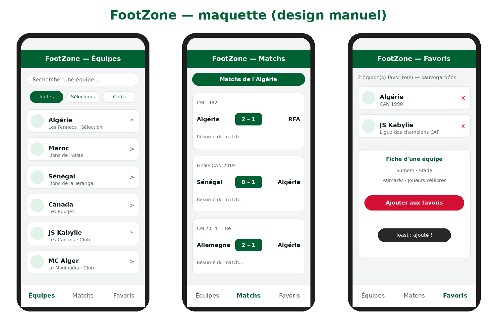
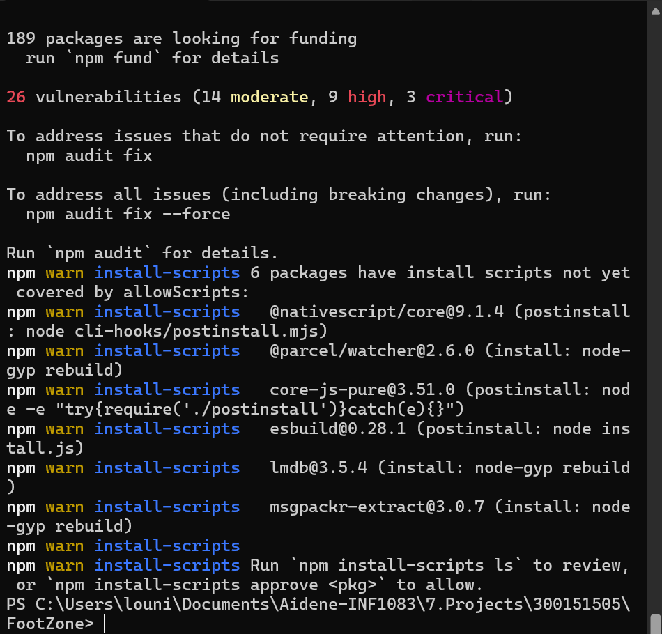
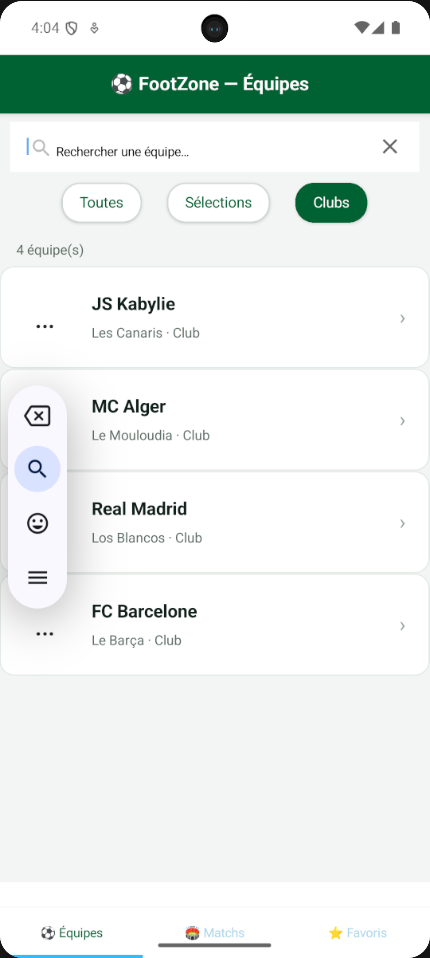
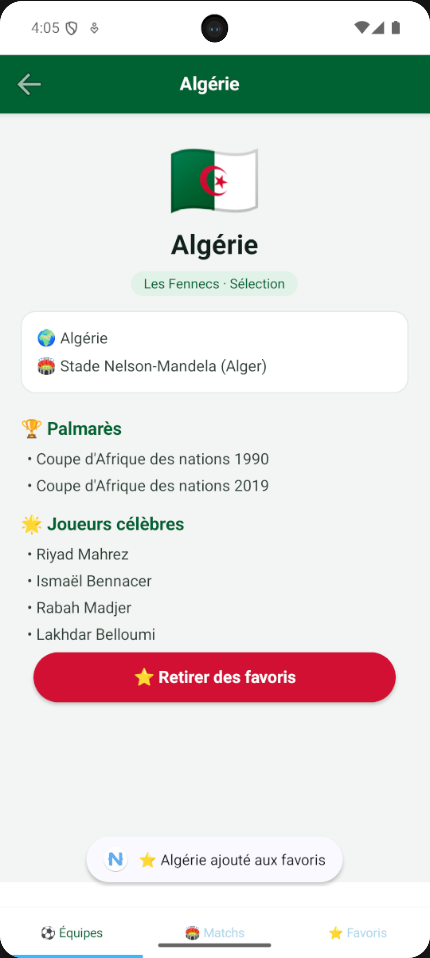
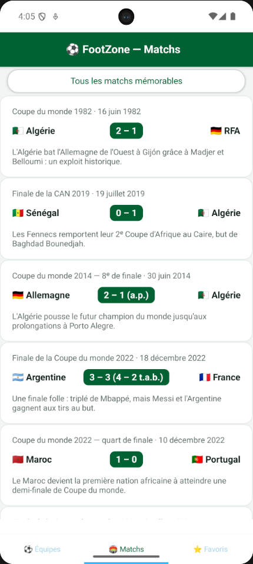
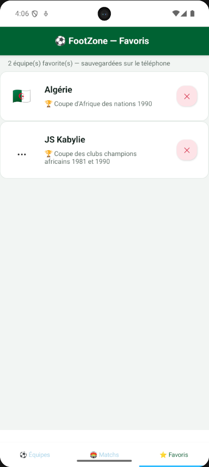

# ⚽ FootZone — Projet mobile INF1083

**Étudiant :** Aidene Arezki  
**Matricule :** 300151505  
**GitHub :** [300151505](https://github.com/300151505)  
**Cours :** INF1083 — Développement d'applications  
**Session :** Automne 2026  

> ℹ️ Projet réalisé sur l'ordinateur d'un ami (session Windows `louni`) car mon ordinateur n'avait plus d'espace, avec mon propre dépôt et mon compte GitHub.

---

## 📝 Résumé

**FootZone** est une application mobile pour les passionnés de football. Elle présente des **sélections nationales** (Algérie, Maroc, Sénégal, Égypte, France, Brésil, Argentine, Canada) et des **clubs** (JS Kabylie, MC Alger, Real Madrid, FC Barcelone). Chaque équipe a une fiche avec son surnom, son stade, son palmarès et ses joueurs célèbres.

L'onglet **Matchs** rappelle des **matchs mémorables**, en particulier ceux de l'Algérie (victoire contre la RFA en 1982, finale de la CAN 2019…). L'utilisateur peut **ajouter ses équipes préférées aux favoris** : un message *toast* confirme l'action, et les favoris restent **sauvegardés sur le téléphone**.

---

## 🎨 Design (maquette manuelle)



| Couleur | Code | Utilisation |
|---|---|---|
| 🟩 Vert | `#006233` | barre du haut, filtres actifs, score, onglet sélectionné |
| 🟥 Rouge | `#D21034` | bouton favoris, bouton ✕ |
| ⬜ Gris-vert clair | `#F2F5F3` | fond des pages |

> Les couleurs viennent du **drapeau algérien** 🇩🇿.

---

## 📱 Les pages (3 onglets + 1 fiche)

| # | Page | Rôle |
|---|---|---|
| 1 | **⚽ Équipes** (onglet) | 12 équipes, recherche (`SearchBar`), filtres **Toutes / Sélections / Clubs**, ⭐ sur les favoris |
| ↳ | **📄 Fiche d'une équipe** | drapeau, surnom, pays, stade, palmarès, joueurs célèbres, bouton **Ajouter aux favoris** + toast |
| 2 | **🏟️ Matchs** (onglet) | 6 matchs mémorables (score, compétition, résumé), filtre **🇩🇿 Matchs de l'Algérie** |
| 3 | **⭐ Favoris** (onglet) | équipes favorites sauvegardées, bouton ✕ pour retirer |

---

## 🛠️ Informations techniques

### 🧩 Template (patron)

```powershell
cd 7.Projects\300151505
ns create FootZone --template @nativescript/template-tab-navigation-ng
```

| Élément | Détail |
|---|---|
| Template | `@nativescript/template-tab-navigation-ng` (navigation par onglets, Angular) |
| Framework | NativeScript 9 + Angular 22 (NgModule) |
| Langage | TypeScript |
| Identifiant | `org.nativescript.FootZone` |
| Testé sur | Émulateur **Pixel 7 — Android 15 (API 35)** |

### 🔌 Plugins

| Plugin | Utilisation dans FootZone |
|---|---|
| **`@triniwiz/nativescript-toasty`** | affiche un petit message (*toast*) en bas de l'écran quand on ajoute ou retire une équipe des favoris |
| **`@nativescript/theme`** | thème de base du template |

```powershell
cd FootZone
npm install @triniwiz/nativescript-toasty
```



### 🧠 Notions utilisées

| Notion | Où ? |
|---|---|
| `TabView` + `page-router-outlet` (3 onglets) | `app.component.html` |
| Routage avec paramètre `item/:id` + `nsRouterLink` | `home-routing.module.ts`, `home.component.html` |
| Services Angular (`providedIn: 'root'`) | `shared/foot.service.ts`, `shared/favoris.service.ts` |
| Interfaces TypeScript | `shared/equipe.ts` (`Equipe`, `Match`) |
| `ApplicationSettings` (sauvegarde locale) | `shared/favoris.service.ts` |
| **Signals** (`signal`, `computed`) | filtres, recherche, favoris (Angular 22 *zoneless*) |
| `@for`, `@if`, `ListView`, `SearchBar`, `ScrollView` | toutes les pages |
| Thème SCSS personnalisé (classes `fz-…`) | `src/_app-common.scss` |

---

## 📁 Structure du code

```text
7.Projects/300151505/
├── README.md
├── images/
└── FootZone/
    ├── package.json                     ← dépendance @triniwiz/nativescript-toasty
    └── src/
        ├── _app-common.scss             ← thème FootZone
        └── app/
            ├── app.component.html       ← 3 onglets
            ├── shared/
            │   ├── equipe.ts            ← interfaces Equipe et Match
            │   ├── foot.service.ts      ← 12 équipes + 6 matchs
            │   └── favoris.service.ts   ← favoris (ApplicationSettings)
            ├── home/                    ← ⚽ onglet Équipes
            │   └── item-detail/         ← 📄 fiche équipe (favori + toast)
            ├── browse/                  ← 🏟️ onglet Matchs
            └── search/                  ← ⭐ onglet Favoris
```

### Extraits du code

**Filtre + recherche — `home/home.component.ts`**

```typescript
filtre = signal('Toutes')
recherche = signal('')

equipes = computed(() =>
  this.foot
    .getEquipes()
    .filter((e) => this.filtre() === 'Toutes' || e.type === this.filtre())
    .filter((e) => e.nom.toLowerCase().includes(this.recherche().toLowerCase()))
)
```

**Favoris sauvegardés — `shared/favoris.service.ts`**

```typescript
const CLE = 'footzone-favoris'

readonly ids = signal<number[]>(JSON.parse(ApplicationSettings.getString(CLE, '[]')))

basculer(id: number): boolean {
  const ajout = !this.estFavori(id)
  const liste = ajout ? [...this.ids(), id] : this.ids().filter((x) => x !== id)
  this.ids.set(liste)
  ApplicationSettings.setString(CLE, JSON.stringify(liste))
  return ajout
}
```

**Message toast (plugin) — `home/item-detail/item-detail.component.ts`**

```typescript
import { Toasty, ToastDuration, ToastPosition } from '@triniwiz/nativescript-toasty'

basculerFavori(): void {
  const ajout = this.favoris.basculer(this.equipe.id)
  const texte = ajout ? `⭐ ${this.equipe.nom} ajouté aux favoris` : `${this.equipe.nom} retiré des favoris`
  new Toasty({ text: texte, duration: ToastDuration.SHORT, position: ToastPosition.BOTTOM }).show()
}
```

**Filtre « matchs de l'Algérie » — `browse/browse.component.ts`**

```typescript
seulementAlgerie = signal(false)

matchs = computed(() =>
  this.foot.getMatchs()
    .filter((m) => !this.seulementAlgerie() || (m.domicile + m.exterieur).includes('Algérie'))
)
```

---

## ▶️ Exécuter le projet

```powershell
cd 7.Projects\300151505\FootZone
npm install
ns run android
```

---

## ✅ Résultat (captures sur l'émulateur)

| ⚽ Équipes — filtre « Clubs » | 📄 Fiche Algérie + toast | 🏟️ Matchs mémorables | ⭐ Favoris |
|---|---|---|---|
|  |  |  |  |

- Sur la fiche **Algérie**, le toast **« ⭐ Algérie ajouté aux favoris »** apparaît en bas de l'écran (plugin Toasty).
- La page **Favoris** affiche les 2 équipes ajoutées (Algérie et JS Kabylie), même après la fermeture de l'application.

---

## ⚠️ Difficultés et solutions

| Difficulté | Solution |
|---|---|
| Écran blanc quand deux projets ont le même identifiant (`b300151505`) | Projet nommé **FootZone** → identifiant unique `org.nativescript.FootZone` |
| Angular 22 n'actualise pas l'écran automatiquement (*zoneless*) | **Signals** (`signal`, `computed`) |
| Partager les favoris entre la fiche et l'onglet Favoris | Un seul `FavorisService` (`providedIn: 'root'`) |
| Le thème met une majuscule à chaque mot | `text-transform: none` dans le thème |
| Certains « drapeaux » de clubs (emojis de couleur) s'affichent `...` sur l'émulateur | Amélioration possible : utiliser des logos en images |

## 🚀 Améliorations possibles

- Résultats et calendrier **en direct** avec une API de football (RxJS + `HttpClient`)
- Vrais logos des clubs en images
- Notifications avant les matchs de l'équipe favorite

---

<p align="center"><b>⚽ FootZone — INF1083 | 300151505</b></p>
