<div align="center">


# 🌍 Lounivers

### ✨ *L'univers du voyage, par Lounes* ✨

**Un guide de voyage mobile : 50 villes, 5 continents, une carte du monde, l'histoire de chaque ville et tout pour préparer son départ.**


| 👤 Étudiant | 🆔 Numéro | 🏫 Établissement | 📚 Cours |
|:-:|:-:|:-:|:-:|
| **Lounes Allouti** | 300151781 | Collège Boréal | INF1083 |

</div>

---

## 📑 Sommaire

| | | |
|---|---|---|
| [📊 En chiffres](#-lounivers-en-chiffres) | [📖 Résumé](#-résumé) | [🏷️ Le nom](#️-le-nom--lounivers) |
| [🎨 Design manuel](#-design-manuel) | [🧩 Template et plugins](#-template-et-plugins) | [📱 Les 8 pages](#-les-8-pages) |
| [✨ Fonctionnalités](#-fonctionnalités) | [🖼️ Captures](#️-captures-décran) | [🏗️ Architecture](#️-architecture) |
| [🔬 Sous le capot](#-sous-le-capot) | [🧗 Défis relevés](#-défis-relevés) | [✅ Tests](#-tests-réalisés) |

---

## 📊 Lounivers en chiffres

<div align="center">

| 🌍 | 🗺️ | 📱 | 🗣️ | 💱 | 🏅 | ✨ | 🧑‍💻 |
|:-:|:-:|:-:|:-:|:-:|:-:|:-:|:-:|
| **50** | **5** | **8** | **20** | **31** | **12** | **17** | **~3 500** |
| villes | continents | pages | langues | devises | badges | fonctionnalités | lignes de code |

</div>

---

## 📖 Résumé

> 🎯 **Le problème** : préparer un voyage oblige à jongler entre plusieurs applications — un guide pour la ville, une carte, un convertisseur, une liste de valise, un tableur pour le budget…
>
> 💡 **La solution** : **Lounivers réunit tout dans une seule application**, belle, rapide et qui fonctionne même sans compte.

**Lounivers** fait découvrir **50 villes sur 5 continents**. Chaque destination possède une fiche complète :
**photo et histoire** chargées en direct depuis **Wikipédia**, lieux à ne pas manquer, **heure locale**,
**convertisseur de devises** et **phrases utiles** dans la langue du pays.

L'application accompagne aussi la **préparation du voyage** : favoris, valise, **budget**, **compte à rebours**,
**carnet de notes**, une **carte du monde** interactive, un **quiz des drapeaux** et des **badges** pour progresser
de 🎒 *Touriste* à 👑 *Légende*.

---

## 🏷️ Le nom : Lounivers

<div align="center">

### **Lou**nes ➕ **Univers** 🟰 **Lounivers** 🌍

</div>

Mon prénom fusionné avec l'idée d'un **univers à explorer**.

| Élément de l'icône | Signification |
|---|---|
| 🟦 Fond **indigo** | La couleur signature de l'application |
| ⚪ **Anneau** blanc | Le globe terrestre, l'univers à parcourir |
| 🟨 **« L »** doré | **L**ounes, le créateur |
| 🟠 Petite **planète** | Le voyageur en orbite autour du monde |

L'icône et l'**écran de démarrage** sont dessinés en **vectoriel** (Android `vector drawable`) : nets sur tous les écrans.

---

## 🎨 Design manuel

### 🎨 Palette

| Couleur | Code | Rôle |
|:-:|:-:|---|
|  | `#4F46E5` | **Indigo** — couleur principale, bandeaux, boutons |
|  | `#F59E0B` | **Or** — accents, badges, destination du jour |
|  | `#0F172A` | **Ardoise** — titres et texte |
|  | `#F1F5F9` | **Brume** — fond des pages |
| 🏳️ | *variable* | Chaque fiche prend la **couleur du drapeau** de son pays |

### 📐 Principes

- 🃏 **Cartes arrondies** (16 px) sur fond clair, avec une **bande de couleur** du pays à gauche.
- 🔤 **Hiérarchie claire** : grand titre, sous-titre gris, petites étiquettes en MAJUSCULES.
- 🌙 **Mode sombre complet**, avec des contrastes vérifiés pour chaque élément.
- ✨ **Animations courtes** (150 à 500 ms) qui guident l'œil sans ralentir.

### ✏️ Maquette

```text
┌──────────────────────┐  ┌──────────────────────┐  ┌──────────────────────┐
│ Lounivers            │  │ ← Montréal           │  │ Carte du monde       │
│ ┌──────────────────┐ │  │ ┌──────────────────┐ │  │ [Toutes][Afrique] −+ │
│ │ Bonjour 👋        │ │  │ │   📷 photo wiki   │ │  │  · · ·  ●  · · ·  ●  │
│ │ 50 │ 5 │ 0       │ │  │ ├──────────────────┤ │  │ · ● · · · ● ● · · ·  │
│ │ ✨ Ville du jour  │ │  │ │ 🇨🇦 Montréal      │ │  │  · · · ● · · · ● ·   │
│ │ [🎯 Quiz][🎲 Hasard]│ │  │ │ 🌍 Amérique 🕒 22:17│ │  ├──────────────────┤ │
│ └──────────────────┘ │  │ └──────────────────┘ │  │ │ 🇩🇿 Oran           │ │
│ 🔍 Rechercher  [⭐ ⇅] │  │ [♡ Favori][+ Voyage] │  │ │ 🕒 04:13  📍 6547 km│ │
│ [Toutes][Afrique]... │  │ À PROPOS            │  │ │ [Voir la fiche →] │ │
│ ▌🇦🇷 Buenos Aires   › │  │ 📜 HISTOIRE         │  │ └──────────────────┘ │
│ ▌🇵🇪 Lima           › │  │ 🗣️ PHRASES UTILES    │  │                      │
├──────────────────────┤  │ 💱 CONVERTISSEUR    │  ├──────────────────────┤
│Explorer Favoris Carte│  │ 📝 CARNET           │  │Explorer Favoris Carte│
│   Voyage    Infos    │  └──────────────────────┘  │   Voyage    Infos    │
└──────────────────────┘                            └──────────────────────┘
```

---

## 🧩 Template et plugins

### 📐 Template (patron)

| Template | Rôle |
|---|---|
| [`@nativescript/template-tab-navigation-ng`](https://github.com/NativeScript/nativescript-app-templates/tree/main/packages/template-tab-navigation-ng) | Application **Angular** avec **navigation par onglets** (`TabView` + `page-router-outlet` nommés) |

```bash
ns create B300151781 --template @nativescript/template-tab-navigation-ng
```

### 🔌 Plugins

| Plugin | Utilisation dans Lounivers |
|---|---|
| [`@nativescript/social-share`](https://market.nativescript.org/plugins/@nativescript/social-share) | Bouton **↗ Partager** : envoyer une destination ou l'application |
| [`@nativescript/theme`](https://www.npmjs.com/package/@nativescript/theme) | Thème de base et **mode sombre** (classe `.ns-dark` sur la racine) |

```bash
npm install @nativescript/social-share
```

### ⚙️ Modules `@nativescript/core` exploités

| Module | Utilisation |
|---|---|
| `Http` | Appels à l'**API REST de Wikipédia** (photo + histoire) |
| `ApplicationSettings` | **Persistance** : favoris, voyage, budget, notes, badges, thème, meilleur score |
| `View.animate` | Cartes qui glissent, cœur qui pulse, mauvaise réponse qui tremble |
| `Dialogs` | Confirmation « ajoutée à votre voyage » |
| `DatePicker` · `Switch` · `SearchBar` | Date de départ, mode sombre, recherche |
| `ListView` · `AbsoluteLayout` · `ScrollView` | Listes performantes, épingles de la carte, défilement |

---

## 📱 Les 8 pages

> 📋 L'énoncé demande **3 pages minimum** — Lounivers en propose **8** : 5 onglets + 3 pages de détail.

| # | Page | Type | Contenu |
|:-:|---|:-:|---|
| 1 | 🧭 **Explorer** | Onglet | 50 villes, recherche sans accents, filtres par continent, tri, destination du jour |
| 2 | ♥ **Favoris** | Onglet | Les villes coup de cœur, sauvegardées sur le téléphone |
| 3 | 🗺️ **Carte** | Onglet | Carte du monde, épingles aux couleurs des drapeaux, zoom, distance |
| 4 | 🧳 **Mon voyage** | Onglet | Préparation en %, compte à rebours, budget, villes à visiter, valise |
| 5 | 🌍 **Infos** | Onglet | Badges et niveau, mode sombre, technologies, développeur |
| 6 | 🏙️ **Fiche ville** | Détail | Photo + histoire Wikipédia, lieux, phrases, carnet, convertisseur |
| 7 | 🎯 **Quiz** | Détail | 5 questions, 4 pays différents, meilleur score |
| 8 | 🏆 **Résultat** | Détail | Médaille 🏆 🥈 🌱 selon le score |

### 🧭 Navigation

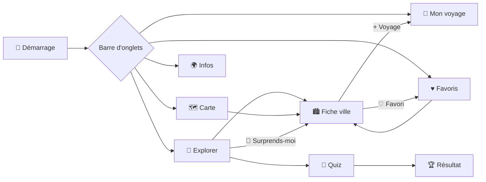

---

## ✨ Fonctionnalités

### 🌍 Découvrir

| | Fonctionnalité | Détail |
|:-:|---|---|
| 🏙️ | **50 destinations** | Europe 15 · Afrique 11 · Amérique 13 · Asie 9 · Océanie 2 |
| 📷 | **Photo et histoire** | Chargées en direct depuis l'API Wikipédia, source citée |
| 🗺️ | **Carte du monde** | Projection équirectangulaire, épingles cliquables, zoom ×1 / ×1,6 / ×2,4 |
| 📍 | **Distance** | À vol d'oiseau depuis le Collège Boréal (formule de haversine) |
| 🕒 | **Heure locale** | Calculée en direct pour chaque ville |
| 🗣️ | **Phrases utiles** | 20 langues, avec l'écriture d'origine : العربية · 日本語 · 中文 · 한국어 · ไทย · हिन्दी · Ελληνικά |
| ✨ | **Destination du jour** | Une nouvelle ville mise en avant chaque jour |
| 🎲 | **Surprends-moi** | Ouvre une destination au hasard |

### 🧳 Préparer

| | Fonctionnalité | Détail |
|:-:|---|---|
| ♥ | **Favoris** | Ajout en un geste, compteur sur l'accueil |
| ✈️ | **Compte à rebours** | « J-23 avant le grand départ » |
| 💰 | **Budget** | Total, dépenses, reste, alerte en cas de dépassement |
| 🧳 | **Valise** | Liste à cocher avec barre de progression |
| 📝 | **Carnet** | Une note personnelle par ville, datée |
| 💱 | **Convertisseur** | Dollars canadiens → 31 devises |

### 🎮 S'amuser

| | Fonctionnalité | Détail |
|:-:|---|---|
| 🎯 | **Quiz des drapeaux** | 5 questions, une seule bonne réponse possible, meilleur score |
| 🏅 | **12 badges, 5 niveaux** | 🎒 Touriste → 🧭 Explorateur → 🗺️ Aventurier → 🌍 Globe-trotteur → 👑 Légende |
| 🌙 | **Mode sombre** | Mémorisé entre deux lancements |
| ✨ | **Animations** | Apparition, pulsation, tremblement, rebond |
| ↗ | **Partage** | Via le plugin social-share |

---

## 🖼️ Captures d'écran

<table>
  <tr>
    <th>🧭 Explorer</th>
    <th>🗺️ Carte du monde</th>
    <th>🏙️ Fiche ville</th>
  </tr>
  <tr>
    <td>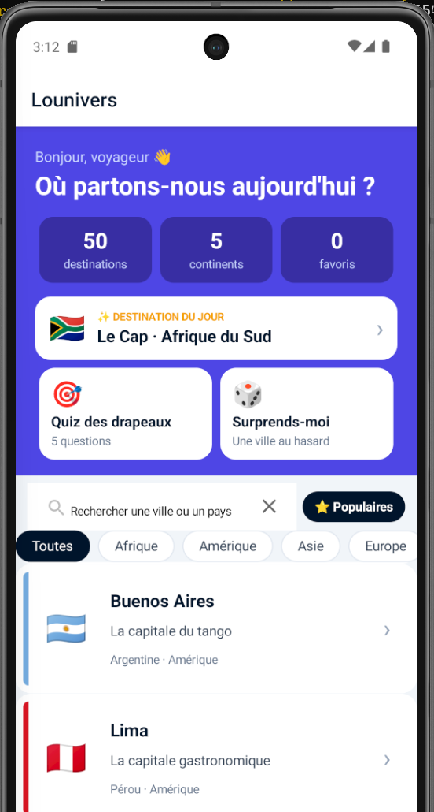</td>
    <td>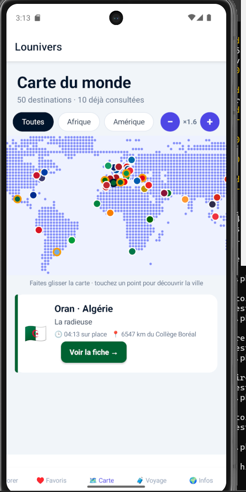</td>
    <td>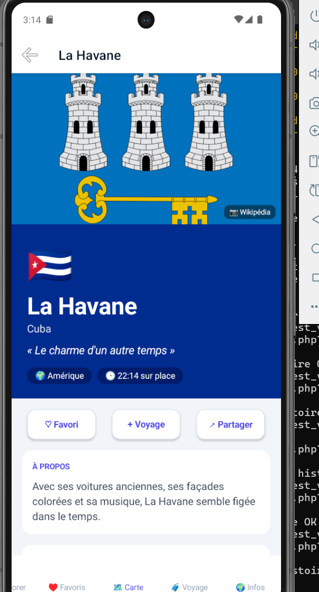</td>
  </tr>
  <tr>
    <td align="center"><sub>50 villes, tri, filtres, destination du jour</sub></td>
    <td align="center"><sub>Oran sélectionnée : heure locale et distance</sub></td>
    <td align="center"><sub>Photo Wikipédia et couleurs du drapeau</sub></td>
  </tr>
  <tr>
    <th>📜 Histoire (Wikipédia)</th>
    <th>🎯 Quiz des drapeaux</th>
    <th>🧳 Mon voyage</th>
  </tr>
  <tr>
    <td>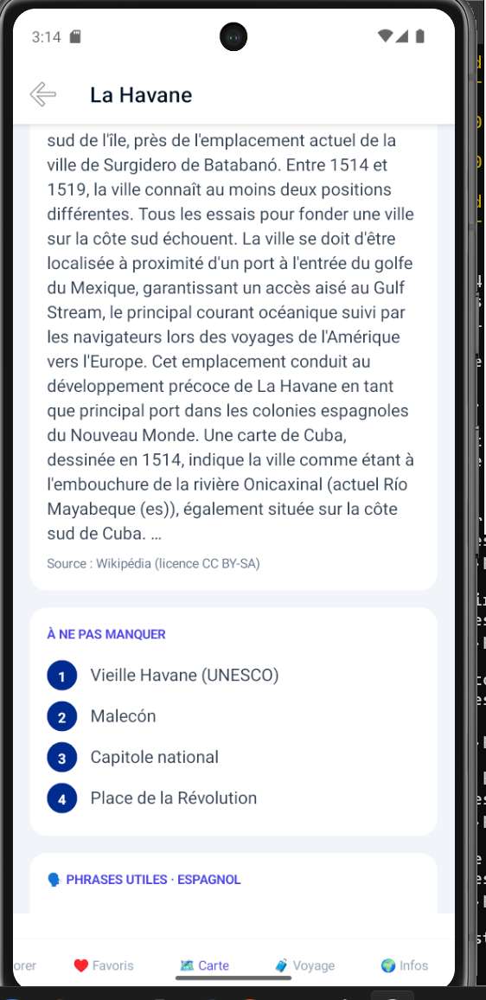</td>
    <td>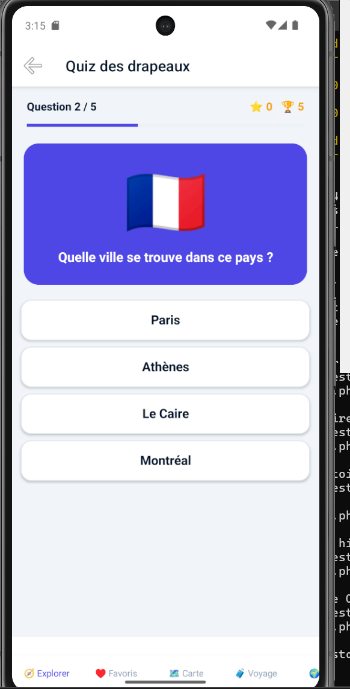</td>
    <td>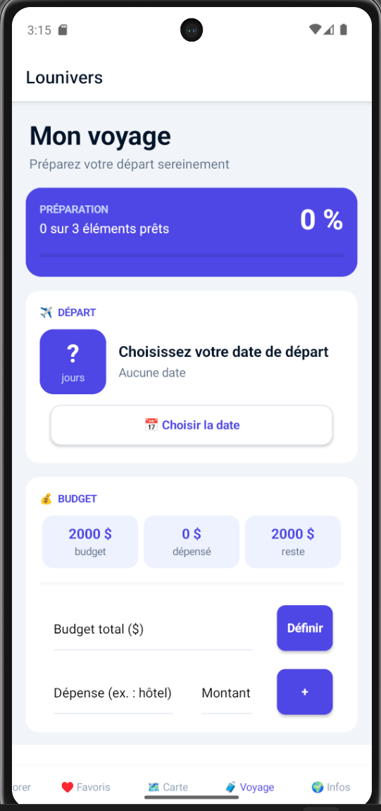</td>
  </tr>
  <tr>
    <td align="center"><sub>Vraie histoire de La Havane, source citée</sub></td>
    <td align="center"><sub>4 pays différents, score et record</sub></td>
    <td align="center"><sub>Préparation, départ et budget</sub></td>
  </tr>
  <tr>
    <th>♥ Favoris</th>
    <th>🏅 Badges</th>
    <th>🌙 Mode sombre</th>
  </tr>
  <tr>
    <td>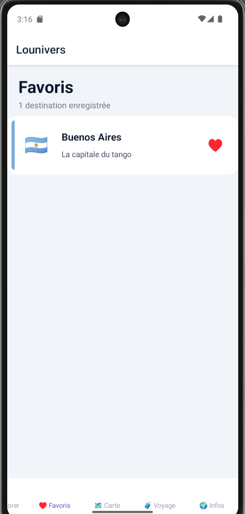</td>
    <td>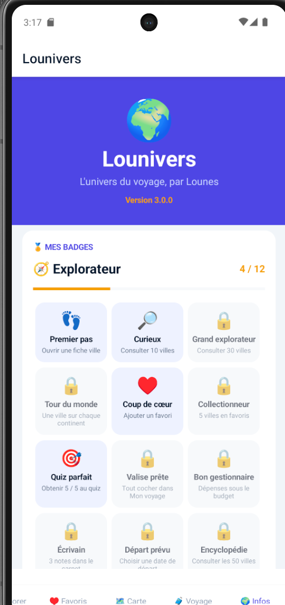</td>
    <td>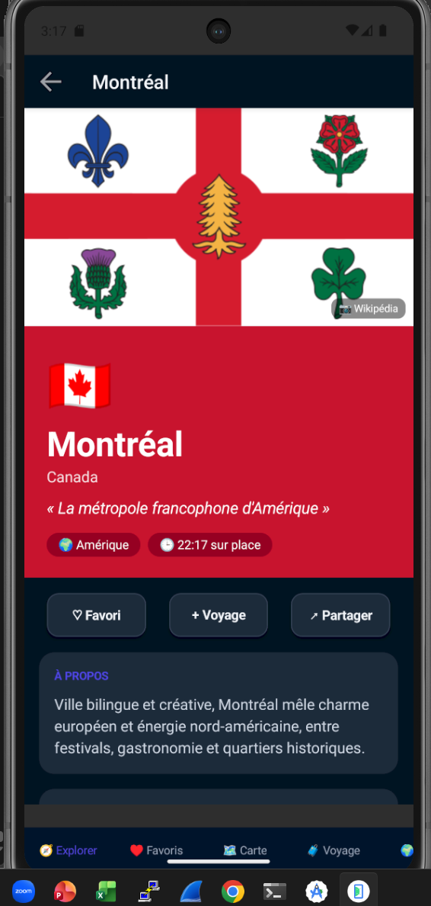</td>
  </tr>
  <tr>
    <td align="center"><sub>Coups de cœur sauvegardés</sub></td>
    <td align="center"><sub>Niveau Explorateur, 4 / 12 badges</sub></td>
    <td align="center"><sub>Thème sombre complet</sub></td>
  </tr>
</table>

---

## 🏗️ Architecture

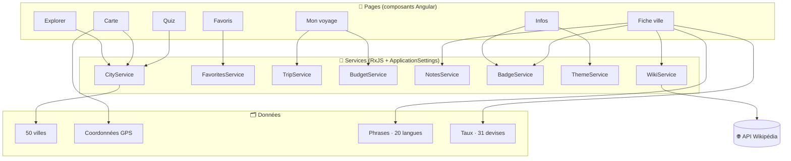

```text
B300151781/src/app
├── core/
│   ├── models/city.ts            # Interfaces City, TripItem
│   ├── data/                     # 50 villes, coordonnées GPS, phrases, taux de change
│   └── services/                 # city, favorites, trip, budget, notes, badge, theme, wiki
├── shared/                       # Fiche ville (partagée par 3 onglets) + animations
├── explore/                      # Onglet Explorer + Quiz
├── favorites/                    # Onglet Favoris
├── map/                          # Onglet Carte du monde
├── trip/                         # Onglet Mon voyage
├── about/                        # Onglet Infos (badges, mode sombre)
├── app-routing.module.ts         # 5 outlets nommés, modules chargés à la demande
└── app.component.html            # TabView (5 onglets)
```

| Choix technique | Pourquoi |
|---|---|
| 🧠 **Services + RxJS** (`BehaviorSubject`, pipe `async`) | Un favori ajouté dans une fiche apparaît **instantanément** dans l'onglet Favoris et sur l'accueil |
| 💾 **ApplicationSettings** | Toutes les données restent **sur le téléphone**, sans compte ni serveur |
| 🚚 **Lazy loading** | Chaque onglet est un module chargé à la demande : démarrage plus rapide |
| ♻️ **Fiche ville partagée** | Un seul composant réutilisé par Explorer, Favoris et Carte |

---

## 🔬 Sous le capot

### 🗺️ Placer une ville sur la carte (projection équirectangulaire)

```ts
export function project(lat: number, lon: number, width: number) {
  const height = width * MAP_RATIO
  return {
    x: ((lon + 180) / 360) * width,
    y: ((MAP_LAT_TOP - lat) / (MAP_LAT_TOP - MAP_LAT_BOTTOM)) * height,
  }
}
```

### 📍 Distance à vol d'oiseau (formule de haversine)

```ts
export function distanceKm(a: [number, number], b: [number, number]): number {
  const rad = (deg: number) => (deg * Math.PI) / 180
  const dLat = rad(b[0] - a[0])
  const dLon = rad(b[1] - a[1])
  const h = Math.sin(dLat / 2) ** 2 + Math.cos(rad(a[0])) * Math.cos(rad(b[0])) * Math.sin(dLon / 2) ** 2
  return Math.round(6371 * 2 * Math.asin(Math.sqrt(h)))
}
```

### 🌐 Photo et histoire depuis Wikipédia

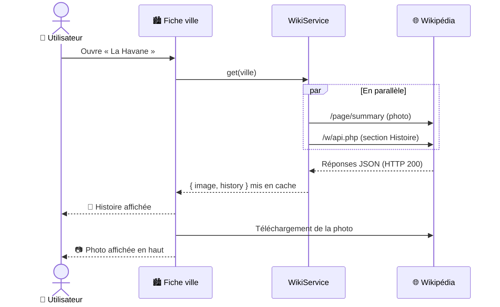

### ⚡ État partagé avec RxJS

```ts
@Injectable({ providedIn: 'root' })
export class FavoritesService {
  private readonly ids$ = new BehaviorSubject<number[]>(this.load())

  readonly favorites$: Observable<City[]> = this.ids$.pipe(
    map((ids) => ids.map((id) => this.cityService.getById(id)).filter((city): city is City => !!city)),
  )
}
```

---

## 🧗 Défis relevés

| # | 🚧 Problème rencontré | ✅ Solution |
|:-:|---|---|
| 1 | Le bouton **← Retour** ne faisait rien sur Android | `NavigationButton` + `RouterExtensions.back({ relativeTo })` pour les outlets nommés |
| 2 | Wikipédia **refusait** les requêtes (HTTP 403) | En-tête `User-Agent` conforme avec un lien de contact |
| 3 | Les données Wikipédia arrivaient mais **l'écran ne se mettait pas à jour** | `NgZone.run()` + `ChangeDetectorRef.detectChanges()` |
| 4 | Une roue de chargement **infinie** sans connexion | Délai maximum (`Promise.race`, 12 s) et message hors connexion |
| 5 | Deux bonnes réponses possibles au quiz (Alger et Oran) | Tirage de **4 pays différents** à chaque question |
| 6 | Le thème mettait une **Majuscule À Chaque Mot** | `text-transform: none` sur les textes |
| 7 | « montreal » ne trouvait pas « Montréal » | Recherche **sans accents** (`normalize('NFD')`) |
| 8 | Afficher une carte du monde **sans plugin** | Image en points générée à partir de données géographiques + `AbsoluteLayout` |

---

## ✅ Tests réalisés

Testé sur l'émulateur **Pixel 7 — Android 13 (API 33)**.

- [x] Les 5 onglets s'affichent et restent indépendants
- [x] Recherche « alg » → Alger · « montreal » → Montréal (sans accent)
- [x] Filtres par continent, dont **Océanie** (Sydney, Auckland)
- [x] Tri : ⭐ Populaires → 🔤 A → Z → 🕒 Fuseau horaire
- [x] Fiche ville : photo et histoire Wikipédia, puis message propre **hors connexion**
- [x] Convertisseur : 100 $ CAD → 9 600 DZD
- [x] Carte : sélection d'une ville, distance, zoom, bouton « Voir la fiche »
- [x] Quiz : 5 questions, animation bonne / mauvaise réponse, record sauvegardé
- [x] Budget : dépassement → alerte « ⚠️ Budget dépassé »
- [x] Favoris, notes, budget et thème **conservés** après fermeture de l'application
- [x] Badges débloqués automatiquement
- [x] Mode sombre sur tous les écrans
- [x] Bouton ← Retour et bouton ◁ d'Android

---

## 🚀 Lancer le projet

```bash
cd B300151781
npm install
ns run android
```

> ℹ️ La photo et l'histoire des villes nécessitent une connexion Internet ; tout le reste fonctionne hors ligne.

---

## 🔭 Évolutions futures

- 🌦️ Météo en direct sur chaque fiche
- 🇬🇧 Version anglaise de l'interface
- 🔔 Rappel la veille du départ (notifications locales)
- ☁️ Synchronisation des favoris entre plusieurs appareils

---

## 📜 Crédits et licences

| Ressource | Source | Licence |
|---|---|---|
| Photos et textes d'histoire | [Wikipédia](https://fr.wikipedia.org) | CC BY-SA 4.0 |
| Contours des continents (carte) | [Natural Earth](https://www.naturalearthdata.com) via `world-atlas` | Domaine public |
| Framework | [NativeScript](https://nativescript.org) · [Angular](https://angular.dev) | Apache 2.0 · MIT |

---

<div align="center">


**Lounivers** — *L'univers du voyage, par Lounes*

✍️ **Lounes Allouti** · 300151781 · Collège Boréal · INF1083

*Fait avec ♥ au Canada* 🍁

</div>
