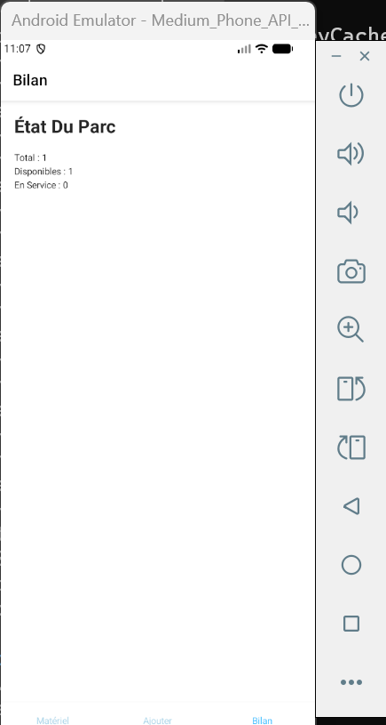

# ParcLabo

Lyes Medjahed · INF1083 · 300153676

ParcLabo est une application mobile pour inventorier le matériel d’une salle informatique. Un technicien peut enregistrer un appareil, préciser sa salle et indiquer s’il est disponible ou déjà en service. L’inventaire est conservé sur le téléphone entre deux ouvertures.

## Les trois pages

| Onglet | Utilisation |
| --- | --- |
| Matériel | Consulter le nom, la salle et la disponibilité des appareils. |
| Ajouter | Saisir le nom et la salle, choisir la disponibilité et enregistrer l’appareil. |
| Bilan | Consulter le nombre total d’appareils, le nombre disponible et le nombre en service. |

## Patron et plugins

Le projet utilise le patron Angular à onglets `@nativescript/template-tab-navigation-ng`. L’intégration Angular repose sur `@nativescript/angular` et les styles sur `@nativescript/theme`. Le stockage local utilise `ApplicationSettings` de `@nativescript/core`.

## Exécution

Extraire le [projet ParcLabo](./ParcLabo-300153676.zip), ouvrir un terminal dans `b300153676`, puis lancer `npm ci` et `ns run android`.

Pour essayer, ouvrir **Ajouter**, saisir **Routeur Cisco** et **C250**, laisser **Disponible** activé et toucher **Enregistrer**. Consulter ensuite **Matériel** et **Bilan**. Après la fermeture et la réouverture de l’application, le routeur doit toujours figurer dans la liste.

## Test sur Android

Depuis l’onglet Ajouter, j’ai enregistré un Routeur Cisco dans la salle C250 avec le statut Disponible. L’onglet Matériel affiche le routeur et le bilan indique un appareil au total, un disponible et zéro en service. Après avoir fermé puis rouvert ParcLabo, j’ai retrouvé le routeur dans la salle C250.

