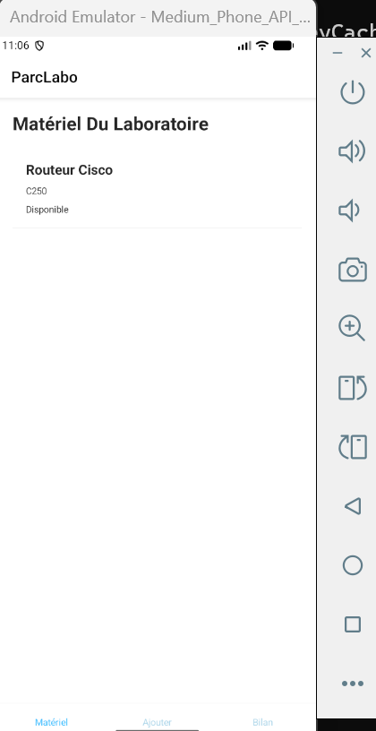

# ParcLabo · Inventaire du matériel informatique

**Lyes Medjahed · 300153676 · INF1083**

ParcLabo aide un technicien à identifier le matériel d’une salle. Il peut photographier un appareil, enregistrer son nom et sa salle, puis retrouver sa fiche dans l’inventaire. Le bilan compte les appareils disponibles et ceux en service.

## Parcours dans l’application

| Onglet | Action |
| --- | --- |
| Ajouter | Saisir le nom et la salle, choisir la disponibilité, puis toucher **Prendre une photo**. Vérifier l’aperçu et toucher **Enregistrer**. La photo est facultative. |
| Inventaire | Retrouver les appareils du plus récent au plus ancien. Chaque fiche indique le nom, la salle et le statut. Une miniature apparaît si une photo est associée. |
| Bilan | Consulter le total d’appareils et leur répartition entre **Disponibles** et **En service**. |

## Captures Android

Ces deux captures proviennent du premier essai avec un routeur Cisco dans la salle C250, avant l’ajout de la caméra.

| 1 · Fiche du matériel enregistré | 2 · Bilan après l’ajout |
| :---: | :---: |
|  |  |

## Patron, plugins et stockage

| Élément | Utilisation |
| --- | --- |
| NativeScript avec Angular | Patron à onglets `@nativescript/template-tab-navigation-ng`. |
| `@nativescript/camera` | Demande l’autorisation d’utiliser la caméra et ouvre l’appareil photo. |
| `@nativescript-community/sqlite` | Enregistre chaque fiche dans la table `devices` de la base locale `parclabo.db`. |
| `@nativescript/core` | Conserve les photos dans le dossier privé de l’application. La fiche SQLite contient le nom du fichier. À la première ouverture, les fiches de la version précédente sont importées depuis `ApplicationSettings`. |

## Lancer sur Android

Télécharger et extraire [ParcLabo-300153676.zip](./ParcLabo-300153676.zip). Dans le dossier `b300153676`, avec un téléphone Android connecté ou un émulateur démarré, exécuter les commandes suivantes.

```powershell
npm ci
ns.cmd run android
```

## Vérification sur téléphone

Dans **Ajouter**, photographier un appareil, renseigner sa salle et enregistrer sa fiche. Vérifier sa miniature dans **Inventaire**, puis le nouveau total dans **Bilan**. Fermer et rouvrir ParcLabo pour vérifier que la fiche et sa photo sont conservées. La prise de vue de cette version reste à vérifier sur Android.
