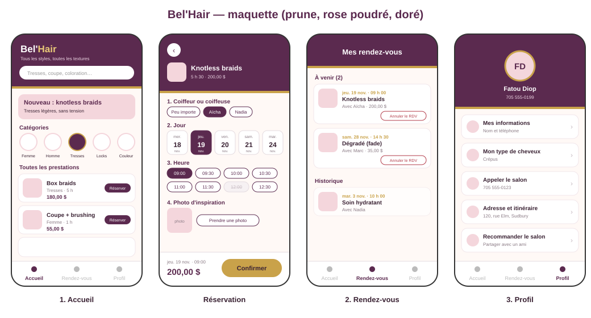
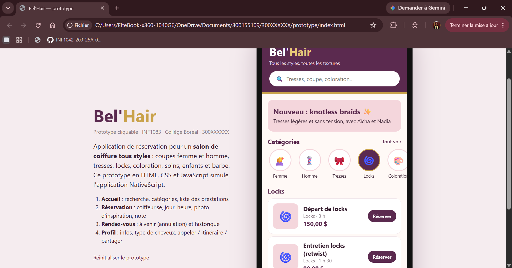

# 💇‍♀️ Bel'Hair

> Projet mobile — INF1083 · Collège Boréal
> 🆔 `300XXXXXX`

## 📝 Résumé

**Bel'Hair** est une application mobile (Android / iOS) de **réservation pour un salon de coiffure qui coiffe tous les types de cheveux**
et propose tous les styles : coupes femme et homme, **tresses** (box braids, knotless, nattes collées, twists), **locks**, coloration,
soins (défrisage, soin des cheveux crépus, lissage), coupes pour enfants et taille de barbe.

La cliente ou le client cherche une prestation par nom ou par catégorie et voit son prix et sa durée. Pour réserver, il ou elle choisit :
- son coiffeur ou sa coiffeuse (seulement les spécialistes de cette prestation) ;
- le jour (seulement les jours d'ouverture) ;
- une heure libre (les créneaux déjà pris sont grisés).

On peut ajouter une **photo d'inspiration** du style voulu et une note pour le salon. Une **notification** rappelle le rendez-vous
la veille. L'onglet Rendez-vous permet de voir et d'annuler ses rendez-vous. L'onglet Profil donne les coordonnées du salon
(appel, itinéraire, horaires) et permet de le recommander à ses amis.

## 🎨 Design (maquette manuelle)



| Onglet / page | Rôle |
|---|---|
| 1. **Accueil** | Recherche, bannière « Nouveau », 8 catégories (Femme, Homme, Tresses, Locks, Coloration, Soins, Enfants, Barbe), liste des 19 prestations avec prix et durée |
| ↳ *Réservation* | Coiffeur·se, jour, heure libre, photo d'inspiration (caméra), note, bouton « Confirmer » |
| 2. **Rendez-vous** | Rendez-vous à venir (avec annulation) et historique |
| 3. **Profil** | Nom et téléphone, type de cheveux, appeler le salon, itinéraire, horaires, recommander le salon |

| Couleur | Code | Utilisation |
|---|---|---|
| Prune | `#5B2A4F` | En-têtes, boutons, onglet actif |
| Rose poudré | `#F4D6DC` | Bannière, vignettes |
| Doré | `#C9A24A` | Ruban sous les en-têtes, bouton « Confirmer » |
| Crème | `#FFF9F6` | Fond des pages |

## 📸 Photos des coiffures

L'application et le prototype affichent une **photo pour chaque prestation**, ainsi que dans la bannière de l'accueil.
Les photos sont rangées dans `prototype/photos/` et `BelHair/app/photos/`, sous un nom précis comme `box-braids.jpg` ou `degrade.jpg`.
La liste complète est dans `photos/LISEZ-MOI.md`.
Elles viennent de banques d'images **libres de droits** : [Unsplash](https://unsplash.com) et [Pexels](https://www.pexels.com).
S'il manque une photo, l'emoji de la catégorie s'affiche à la place.

## 🖱️ Prototype cliquable (HTML · CSS · JavaScript)

Le dossier [`prototype/`](prototype/) contient un **prototype interactif** qui s'ouvre dans un navigateur. On peut y chercher une prestation,
réserver (coiffeur·se, jour, heure, photo, note), voir et annuler ses rendez-vous, et remplir son profil.

| Fichier | Rôle |
|---|---|
| `prototype/index.html` | Structure des 4 écrans et barre d'onglets |
| `prototype/style.css` | Style (prune, rose poudré, doré), cadre du téléphone |
| `prototype/script.js` | Prestations, créneaux horaires, réservations, profil |

▶️ **Pour l'ouvrir :** double-clic sur `prototype/index.html` (ou clic droit → *Ouvrir avec* → Microsoft Edge / Chrome).

## 🧩 Patron (template)

| Template | Description |
|---|---|
| [`@nativescript/template-tab-navigation`](https://market.nativescript.org/plugins/@nativescript/template-tab-navigation) | Navigation par onglets (`TabView`) en **JavaScript**. Chaque onglet a son propre `Frame`, ce qui permet d'ouvrir la page Réservation à l'intérieur de l'onglet Accueil |

Création du projet :

```bash
ns create BelHair --template @nativescript/template-tab-navigation
```

## 💻 Langages

| Partie | Langage | Fichiers |
|---|---|---|
| Écrans (interface) | XML NativeScript (balises proches du HTML : `<Label>`, `<Button>`, `<StackLayout>`…) | `*.xml` |
| Logique | **JavaScript** (ES2020, modules `import` / `export`) | `*.js` |
| Style | CSS | `app.css` |

## 🔌 Plugins

| Plugin | Utilisation dans l'app |
|---|---|
| [`@nativescript/theme`](https://market.nativescript.org/plugins/@nativescript/theme) | Styles de base (marges, champs) |
| [`@nativescript/local-notifications`](https://market.nativescript.org/plugins/@nativescript/local-notifications) | Rappel du rendez-vous la veille (ou 1 h avant) ; le rappel est annulé si on annule le rendez-vous |
| [`@nativescript/camera`](https://market.nativescript.org/plugins/@nativescript/camera) | Photo d'inspiration du style voulu, jointe au rendez-vous |
| [`@nativescript/social-share`](https://market.nativescript.org/plugins/@nativescript/social-share) | « Recommander le salon » (SMS, WhatsApp, courriel…) |

Installation :

```bash
ns plugin add @nativescript/local-notifications
ns plugin add @nativescript/camera
ns plugin add @nativescript/social-share
```

Modules du cœur utilisés : `ApplicationSettings` (sauvegarde des rendez-vous et du profil), `ObservableArray`, `Repeater`
(listes, créneaux, jours), `Dialogs` (confirmation, choix du type de cheveux), `Utils.openUrl` (appeler le salon, ouvrir Google Maps),
la navigation avec `Frame`.

## 🗂️ Structure

```
BelHair/
├── app/
│   ├── app.js / app.css / app-root.xml       # TabView à 3 onglets + style
│   ├── components/ ruban.xml                 # Ruban doré sous les en-têtes
│   ├── photos/                               # Photos des coiffures (libres de droits)
│   ├── home/      home-page.xml / .js        # Onglet 1 : Accueil
│   ├── booking/   booking-page.xml / .js     # Réservation (navigation)
│   ├── rdv/       rdv-page.xml / .js         # Onglet 2 : Rendez-vous
│   ├── profile/   profile-page.xml / .js     # Onglet 3 : Profil
│   └── services/  salon-service.js           # Prestations, coiffeurs, créneaux, rendez-vous
├── nativescript.config.ts                    # Configuration NativeScript (fichier standard du template)
├── package.json
└── jsconfig.json
```

## ▶️ Exécution

```bash
cd BelHair
npm install
ns run android     # ou : ns run ios
```

> Si le dossier `App_Resources` est absent, créer un projet avec `ns create` (template ci-dessus), puis y copier le dossier `app/` et le fichier `package.json`.

## 🖼️ Captures d'écran


