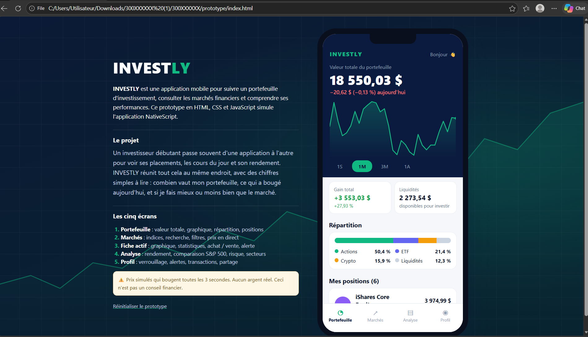
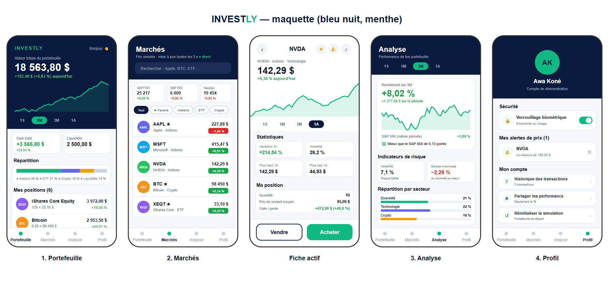

# 300155927

# 📈 INVESTLY — Suivre son portefeuille d'investissement

**INVESTLY** est une application mobile pour suivre un portefeuille d'investissement, consulter les marchés financiers et comprendre ses performances. Ce prototype en **HTML, CSS et JavaScript** simule l'application NativeScript.

## 💡 Le projet

Un investisseur débutant passe souvent d'une application à l'autre pour voir ses placements, les cours du jour et son rendement. **INVESTLY réunit tout cela au même endroit**, avec des chiffres simples à lire : combien vaut mon portefeuille, ce qui a bougé aujourd'hui, et si je fais mieux ou moins bien que le marché.

## 🛠️ Technologies

| Élément | Détail |
|---|---|
| Prototype | HTML, CSS et JavaScript (fichier `prototype/index.html`) |
| Application finale | NativeScript |
| Données | Prix simulés, mis à jour toutes les 3 secondes |
| Compte | Compte de démonstration (aucun argent réel) |

## 📱 Les cinq écrans

### 1️⃣ 💼 Portefeuille

L'écran d'accueil montre la **valeur totale du portefeuille** (par exemple 18 550,03 $), ce qui a bougé aujourd'hui (−20,62 $, −0,13 %), un graphique (périodes 1S, 1M, 3M, 1A), le **gain total** (+3 553,03 $, +27,93 %) et les **liquidités** disponibles pour investir (2 273,54 $).

La **répartition** montre où est placé l'argent :
- 🟢 Actions — 50,4 %
- 🔵 ETF — 21,4 %
- 🟠 Crypto — 15,9 %
- ⚪ Liquidités — 12,3 %

En bas, **Mes positions (6)** liste les placements, par exemple iShares Core Equity et Bitcoin.

### 2️⃣ 📊 Marchés

L'écran **Marchés** montre les indices, avec les prix en direct :
- **S&P/TSX** : 25 217 (+0,68 %)
- **S&P 500** : 6 009 (−0,68 %)
- **Nasdaq** : 19 454 (−0,83 %)

On peut **rechercher** un actif (Apple, BTC, ETF…) et **filtrer** la liste : Tout, ⭐ Favoris, Actions, ETF, Crypto. La liste donne le prix de chaque actif, par exemple AAPL 227,88 $, MSFT 415,47 $, NVDA 142,29 $, BTC 98 450 $ et XEQT 33,10 $.

### 3️⃣ 📄 Fiche actif

En touchant un actif, on ouvre sa **fiche**. Exemple avec **NVDA** (NVIDIA, Actions, Technologie) :
- Prix : **142,29 $** (+0,38 % aujourd'hui)
- Statistiques : Variation 1A +214,54 %, Volatilité 26,2 %, Plus haut 1A 142,29 $, Plus bas 1A 44,93 $
- Ma position : Quantité 10, Prix de revient moyen 95,00 $, Gain / perte **+472,90 $ (+49,8 %)**
- Deux boutons : **Vendre** et **Acheter**

On peut aussi mettre l'actif en favori (⭐) et créer une alerte de prix (🔔).

### 4️⃣ 📈 Analyse

L'écran **Analyse** compare la performance du portefeuille avec le marché :
- **Rendement sur 3M : +8,02 %** (+1 377,88 $ sur la période)
- **S&P 500 (même période) : +1,89 %** — ✅ Mieux que le S&P 500 de 6,13 points

**Indicateurs de risque** : Volatilité 7,1 % (risque faible), Baisse maximale −2,26 % du sommet au creux.

**Répartition par secteur** : Diversifié 21 %, Technologie 22 %, Crypto 16 %.

### 5️⃣ 👤 Profil

L'écran **Profil** montre le compte de démonstration (**Awa Koné**) :
- 🔒 **Sécurité** : Verrouillage biométrique (empreinte ou visage)
- 🔔 **Mes alertes de prix (1)** : NVDA au-dessus de 150,00 $
- 🧾 **Mon compte** : Historique des transactions (3 transactions), Partager ma performance (seulement le %), Réinitialiser la simulation (portefeuille de départ)

La barre de navigation en bas permet de passer d'un écran à l'autre : **Portefeuille**, **Marchés**, **Analyse**, **Profil**.

## ▶️ Ouvrir le prototype

Ouvrir le fichier `prototype/index.html` dans un navigateur. Le lien **« Réinitialiser le prototype »** permet de recommencer avec le portefeuille de départ.

## ⚠️ À savoir

- Les prix sont **simulés** et bougent toutes les 3 secondes : les montants changent d'une capture à l'autre (par exemple, la valeur totale passe de 18 550,03 $ à 18 563,80 $).
- **Aucun argent réel** n'est en jeu.
- Ceci n'est **pas un conseil financier**.
