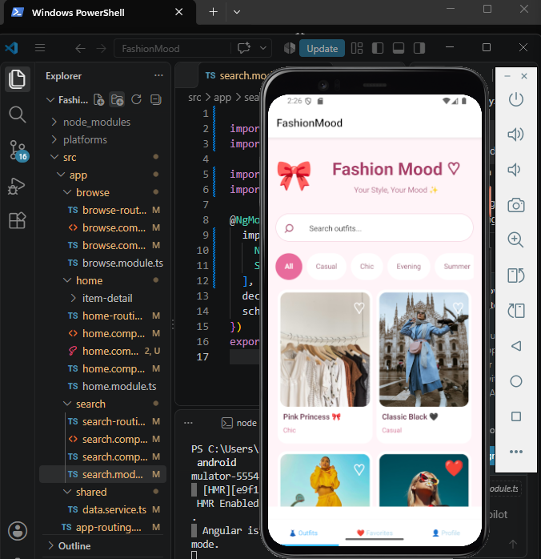
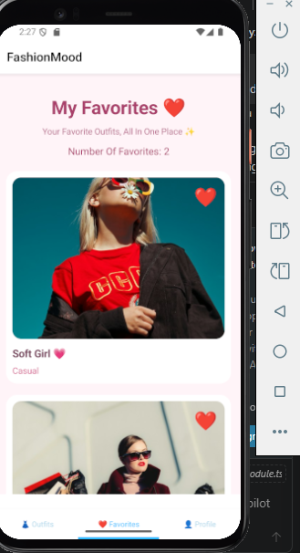
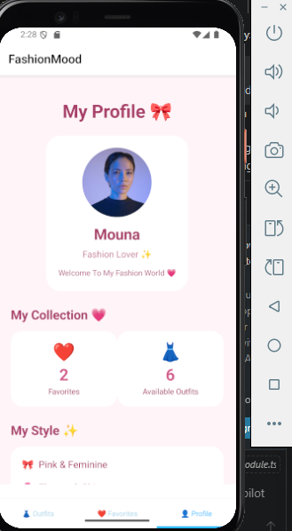
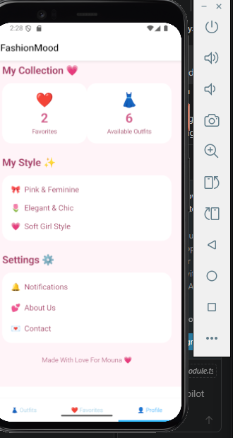

# 300156497
# 🎀💖 FashionMood – Ton style, ton inspiration mode ! 💖🎀
FashionMoodNativeScriptAngular

# 🌸 Découvrez de nouvelles tenues • ❤️ Sauvegardez vos favoris • 👗 Exprimez votre style 🌸

# 📖 Présentation du projet
FashionMood est une application mobile développée avec NativeScript, Angular et TypeScript dans le cadre d'un projet scolaire réalisé au Collège Boréal.

Cette application permet aux utilisateurs de découvrir différentes idées de tenues, de consulter leurs styles préférés et de gérer facilement leurs favoris grâce à une interface moderne, élégante et conviviale.

Le projet a été conçu afin de mettre en pratique les concepts du développement mobile multiplateforme, la navigation entre plusieurs pages, la gestion des données ainsi que la sauvegarde locale des informations.

# 🎯 Objectifs du projet
FashionMood a été développé afin de permettre aux utilisateurs de :

👗 Découvrir différentes idées de tenues.

❤️ Ajouter ou retirer des tenues de leurs favoris.

📸 Consulter des photos inspirantes de vêtements.

🌷 Explorer plusieurs catégories de styles.

💾 Sauvegarder les favoris localement sur l'appareil.

👤 Consulter un profil personnalisé.

✨ Profiter d'une expérience mobile simple et agréable.

# 📱 Fonctionnalités principales
# 👗 Onglet 1 : Outfits
La page Outfits constitue la page d'accueil de l'application.

Elle permet aux utilisateurs de découvrir différentes tenues et de naviguer parmi plusieurs catégories vestimentaires.

Fonctionnalités :
🖼️ Affichage des tenues avec leurs images.

👚 Présentation du nom et de la catégorie de chaque tenue.

🌸 Filtrage par catégories :

All
Casual
Chic
Evening
Summer
❤️ Ajout ou suppression des favoris.

🎀 Affichage sous forme de galerie moderne à deux colonnes.

# ❤️ Onglet 2 : Favorites
La page Favorites permet de retrouver rapidement toutes les tenues enregistrées.

Fonctionnalités :
💗 Affichage des tenues favorites avec leurs photos.

👗 Présentation du nom et de la catégorie.

🔢 Affichage automatique du nombre total de favoris.

💔 Suppression d'une tenue des favoris.

🌷 Message informatif lorsqu'aucune tenue n'est enregistrée.

💾 Sauvegarde locale des favoris grâce à ApplicationSettings de NativeScript.

# 👤 Onglet 3 : Profile
La page Profile présente les informations personnelles de l'utilisateur ainsi que des statistiques sur l'application.

Fonctionnalités :
📸 Photo de profil.

👤 Nom de l'utilisatrice : Mouna.

💕 Présentation personnelle.

❤️ Nombre total de favoris.

👗 Nombre total de tenues disponibles.

🎀 My Style
🎀 Pink & Feminine
🌷 Elegant & Chic
💗 Soft Girl Style
⚙️ Settings
🔔 Notifications
💕 About Us
💌 Contact
🛠️ Technologies utilisées
# Technologie	Utilisation
📱 NativeScript	Développement de l'application mobile
🅰️ Angular	Gestion des composants et de la navigation
💻 TypeScript	Développement des fonctionnalités
🌐 HTML	Création des interfaces utilisateur
🎨 SCSS	Personnalisation du design
🤖 Android Emulator	Tests de l'application
🐙 Git & GitHub	Gestion du code source
# 📂 Structure du projet
FashionMood/
│
├── src/
│   └── app/
│       ├── home/
│       │   ├── home.component.ts
│       │   ├── home.component.html
│       │   └── home.component.scss
│       │
│       ├── browse/
│       │   ├── browse.component.ts
│       │   └── browse.component.html
│       │
│       ├── search/
│       │   ├── search.component.ts
│       │   ├── search.component.html
│       │   ├── search.module.ts
│       │   └── search-routing.module.ts
│       │
│       ├── shared/
│       │   └── data.service.ts
│       │
│       ├── app.component.ts
│       ├── app.component.html
│       ├── app.module.ts
│       └── app-routing.module.ts
│
├── images/
│   ├── outfits.png
│   ├── favorites.png
│   └── profile.png
│
└── README.md
# 💻 Fonctionnalités techniques développées
🎀 Navigation par onglets
L'application utilise un système de navigation basé sur TabView permettant d'accéder rapidement aux principales sections :

✅ Outfits

✅ Favorites

✅ Profile

# 👗 Gestion des données
Une interface Outfit a été créée afin de représenter chaque tenue disponible dans l'application.

Chaque tenue possède :

🆔 Un identifiant unique
👗 Un nom
🏷️ Une catégorie
📸 Une image
❤️ Un état favori
❤️ Gestion des favoris
Les favoris sont enregistrés localement grâce au module ApplicationSettings.

# Cette fonctionnalité permet de :

✅ Conserver les favoris après la fermeture de l'application.

✅ Restaurer automatiquement les préférences de l'utilisateur.

✅ Offrir une meilleure expérience utilisateur.

# 🌸 Filtrage des tenues
Les tenues peuvent être filtrées dynamiquement selon leur catégorie.

Les catégories disponibles sont :

All
Casual
Chic
Evening
Summer
Cette fonctionnalité facilite la recherche et l'exploration des différents styles vestimentaires.

# 👤 Statistiques du profil
La page Profile affiche automatiquement :

❤️ Le nombre de favoris enregistrés.

👗 Le nombre total de tenues disponibles.

Ces informations sont récupérées directement depuis le service principal de l'application.

# ⚙️ Commandes utilisées pendant le développement
🆕 Création du projet
ns create FashionMood --template @nativescript/template-tab-navigation-ng
# 📁 Accéder au dossier du projet
cd FashionMood
# 💻 Ouvrir le projet dans Visual Studio Code
code .
# ▶️ Lancer l'application Android
ns run android
# ⏹️ Arrêter l'exécution
Ctrl + C
# 🧪 Tests réalisés
Les fonctionnalités suivantes ont été testées avec succès :

✅ Vérification de l'affichage des trois onglets.

✅ Vérification de l'affichage des photos.

✅ Validation du filtrage par catégories.

✅ Ajout et suppression des favoris.

✅ Vérification de l'affichage des favoris.

✅ Validation des statistiques du profil.

✅ Vérification de la navigation entre les pages.

✅ Tests sur Android Emulator.

✅ Vérification de la sauvegarde locale des favoris.

Le projet FashionMood a permis de développer une application mobile complète dédiée à la découverte de styles vestimentaires.

# Grâce à ce projet, plusieurs compétences ont été développées :

🎨 Création d'interfaces mobiles modernes.

📱 Développement avec NativeScript et Angular.

🧭 Mise en place d'une navigation par onglets.

❤️ Gestion d'une liste de favoris.

💾 Sauvegarde locale des données.

👗 Organisation et affichage dynamique de contenu.

🧪 Réalisation de tests fonctionnels.

🐙 Utilisation de Git et GitHub pour la gestion du projet.

Cette expérience a permis d'approfondir les connaissances en développement mobile tout en réalisant une application fonctionnelle, esthétique et facile à utiliser.

# ✨👗💖 Merci d'avoir découvert FashionMood ! 💖👗✨

# 🎓
